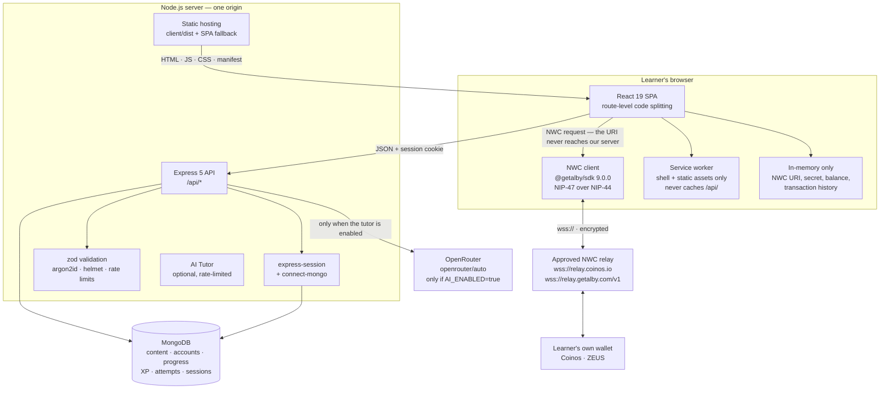

# KAOS Bitcoin Academy

> **Understand Bitcoin. Experience the Network.**

A free, beginner-first Bitcoin education platform that makes Bitcoin easier to *understand*
and easier to *experience* — built for African learners, and for anyone who has ever closed a
tab because the explanation started too deep.

KAOS Bitcoin Academy combines structured, plain-language courses with a real Bitcoin and
Lightning practice area: learners read a lesson, answer a short knowledge check, and — if they
want to go further — connect **their own** Lightning wallet over
[Nostr Wallet Connect](https://github.com/nostr-protocol/nips/blob/master/07.md) to inspect a
balance, read transaction history, and try a payment, without the academy ever holding their
money or their keys.

[](https://nodejs.org/)
[](https://www.typescriptlang.org/)
[](https://react.dev/)
[](https://kaos-bitcoin-academy.onrender.com)
[](./LICENSE)

---

## Table of contents

- [Project identity](#a-project-identity)
- [The problem](#b-the-problem)
- [Our solution](#c-our-solution)
- [Core features](#d-core-features)
- [Screenshots and demonstration](#e-screenshots-and-demonstration)
- [Technology stack](#f-technology-stack)
- [Architecture](#g-architecture)
- [Getting started](#h-getting-started)
- [Bitcoin and Lightning wallet setup](#i-bitcoin-and-lightning-wallet-setup)
- [Security by design](#j-security-by-design)
- [PWA and offline experience](#k-pwa-and-offline-experience)
- [Testing and quality assurance](#l-testing-and-quality-assurance)
- [Deployment](#m-deployment)
- [Project constraints and limitations](#n-project-constraints-and-limitations)
- [Roadmap](#o-roadmap)
- [Hackathon alignment](#p-hackathon-alignment)
- [License and contribution](#q-license-and-contribution)

---

## A. Project identity

| | |
| --- | --- |
| **Project** | KAOS Bitcoin Academy |
| **Tagline** | Understand Bitcoin. Experience the Network. |
| **Repository** | [github.com/KAOS-CODM/kaos-bitcoin-academy](https://github.com/KAOS-CODM/kaos-bitcoin-academy) |
| **Developer** | Isaiah Yemi Adelowo ([KAOS-CODM on Devpost](https://devpost.com/KAOS-CODM)) |
| **Hackathon** | [Dakar Bitcoin Hack 2026 by BTrust](https://dakar-bitcoin-hack-2026.devpost.com/) |
| **Deadline** | 20 November 2026, 9:00 PM GMT+1 |
| **Live deployment** | **[kaos-bitcoin-academy.onrender.com](https://kaos-bitcoin-academy.onrender.com)** — hosted on Render. See [Deployment](#m-deployment). |
| **Cost to run** | Zero. Free tiers only — no paid services, subscriptions, or APIs. |

**What it is.** A single-origin web application: a React single-page app, an Express API, and
a MongoDB database, served from one Node.js process. It is also an installable progressive
web app that works on a phone.

**What it is not.** It is not a custodial wallet, a trading platform, an exchange, or an
investment product. It holds no user funds, gives no investment advice, and makes no
promises about returns.

---

## B. The problem

Most Bitcoin material is written for people who already understand the basics. The result is
that a genuine beginner hits three walls almost immediately:

1. **The vocabulary arrives before the intuition.** "Non-custodial", "UTXO", "mempool", and
   "channel" are used as if they were shared knowledge. For a learner in Dakar, Nairobi, or
   Lagos, the first page of a search result can be a technical specification.
2. **Theory and practice are separated.** The typical path is: read about wallets for weeks,
   then try to install one. The gap between understanding *that* keys should not leave your
   device and actually *holding* a key that must not leave your device is where most people
   give up.
3. **The first mistake is expensive and invisible.** A beginner who pastes a seed phrase into
   a website, or sends a real payment to a wrong address, rarely learns what happened from the
   interface that let it happen.

There is a regional dimension too. Bitcoin adoption in West and East Africa is growing, but
the practical barriers are concrete: metered and intermittent data, mobile-first connections,
and payment rails that are not always cards or bank transfers. An education platform for
beginners that assumes a fast laptop, an unlimited data plan, and a pre-funded custodial
wallet account is not built for the people who need it most.

KAOS Bitcoin Academy is designed against these barriers: plain language, mobile-first,
zero-cost to use, and a wallet practice that runs against the learner's **own** wallet so
that no custodial risk is introduced while learning.

---

## C. Our solution

KAOS Bitcoin Academy is structured around a simple promise: **explain first, then let the
learner touch the real thing, then let them verify it themselves.**

### The learning loop

```
Read a lesson  →  Answer a knowledge check  →  Earn XP  →  Try it on a real wallet
   (plain text)      (server-scored)          (tracked)     (your own funds, your own keys)
```

A lesson is structured text: paragraphs, headings, key terms with plain definitions, worked
examples, and lists. Every technical term is explained the first time it appears, and the
content is written for a reader with no background in cryptography, finance, or programming.
The section format also supports callouts and reflection prompts; those two are available to
authors but are not yet used in the shipped lessons.

The academy currently ships **8 courses, 22 lessons, 30 quizzes covering 87 questions, and 3
achievements**. The full course list is deliberately sequenced: *Bitcoin 101* →
*Money and Bitcoin* → *How Bitcoin Works* → *Bitcoin Wallets* → *Using Bitcoin* →
*The Lightning Network* → *Staying Safe* → *Beyond Bitcoin*. The first eight lessons of
*Bitcoin 101* are complete; every later course currently opens with its first module, and the
table below reflects exactly that.

| Course | Lessons | Status |
| --- | --- | --- |
| 01 · Bitcoin 101 | 8 | Complete |
| 02 · Money and Bitcoin | 2 | First module |
| 03 · How Bitcoin Works | 2 | First module |
| 04 · Bitcoin Wallets | 2 | First module |
| 05 · Using Bitcoin | 2 | First module |
| 06 · The Lightning Network | 2 | First module |
| 07 · Staying Safe | 2 | First module |
| 08 · Beyond Bitcoin | 2 | First module |

### Progress that the learner can actually see

Completing a lesson records progress against the account. Passing a knowledge check awards
XP (10 for a lesson check, 25 for a course assessment, 50 for finishing a course) and can
unlock one of three achievements: **First Check**, **Assessment Passed**, and **Course
Finisher**. The signed-in dashboard shows overall percentage, completed lessons, XP totals,
unlocked achievements, and where to resume.

### Practice, not simulation

Two practice areas sit alongside the courses:

- **The Bitcoin Playground** — six interactive simulations (wallet creation and key
  relationships, public and private keys, transaction construction, broadcasting and
  confirmation, block formation, and mining and proof of work). Every simulation is labelled
  as fictional and uses obviously fake data (`DEMO-TX-NOT-REAL-0001`); nothing in it touches
  a real network, and the interface never lets a simulation be mistaken for the real thing.
- **The Lightning wallet practice** — a real NWC connection to the learner's **own** wallet.
  This is the part that closes the gap between theory and practice, and it is deliberately
  built so that the academy can never touch the learner's funds.

### A wallet the learner controls

The wallet page is not a demo. It is a client-only Nostr Wallet Connect integration: the
learner generates a connection URI inside their own wallet, pastes it into the academy, and
the academy talks to that wallet **from the learner's browser** using NIP-47 over NIP-44
encryption. The academy server never sees the URI, the secret, the balance, or the
transaction history — those exist only in the browser tab.

What the learner can do with a connected wallet:

| Action | NIP-47 method | Notes |
| --- | --- | --- |
| Read wallet identity, alias and network | `get_info` | Runs when you connect, and on demand |
| Read the wallet's balance | `get_balance` | Manual button press only |
| Read transaction history | `list_transactions` | Manual button press only, bounded to 20 records |
| Pay a Lightning invoice | `pay_invoice` | Two-step: inspect the invoice, then confirm the amount |
| Create a receive invoice | `make_invoice` | Practice limit of 100 satoshis, 10-minute expiry |
| Look up an invoice's settlement state | `lookup_invoice` | One-shot, only after a payment attempt |

Everything is manual. There is no polling, no automatic refresh, and no background request.
If you do not press the button, no wallet request is made.

---

## D. Core features

Every item below is implemented in the current codebase and covered by the test suite.

### Learning

- **Structured courses and lessons** — 8 courses, 22 lessons, each with objectives, a
  summary, estimated reading time, and typed content sections. The shipped lessons use
  paragraphs, headings, key terms with definitions, worked examples, and lists; the section
  format additionally supports callouts and reflection prompts, which are available to
  authors but not yet used in the published content. Content is seeded into MongoDB from
  typed source modules and validated at seed time.
- **A free preview lesson** — *What is Bitcoin?* is readable with no account, so a visitor
  can judge the quality before signing up.
- **Lesson completion tracking** — completing a lesson is recorded against the account and
  drives the per-course and overall progress indicators.
- **Quizzes and course assessments** — 30 quizzes / 87 questions. Lesson-level knowledge
  checks and end-of-course assessments are scored server-side; a lesson check and a course
  assessment are separate instruments with different pass marks.
- **XP and achievements** — XP is awarded for passing a lesson check (10), passing a course
  assessment (25), and completing a course (50). XP events are stored with a unique event key
  so a reward can never be granted twice, and three achievements can be unlocked.
- **Progress dashboard** — overall and per-course completion, XP totals, unlocked
  achievements, recently visited lessons, and a resume link.

### Accounts

- **Email-and-password registration and sign-in** — passwords are hashed with **Argon2id**
  (19 MiB memory cost, per the OWASP baseline) and are never logged or returned by the API.
- **Server-side sessions** — sessions are stored in MongoDB with a seven-day TTL. The session
  cookie is `httpOnly`, `sameSite=lax`, and `secure` in production, where it is named
  `__Host-kaos_session` so the browser will only ever send it back to the exact origin that
  set it.
- **Sign-in, sign-out, and session renewal** — the session identifier is regenerated on
  sign-in **and** on registration, and signing out destroys the server-side session.

### Bitcoin and Lightning

- **A real Nostr Wallet Connect integration** — `@getalby/sdk` 9.0.0, NIP-47 requests over
  NIP-44 encryption, with strict envelope validation on every reply.
- **A relay allowlist** — only `wss://relay.coinos.io` and `wss://relay.getalby.com/v1` are
  ever contacted. The allowlist is enforced in code and asserted by tests.
- **An account dashboard** — connection state, wallet alias, network, last successful
  refresh, balance, transaction history, capability list, and a plain-language account
  diagnostic that keeps a missing permission, an unsupported operation, an insufficient
  balance, an expired session, and a transport failure strictly apart.
- **Evidence-based payment flow** — the academy never reports a payment as successful. A
  payment is only ever described as *unverified*, *preimage-verified*, or *wallet-reported
  settled*, and the interface says which of those it is.

### Interface

- **An installable progressive web app** — web app manifest, generated application icons, a
  service worker, an offline fallback page, and an in-app update prompt.
- **Offline shell** — the application shell and static assets remain available offline.
- **Responsive layout** — the navigation becomes a scrollable strip on small screens, layouts
  adapt from mobile through desktop, and long code samples no longer force a horizontal
  scroll.
- **Accessible by construction** — semantic landmarks, labelled fields, announced validation
  errors, visible keyboard focus on every control, text alternatives for colour-only status,
  and full `prefers-reduced-motion` support.
- **Route-level code splitting** — the initial JavaScript download is 313.45 kB (97.79 kB
  gzipped); the NWC SDK, `nostr-tools`, and the BOLT 11 decoder are fetched only when a
  learner actually opens the wallet practice.

### AI Tutor (optional)

A contextual AI tutor answers questions about the learner's current lesson. It is **off by
default** and requires the deployment to set `AI_ENABLED=true` and an `OPENROUTER_API_KEY`. The
model is fixed server-side to OpenRouter's `openrouter/auto` routing alias, and the tutor is
rate-limited per learner with a burst limit and a daily limit. It is optional by design: the
academy is fully useful without it.

---

## E. Screenshots and demonstration

> **⚠️ Placeholder — screenshots are not yet included in this repository.**
>
> The repository currently contains only the application icons
> (`client/public/icons/`). **No genuine screenshots of the running application exist yet**,
> and none have been fabricated for this README.

Before submission, replace the table below with real captures of the running application.

| To capture | Suggested file | What it should show |
| --- | --- | --- |
| Home page | `docs/screenshots/home.png` | The landing page and the "Start here" course grid |
| Course catalogue | `docs/screenshots/courses.png` | The catalogue with course cards and progress bars |
| Lesson reading view | `docs/screenshots/lesson.png` | A lesson with key terms and a reflection prompt |
| Quiz feedback | `docs/screenshots/quiz.png` | A scored answer with the explanation and the XP award |
| Learner dashboard | `docs/screenshots/dashboard.png` | Progress, XP, achievements, and resume link |
| Bitcoin Playground | `docs/screenshots/playground.png` | One simulation, with the "fictional data" banner visible |
| Wallet account dashboard | `docs/screenshots/wallet-dashboard.png` | Connection overview, balance, capabilities, and diagnostics |
| Wallet connection help | `docs/screenshots/wallet-connect.png` | The approved-relay list and the NWC connection form |

### Demonstration video

> **⚠️ Placeholder — the demonstration video has not been recorded yet.**
>
> **Target:** a 3–5 minute screen recording for the hackathon submission, hosted on the
> Devpost project page.
>
> Suggested structure:
>
> 1. **0:00–0:30** — the problem: a beginner facing Bitcoin documentation.
> 2. **0:30–1:30** — the courses: browse the catalogue, read the preview lesson.
> 3. **1:30–2:15** — progress: sign in, complete a lesson, pass a knowledge check, earn XP.
> 4. **2:15–3:30** — the wallet practice: connect a real wallet over NWC, read the balance
>    and transaction history, then make a small practice payment.
> 5. **3:30–4:00** — the Playground simulation.
> 6. **4:00–5:00** — mobile view, install as an app, and the offline behaviour.
>
> The recording must use **zero real value**. The practice receive invoice is capped at
> 100 satoshis for exactly this reason.

---

## F. Technology stack

Only technologies that are present in the repository are listed. Nothing here is "planned but
unused".

### Frontend

| Technology | Version | Role |
| --- | --- | --- |
| React | 19.3.1 | UI runtime |
| React DOM | 19.3.1 | DOM renderer |
| React Router DOM | 7.18.5 | Client-side routing, with route-level code splitting |
| TanStack React Query | 5.105.1 | Server-state fetching and caching |
| Tailwind CSS | 4.3.3 | Utility CSS, via the Vite plugin |
| Vite | 8.3.5 | Dev server and production build |
| TypeScript | 5.9.3 | Strict type checking (`strict`, `verbatimModuleSyntax`) |

### Backend

| Technology | Version | Role |
| --- | --- | --- |
| Node.js | ≥ 20 | Runtime (verified on 26.13.1) |
| Express | 5.3.0 | HTTP server, static hosting, SPA fallback |
| express-session | 1.19.0 | Server-side sessions |
| connect-mongo | 6.0.0 | MongoDB-backed session store with a 7-day TTL |
| Mongoose | 9.11.4 | MongoDB ODM |
| argon2 | 0.45.1 | Argon2id password hashing |
| helmet | 8.3.0 | Security headers and the Content-Security-Policy |
| zod | 4.6.7 | Request body validation |
| express-rate-limit | 8.7.2 | Auth, quiz, and tutor rate limits |
| pino / pino-http | 10.4.0 / 11.0.0 | Structured request logging |
| dotenv | 18.0.9 | Local environment loading |
| tsx | 4.23.15 | Dev-time TypeScript execution (dev dependency) |

### Database and persistence

| Technology | Role |
| --- | --- |
| MongoDB (Atlas Free tier) | Courses, lessons, quizzes, user accounts, progress, quiz attempts, XP events, achievements, and sessions |
| Mongoose models | `User`, `Course`, `Lesson`, `Progress`, `Quiz`, `QuizAttempt`, `XpEvent`, `Achievement`, `UserAchievement` |
| `connect-mongo` | Session persistence with a native TTL index |
| Custom DNS resolver | A scoped `node:dns` resolver pinned to `1.1.1.1` / `8.8.8.8`, used only for MongoDB Atlas hostnames, to work around unreliable recursive resolution on some networks |

### Bitcoin and Lightning integration

| Technology | Version | Role |
| --- | --- | --- |
| `@getalby/sdk` | 9.0.0 | Nostr Wallet Connect client (NIP-47) |
| `@getalby/lightning-tools` | 9.0.2 | BOLT 11 invoice decoding for local, offline invoice inspection |
| NIP-47 | — | Wallet-service request/response protocol |
| NIP-44 | — | Encrypted payload transport between the browser and the wallet service |

### PWA

| Technology | Role |
| --- | --- |
| Web App Manifest | `client/public/manifest.webmanifest` — name, icons, standalone display, theme colours, shortcuts |
| Hand-written Service Worker | `client/public/sw.js` — shell and asset caching with explicit API and cross-origin exclusions |
| Generated PNG/SVG icons | `scripts/generate-icons.mjs` — a dependency-free PNG encoder, so the icons are reproducible with no image toolchain |

### Testing and development tools

| Technology | Role |
| --- | --- |
| `node:test` | The test runner, using the Node.js built-in runner |
| `tsx` | Runs TypeScript directly in the test and dev processes |
| `assert` (`node:assert/strict`) | Assertions |
| ESLint / Prettier | **Not present.** The project relies on `tsc --noEmit` under `strict` mode plus the test suite. |

### Deployment

| Technology | Role |
| --- | --- |
| Single-origin Node.js process | Serves the JSON API and the built client from one process |
| Express static hosting | Serves `client/dist`, with the SPA fallback for client-side routes |
| Render | The hosting provider. A free-plan Node.js Web Service running the application at [kaos-bitcoin-academy.onrender.com](https://kaos-bitcoin-academy.onrender.com) |

---

## G. Architecture



### How to read the diagram

- **One origin, two halves.** The Express process serves the JSON API under `/api` and the
  built client from `client/dist`. There is no separate frontend host, so there is no CORS
  configuration to get wrong and no second place to deploy.
- **The wallet path never touches the academy server.** This is the most important line in
  the diagram. The NWC connection URI is pasted into the browser, parsed locally, and used to
  talk to the wallet service over an encrypted WebSocket. The server has no wallet route, no
  wallet credential store, and no knowledge of the learner's balance.
- **Sessions live in the database, not in memory.** `connect-mongo` stores them with a
  seven-day TTL, so a restart does not sign everyone out and more than one server process
  can serve the same sessions.
- **The service worker is deliberately restricted.** It caches the application shell and
  hashed assets. It refuses to touch `/api/`, refuses cross-origin requests, and refuses
  non-`GET` requests — so no account response, wallet material, or payment action can be
  cached or replayed.
- **The AI Tutor is an optional outbound edge.** The diagram shows it dashed-off in practice:
  it exists only when the deployment enables it, and it never receives wallet data.

---

## H. Getting started

### Prerequisites

| Requirement | Version | Why |
| --- | --- | --- |
| Node.js | **20 or newer** | Enforced by `engines.node` in `server/package.json` |
| npm | 10 or newer | Ships with Node 20+ |
| MongoDB | Any | A local `mongod`, or a free MongoDB Atlas cluster |
| A modern browser | Current Chrome, Firefox, Safari, or Edge | The wallet practice needs Web Crypto and WebSocket |

Verified on Node.js 26.13.1 and npm 11.20.0.

### 1. Clone

```sh
git clone https://github.com/KAOS-CODM/kaos-bitcoin-academy.git
cd kaos-bitcoin-academy
```

### 2. Install dependencies

The root `package.json` holds only the workspace scripts; the applications live in `client/`
and `server/` and each has its own manifest and lockfile. Install both:

```sh
npm install --prefix client
npm install --prefix server
```

### 3. Configure the environment

```sh
cp server/.env.example server/.env
cp client/.env.example client/.env.local
```

Edit `server/.env`. Every value is documented inline in the example file.

| Variable | Required | Purpose |
| --- | --- | --- |
| `NODE_ENV` | for production | `production` enables the strict security headers and the secure cookie |
| `PORT` | no | Defaults to `4000` |
| `MONGODB_URI` | **yes** | MongoDB connection string. The server refuses to start in production without it |
| `MONGODB_DB` | no | Defaults to `kaos_academy` |
| `SESSION_SECRET` | **yes in production** | At least 32 characters. Generate one with `node -e "console.log(require('crypto').randomBytes(32).toString('hex'))"` |
| `APP_ORIGIN` | recommended | The browser's origin, e.g. `http://localhost:5173` |
| `RENDER_EXTERNAL_URL` | optional | A second allowed origin, for example a preview deployment URL |
| `LOG_LEVEL` | no | Defaults to `info` |
| `AI_ENABLED` | optional | `true` enables the AI Tutor — only together with a key |
| `OPENROUTER_API_KEY` | optional | The tutor key. **The tutor stays disabled without it** |

`client/.env.local` has one optional variable, `VITE_API_BASE_URL`. Leave it empty for the
normal single-origin setup. Every `VITE_` value is embedded in the public JavaScript bundle —
**never put a secret in it**.

Generate a session secret:

```sh
node -e "console.log(require('crypto').randomBytes(32).toString('hex'))"
```

### 4. Database and seed

The course content lives in typed source modules and is seeded into MongoDB. Without seeding,
the API has no courses to serve.

```sh
npm run seed
```

The server refuses to start in production without `MONGODB_URI`, and refuses to serve data
routes when the database is unreachable — it answers `503` instead of failing silently.

### 5. Run in development

```sh
npm run dev
```

This starts the API and the client together (`scripts/dev.mjs`). The client is at
`http://localhost:5173` and proxies `/api` to the server on port `4000`.

### 6. Build for production

```sh
npm run build
```

This compiles the server with `tsc` into `server/dist/` and builds the client with Vite into
`client/dist/`.

### 7. Run the production build

```sh
npm start
```

The server serves the API and the built client from one origin on `PORT` (default `4000`).

### 8. Typecheck and test

```sh
npm run typecheck          # server and client
npm --prefix server test   # the full test suite
```

### Command reference

| Command | What it does |
| --- | --- |
| `npm run dev` | Runs the API and the Vite dev server together |
| `npm run build` | Builds the server (`tsc`) and the client (Vite) |
| `npm start` | Runs the compiled server from `server/dist` |
| `npm run seed` | Seeds the course content into MongoDB |
| `npm run typecheck` | Type-checks the server and the client |
| `npm --prefix server test` | Runs the full test suite (equivalent to `npm test`) |
| `node scripts/generate-icons.mjs` | Regenerates the PWA icons from source |

---

## I. Bitcoin and Lightning wallet setup

The wallet practice is **optional**. Every course, lesson, quiz, the Playground, and the
dashboard work without a wallet, and the academy never asks for one.

### The connection method

Nostr Wallet Connect (NWC) — a NIP-47 protocol where your wallet service exposes a set of
methods and the application calls them. The application here is **browser-only**: there is no
backend wallet proxy and no wallet credential on the server.

Two things must line up: the relay in the connection URI, and the wallet that issued it.

| Approved relay | Wallets known to work with it |
| --- | --- |
| `wss://relay.coinos.io` | Coinos |
| `wss://relay.getalby.com/v1` | ZEUS |

The relay is the message service named inside the URI; it is **not** the wallet provider.

### Wallet prerequisites

- A Lightning wallet that supports Nostr Wallet Connect. Coinos and ZEUS are the two tested.
- A **zero-satoshi** budget on the connection. The academy is an education platform and asks
  for no funds.
- Ideally, a connection limited to the methods you want to try.

### The connection flow

1. In your wallet, create a Nostr Wallet Connect connection and set the budget to 0 sats.
2. Copy the generated connection URI. It looks like
   `nostr+walletconnect://<pubkey>?relay=<relay>&secret=<secret>`.
3. On the **Wallet** page, paste it into the connection field and choose
   *Connect and request get_info*.
4. The academy validates the URI **locally in your browser** — scheme, relay allowlist,
   parameter names, hex format, and length — and only then contacts the wallet.
5. Your wallet answers `get_info`, and the account dashboard opens.

### What you can and cannot do

| You can | You cannot |
| --- | --- |
| Read your wallet's alias, network, and reported capabilities | See or store your seed phrase — the academy never asks for one |
| Read the balance your wallet reports | Move funds the academy holds, because it holds none |
| Read the last 20 transactions your wallet reports | Trigger a wallet request the academy does not initiate |
| Pay an invoice you have inspected and confirmed | Pay without seeing the amount first |
| Create a practice receive invoice (capped at 100 sats) | Create an invoice that the academy keeps |
| Disconnect and clear everything | Continue a session after you disconnect — the client is closed |

### Security considerations

- **Your connection URI is a credential.** It contains a secret that authorises the academy to
  act as you within the limits your wallet sets. Treat it like a password. The academy keeps
  it in the page's memory only: it is never sent to the server, never logged, and never
  written to browser storage. Do not paste it into a chat, a terminal, a screenshot, or a
  support message.
- **Never share a seed phrase or a private key.** No legitimate NWC flow needs one. Anyone
  who asks for it is trying to steal your wallet.
- **Use a zero budget.** The academy is for learning. A budget of 0 sats means a mistake
  cannot cost you money.
- **Revoke the connection in your wallet** when you are finished. Disconnecting in the academy
  closes the client and clears the page, but only your wallet can revoke the authorisation.
- **The academy never claims a payment succeeded on its own.** A payment is described as
  unverified, preimage-verified, or wallet-reported settled, and the interface always says
  which. If the wallet does not answer, nothing is reported as paid.

### When the wallet or network is unavailable

The academy degrades honestly rather than failing silently:

| Situation | What you see |
| --- | --- |
| The relay cannot be reached | "Temporary relay or transport failure", with a retry button. Nothing is claimed about your wallet or your balance |
| The wallet does not answer in time | A timeout message that says it is a timeout, not a statement about your wallet |
| The wallet does not support a method | "The wallet reported that it does not support this operation on this connection" |
| The connection is not authorised for a method | "Required permission missing", with a pointer to your wallet's permission settings |
| The wallet reports an insufficient balance | Reported as exactly that, and only when the wallet says so |
| The session expired or the page was closed | "Session expired or disconnected", with a prompt to reconnect |

A failed balance request is **never** displayed as a zero balance, and a failed request never
produces a value.

---

## J. Security by design

Security is a graded criterion for this hackathon, so it is worth being precise about what is
actually implemented.

### Authentication and session handling

- **Argon2id password hashing** — 19 MiB memory cost, 2 iterations, parallelism 1 (the OWASP
  baseline). Hashing failures are swallowed rather than crashing the request.
- **Server-side sessions in MongoDB** with a 7-day TTL and a native TTL index, so sessions
  survive restarts and can be revoked.
- **Cookie hardening** — `httpOnly`, `sameSite=lax`, `secure` in production, and named
  `__Host-kaos_session` in production. The `__Host-` prefix is a browser-enforced guarantee
  that the cookie is never sent to a different origin, and it is only accepted when the cookie
  is `secure`, has `path=/`, and has no `domain` attribute.
- **Rate limiting** — 20 attempts per 10 minutes on authentication, 30 quiz attempts per 10
  minutes, and a burst limit plus a 50-per-day limit on the AI Tutor.
- **Session regeneration** on sign-in, to prevent session fixation.

### Input validation

Every mutating request body is parsed with **Zod** before it reaches a handler, with explicit
length and format bounds (email ≤ 254 characters, password 10–128 characters, display name
2–40 characters). A rejected body returns a structured error with per-field messages.

### Security headers

Helmet sets a strict production Content-Security-Policy:

```
default-src 'self'; script-src 'self'; style-src 'self'; img-src 'self' data:;
connect-src 'self' wss://relay.coinos.io wss://relay.getalby.com;
font-src 'self'; object-src 'none'; frame-ancestors 'none'; base-uri 'self';
form-action 'self'; worker-src 'self'; manifest-src 'self'
```

`connect-src` lists **only** the two approved relays — it is never widened to `wss://*`.
Alongside the policy, the server sends HSTS, `X-Content-Type-Options: nosniff`,
`Referrer-Policy: no-referrer`, `Cross-Origin-Opener-Policy: same-origin`,
`Cross-Origin-Resource-Policy: same-origin`, and `X-Frame-Options: SAMEORIGIN`.

### CSRF defence

Mutating requests must be JSON (a browser form post cannot set that content type without a
CORS pre-flight) and must come from the request host or from an explicitly allowed origin.
Requests with no `Origin` header — a `curl` call, or the test suite — are allowed through;
`SameSite` still protects the browser case.

### Secret management

- Secrets live only in environment variables and are never committed. `server/.env` is
  gitignored, and only `.env.example` files — which contain placeholders — are in the
  repository.
- Configuration validation prints **field names only**, never values, so a misconfigured
  secret can never reach a log.
- The built client bundle is asserted in the test suite to contain no `MONGODB_URI`,
  `SESSION_SECRET`, `OPENROUTER_API_KEY`, or database connection string.

### Client-side storage

The application uses **no** browser storage at all. There is no `localStorage`, no
`sessionStorage`, no `indexedDB`, and no cookie written from the client. Learning progress,
XP, and quiz attempts live in MongoDB behind the server-side session, and the wallet
connection lives only in the page's memory. This is asserted by the test suite, which fails
the build if a storage API appears in the wallet modules.

### Wallet communication boundaries

- The NWC URI, the secret, the balance, and the transaction history exist **only in the
  browser tab**. The academy server has no wallet route at all.
- The connection URI is validated locally before use: scheme, exactly one relay, exactly one
  secret, an allow-listed relay, a valid 64-character hex pubkey and secret, no whitespace,
  no fragment, and a maximum length.
- The URI input is a password field, is cleared from the state after the client is created,
  and is removed from the DOM on disconnect or when the page is hidden.
- Every NIP-47 reply is validated strictly: the `result_type` must match the method that was
  asked for, a reply may not carry both an error and a result, and the result shape must
  match the method before any value is accepted.
- Console output from the SDK is suppressed for the duration of every wallet call, so a
  failure cannot print connection details into DevTools.
- The client is closed on disconnect and when the page is hidden, and a late reply can never
  restore stale state.

### Service-worker caching restrictions

The service worker will not cache an `/api/` response, a cross-origin request, or a non-`GET`
request. On activation it prunes the asset cache down to the files the current build
references, so a stale asset cannot be served after a deployment.

### Protection against replaying state-changing operations

Because the worker refuses every non-`GET` request, a payment, an invoice creation, a lesson
completion, or a quiz attempt can never be replayed from a cache. Payment actions in the
academy additionally use an at-most-once guard: the same payment hash cannot be submitted
twice in one page session.

### Safe offline behaviour

The offline page states plainly that **nothing was sent** and that no account request, wallet
request, payment, or invoice can complete while offline. The application never reports an
action as successful until the server and the wallet have confirmed it.

### Reporting a vulnerability

No formal security audit has been carried out on this project, and no audited contact address
is published. If you find a security issue, please report it **privately** through GitHub's
security advisory form on this repository
(*Security → Report a vulnerability*), rather than opening a public issue. Please include the
steps to reproduce, the affected version, and the impact you observed.

---

## K. PWA and offline experience

The academy is installable and keeps working when the network does not.

### Manifest and installability

`client/public/manifest.webmanifest` declares the application name ("KAOS Bitcoin Academy")
and short name ("KAOS Academy"), a standalone display mode, the theme and background colours
`#17140f`, a scope and start URL of `/`, and four icons: a 192×192 PNG, a 512×512 PNG, a
512×512 **maskable** PNG for Android, and an SVG favicon. The icons are generated by
`scripts/generate-icons.mjs`, a dependency-free PNG encoder, so they can be reproduced with
no image toolchain.

### Service-worker registration

The worker is registered after the first paint, so it never delays the first render, and only
in a production build — in development a cached shell would hide code changes.

### What is cached, and what is not

| Request | Behaviour |
| --- | --- |
| Navigation (HTML) | **Network first.** An online learner always receives the current application. If the network fails, the last cached shell is served, then the offline page |
| Hashed build assets (`/assets/*`) | **Cache first.** The file name changes whenever the content changes |
| `/api/**` | **Never cached.** Every API route is authenticated |
| Cross-origin requests | **Never intercepted.** The NWC relays are out of reach |
| Non-`GET` requests | **Never handled.** Nothing can be replayed from the cache |

On activation the asset cache is pruned to the files the current build references, so a
deployment never leaves a stale asset behind.

### Offline fallback

`client/public/offline.html` is served when the network is unreachable and no cached shell is
available. It says *"You are offline"*, states that nothing was sent, and explains that no
account request, wallet request, payment, or invoice can complete offline.

### Update acceptance

A new service worker **does not activate itself**. It waits until the learner accepts the
*"A new version of the Academy is ready"* prompt, and only then takes over and reloads.
Nothing is reloaded behind the learner's back, and the shell and the worker are both served
`no-cache` so the browser notices a new deployment promptly.

### What offline does *not* mean

**Offline access does not mean wallet payments or account operations can complete offline.**
Being able to read a cached lesson is a reading convenience. Nothing that requires the server
or the wallet — signing in, recording progress, submitting a quiz, reading a balance, paying an
invoice — can be completed without a connection, and the interface never pretends otherwise.

---

## L. Testing and quality assurance

```sh
npm run build          # build first: two suites assert against the built output
npm run typecheck      # server and client
npm --prefix server test
```

> **Build before testing.** `server/test/static.test.ts` and
> `server/test/s7-product-readiness.test.ts` assert against the *built* output in
> `client/dist`, not against source. Running the suite against a stale bundle can hide a
> packaging regression.

### Current status

At the time of writing, the suite contains **26 test files and 305 tests, all passing**, with
both type checks clean and the production build succeeding. This is a point-in-time figure for
this commit, not a guarantee for later versions — run the commands above to confirm the state
of your checkout.

### What the suite covers

| Area | Coverage |
| --- | --- |
| Content | Course, lesson, and quiz seed validation |
| Authentication | Registration, login, logout, session behaviour, rate limiting |
| Progress | Lesson completion, per-course and overall progress |
| Quizzes | Scoring, pass marks, XP awards, attempt keys |
| Rewards | XP event de-duplication, achievement unlocking |
| Tutor | Disabled-by-default behaviour, provider failures, context building |
| Wallet | NWC URI parsing and rejection, relay allowlist, strict envelope validation, fake-relay integration, payment-state and error-attribution rules, and the account dashboard |
| Security | No credentials in storage, logs, or the bundle; no forbidden SDK methods; no console output |
| Static delivery | Production CSP, the relay allowlist in `connect-src`, SPA routing, the built bundle's contents |
| Product readiness | Code splitting and bundle budget, the PWA manifest and icons, service-worker safety rules, offline messaging, accessibility markers, and every built asset and route chunk being served |

The wallet tests use an in-memory fake relay and fake requesters. **No test contacts a real
relay or wallet, and no test performs a live payment, invoice, or settlement lookup.**

### Type checking

Both projects are type-checked with `tsc --noEmit` under `strict: true`, with
`verbatimModuleSyntax` and `isolatedModules` enabled on the client.

---

## M. Deployment

### **[→ Deployment Guide](./DEPLOYMENT.md)**

The full guide covers prerequisites, environment variables, the build, the run procedure, the
health check, routing and cache behaviour, cookies and cross-site requests, the security
headers, the service worker, rollback, and the zero-budget constraint.

### Live application

**The academy is deployed and running on Render:**

### **[https://kaos-bitcoin-academy.onrender.com](https://kaos-bitcoin-academy.onrender.com)**

| Setting | Value |
| --- | --- |
| Hosting provider | **Render** |
| Service type | Node.js Web Service |
| Service name | `kaos-bitcoin-academy` |
| Repository | `KAOS-CODM/kaos-bitcoin-academy` |
| Branch | `main` |
| Root directory | Repository root |
| Public URL | `https://kaos-bitcoin-academy.onrender.com` |
| Instance plan | Free |
| Build command | `npm ci --include=dev --prefix server && npm ci --include=dev --prefix client && npm run build` |
| Start command | `npm start` |
| Health check path | `/api/health` |

### Architecture summary

The academy is a **single-origin Node.js process**, and that is exactly how it is hosted. One
Express server serves both the JSON API under `/api` and the built client from `client/dist`,
with an SPA fallback so that a client-side route such as `/courses` or `/dashboard` works on a
direct visit. The frontend and the API therefore share the Render service's origin: there is
no separate frontend host, no reverse-proxy rule to get wrong, and no CORS configuration to
maintain.

The wallet path is unaffected by the hosting arrangement. Nostr Wallet Connect requests run
**from the learner's browser** to the wallet service over the approved relays. The wallet
connection never passes through the academy backend, and the Render service holds no wallet
credential, balance, or transaction history.

### What has been verified in production

These were checked directly against the live service:

| Check | Result |
| --- | --- |
| `GET /` | 200, serves the application shell |
| `GET /dashboard` | 200, serves the same application shell — the SPA fallback works |
| `GET /courses` | 200, serves the same application shell |
| `GET /api/health` | 200, `{"status":"ok","db":"up"}` — the production database is reachable |
| `GET /api/courses` | 200, returns the seeded course catalogue with per-course progress |
| `GET /api/auth/me` | 200, `{"user":null}` for a visitor with no session |
| `GET /api/dashboard` | 401 `UNAUTHORIZED` without a session — the authorisation boundary holds |
| `GET /manifest.webmanifest`, `GET /sw.js`, `/icons/*` | 200, with the correct content types |
| Security headers | The full production Content-Security-Policy is present, with `connect-src` limited to the two approved relays |
| Cache behaviour | `/sw.js` is `no-cache`, hashed assets are `immutable`, and the shell is `max-age=0` |

### What has **not** been verified yet

**No browser-level verification has been performed against the live deployment.** The checks
above were HTTP-level. The following remain outstanding and should be completed before the
project is presented as fully production-proven:

- Signing in, signing out, and session persistence across a reload, in a real browser.
- The dashboard rendering for a signed-in learner with real progress data.
- The quiz flow, the progress writes, and the XP awards, end to end in a browser.
- The AI Tutor, if it is enabled on the deployment.
- The wallet practice against a real Lightning wallet. **No live wallet request has been
  performed** — not on the deployment and not during development.
- The PWA install prompt, the service worker taking over, and the offline fallback, in a real
  browser.
- A screen-reader pass and a keyboard-only pass against the live site.
- Behaviour on a real mobile device and on a slow or metered connection.

> **The free plan spins down.** Render's free instances sleep after inactivity, so the first
> request after a quiet period can take noticeably longer while the service wakes. That is a
> property of the free tier, not a fault in the application, and it is not a
> production-grade uptime guarantee.

### What a deployment needs

| Requirement | Detail |
| --- | --- |
| Runtime | Node.js 20 or newer |
| Build command | `npm ci --include=dev --prefix server && npm ci --include=dev --prefix client && npm run build` |
| Start command | `npm start` |
| Health check path | `/api/health` — returns `{"status":"ok","db":"up"}` |
| Environment | `MONGODB_URI` and `SESSION_SECRET` are required; `APP_ORIGIN` should match the public origin |
| Database | MongoDB Atlas Free tier, or any MongoDB instance |

The build command installs each application's dependencies **including its dev
dependencies**, because both the TypeScript compiler and the Vite build tool are
development dependencies. A plain `npm install` at the repository root is not sufficient: the
root package is a scripts-only package with no npm workspaces, and `client/` and `server/`
each maintain their own manifest and lockfile.

Because sessions are stored in MongoDB, more than one server process can serve the same
sessions. The AI Tutor needs `AI_ENABLED=true` and `OPENROUTER_API_KEY`; without them the
tutor stays disabled and the rest of the academy is unaffected.

---

## N. Project constraints and limitations

Honest limitations, confirmed against the repository.

### Persistence and session

- **Sessions are stored in MongoDB.** If `MONGODB_URI` is not configured — which cannot
  happen in production — the server falls back to an in-process session store and the data
  routes answer `503`.
- **There is no password-change or password-reset flow yet.** The API exposes registration,
  sign-in, sign-out, and a session lookup. A learner who forgets their password currently has
  no self-service recovery path; adding one is on the roadmap.
- The AI Tutor's session context lives in the session store, which has a seven-day TTL.
- The academy stores learning records and account data. It deliberately stores **no** wallet
  credentials, balances, or transaction history server-side.

### External wallet requirements

- The wallet practice requires a learner's own NWC-capable Lightning wallet and a working
  relay connection. Coinos and ZEUS are the tested wallets; other NWC wallets may work but
  have not been tested, and support is not universal.
- Only two relays are approved. A wallet that only offers a different relay cannot be used
  with this academy.
- The wallet is a **remote service**: if it, or the relay, is unavailable, the wallet
  practice is unavailable. The courses are not affected.

### Network requirements

- Courses, quizzes, progress, and the dashboard require a connection to the academy server.
- The Playground simulations run entirely in the browser and need no connection once loaded.
- MongoDB Atlas is reached through a scoped DNS resolver pinned to public resolvers, which
  was written to work around unreliable recursive resolution on some networks.

### Offline limitations

- Offline mode covers the **application shell and static assets only**.
- Signing in, recording progress, submitting a quiz, reading a balance, and every wallet
  operation **require a connection**. Nothing is queued or replayed later.
- The offline page says so explicitly, and the academy never reports an action as successful
  while offline.

### Deployment requirements still outstanding

- The application **is** deployed, at
  [kaos-bitcoin-academy.onrender.com](https://kaos-bitcoin-academy.onrender.com), on Render's
  free plan. The free plan sleeps after inactivity, so the first request after a quiet period
  can be slow while the instance wakes.
- **Browser-level verification of the live deployment is still outstanding.** The service,
  its API, its security headers, and its cache behaviour have been checked over HTTP, but
  sign-in, the dashboard, the quiz flow, the PWA install, and the wallet practice have not
  been exercised in a real browser against the live URL.
- A custom domain has not been configured; the service uses the `onrender.com` hostname.
- A split deployment — the client and the API on different origins — would need a code change
  to the session cookie policy (`sameSite=none` plus explicit CORS with credentials). The
  single-origin setup avoids this entirely and is the recommended topology.

### Content

- *Bitcoin 101* is complete (8 lessons). The other seven courses currently open with their
  first module (2 lessons each). This is stated in the interface as well, so a learner is
  never misled about what is available.
- The AI Tutor is off unless the deployment explicitly enables it.

---

## O. Roadmap

Status is given by evidence in the repository, not by intention.

### Completed

- Eight structured courses with typed content sections, key terms, and reflection prompts.
- Twenty-two lessons, including a free preview lesson readable without an account.
- Thirty quizzes covering eighty-seven questions, with server-side scoring and pass marks.
- Lesson completion tracking, per-course and overall progress.
- XP rewards (10 / 25 / 50) with de-duplicated event keys, and three achievements.
- Email-and-password accounts with Argon2id hashing, server-side MongoDB sessions, and a
  learner dashboard.
- A contextual AI tutor, disabled by default and rate-limited per learner.
- Six interactive Bitcoin Playground simulations, all labelled as fictional.
- A browser-only NWC integration with strict envelope validation, a two-relay allowlist, and
  manual-only requests for `get_info`, `get_balance`, and `list_transactions`.
- A payment and receive practice with two-step confirmation and evidence-based status
  reporting.
- A wallet account dashboard with connection overview, balance, transaction history,
  capability classification, and account diagnostics.
- An installable PWA with a manifest, generated icons, a restricted service worker, an offline
  fallback, and user-accepted updates.
- Route-level code splitting, reducing the initial JavaScript payload by roughly half.
- A security posture of strict CSP, hardened cookies, Zod validation, rate limiting, and
  boundary-enforced wallet isolation.
- 305 automated tests, clean type checks, and a documented deployment and rollback guide.

### In progress

- Course authoring beyond the first module of courses 02–08.
- Broadening the achievement catalogue beyond the current three.

### Planned

- A permanent public deployment.
- Additional Bitcoin and Lightning lessons and assessments.
- A richer achievement and badge system.
- Content in additional languages for regional reach.
- Improvements to the learning-path recommendation.

---

## P. Hackathon alignment

The [Dakar Bitcoin Hack 2026](https://dakar-bitcoin-hack-2026.devpost.com/) asks for a working
prototype, a Lightning wallet implementation, and clear documentation. This section maps the
project against the judging criteria.

| Criterion | Project response |
| --- | --- |
| **Usefulness and local impact** | Beginner-first Bitcoin education, free of charge, built mobile-first for learners on metered or intermittent data. The curriculum is sequenced for a reader with no background in cryptography, finance, or programming, and every technical term is explained where it first appears. The wallet practice lets a learner use their **own** wallet, so no custodial risk and no deposit is required to learn. |
| **Security by design** | The wallet connection never reaches the academy server: NIP-47 requests run browser-to-wallet over NIP-44. Connection URIs are validated locally and kept in memory only. Strict Content-Security-Policy with an explicit two-relay `connect-src`. Argon2id password hashing, MongoDB-backed sessions, `__Host-` prefixed secure cookies, Zod validation on every mutating request, and rate limiting on authentication, quizzes, and the tutor. A service worker that refuses to cache API responses, cross-origin requests, or state-changing operations. Payment success is only ever reported from wallet evidence, never assumed. |
| **UX/UI quality** | A consistent dark theme, a responsive layout from 320 px upward, keyboard-visible focus on every control, announced validation errors, text alternatives for colour-only status, full reduced-motion support, an installable PWA with an offline fallback and a user-accepted update flow, and route-level code splitting that keeps the first load light. |
| **Working MVP** | A complete, working learning platform: eight courses, twenty-two lessons, thirty quizzes, progress, XP, achievements, an account dashboard, six Playground simulations, an optional AI tutor, and a **real** Lightning wallet integration covering `get_info`, `get_balance`, `list_transactions`, `pay_invoice`, `make_invoice`, and `lookup_invoice`. It is **live at [kaos-bitcoin-academy.onrender.com](https://kaos-bitcoin-academy.onrender.com)**, serving the course catalogue and API from the live database. 305 automated tests pass; both type checks and the production build are clean. |
| **Clear pitch and documentation** | This README — problem, solution, features, architecture, setup, wallet guide, security, deployment, and limitations — plus a [deployment guide](./DEPLOYMENT.md), a Mermaid architecture diagram, a verified command reference, and the test suite that backs each claim. The project ships its own implementation and audit reports in `reports/`, and the requirement specification and its integrity hashes are in the repository. |

The project is honest about what is not yet done: the later courses open with their first
module, the AI tutor is optional, and browser-level verification of the live deployment is
still outstanding.

---

## Q. License and contribution

### License

This project is released under the **[MIT License](./LICENSE)**.

```
MIT License — Copyright (c) 2026 Isaiah Yemi Adelowo (KAOS-CODM)
```

MIT was chosen because this is an educational project meant to be read, forked, and taught
from: it keeps attribution intact without imposing conditions on learners or on anyone who
reuses the code. The full text is in [`LICENSE`](./LICENSE).

The copyright is held by **Isaiah Yemi Adelowo**, also known on GitHub and Devpost as
**KAOS-CODM**. The MIT terms themselves are unmodified.

### Contributing

Contributions are welcome, and small, focused pull requests are the easiest to accept.
See **[`CONTRIBUTING.md`](./CONTRIBUTING.md)** for the full guide. In short:

1. **Read [`PRD.md`](./PRD.md)** first. It is the source of truth for scope and it is frozen.
   A change that contradicts it is a change of scope, not a bug fix — raise it first.
2. **Check [`ENGINEERING-DECISIONS.md`](./ENGINEERING-DECISIONS.md)** for decisions already
   made, including the open ones.
3. **For anything touching the wallet**, read the S6 implementation reports in
   [`reports/`](./reports/) first. The wallet boundaries there are deliberate and tested.
4. **Report a bug** with what you did, what you expected, what happened, your environment, and
   the error message — with any wallet URI, seed phrase, or secret removed.
5. **Propose a change** by forking, branching from `main`, making the change, adding the
   focused test that covers it, and running:

   ```sh
   npm run build          # build first: two suites assert against the built output
   npm run typecheck
   npm --prefix server test
   ```

#### House rules

- No new runtime dependency without discussing it first. The project runs at zero cost and
  keeps its dependency surface deliberately small.
- No credential, connection URI, seed phrase, or preimage may ever appear in the source, the
  tests, the reports, or an issue.
- The wallet boundary is not to be relaxed. The server must not gain a wallet route, and the
  service worker must not gain the ability to cache an API response or a state-changing
  request.
- A change that alters a payment's success semantics needs an explicit decision first.
- Documentation is part of the change: if you change behaviour, update `README.md`,
  `DEPLOYMENT.md`, `SECURITY.md`, or `ENGINEERING-DECISIONS.md` in the same pull request.

### Reporting a security issue

See **[`SECURITY.md`](./SECURITY.md)**. Please report privately through GitHub's security
advisory form on this repository rather than opening a public issue. **No formal security
audit has been carried out on this project**, and the document says so plainly.

---

<div align="center">

**KAOS Bitcoin Academy** — *Understand Bitcoin. Experience the Network.*

Built for the [Dakar Bitcoin Hack 2026](https://dakar-bitcoin-hack-2026.devpost.com/) by BTrust.

</div>
