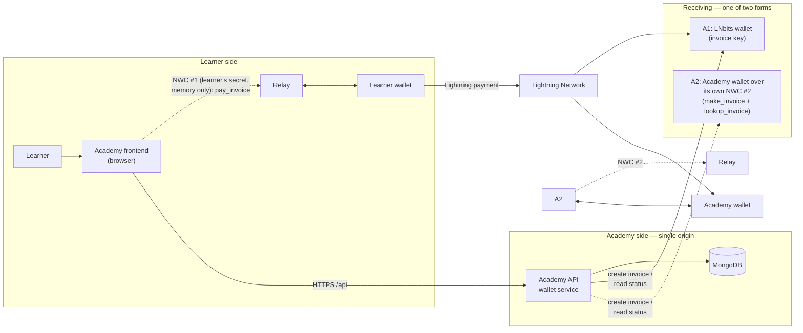
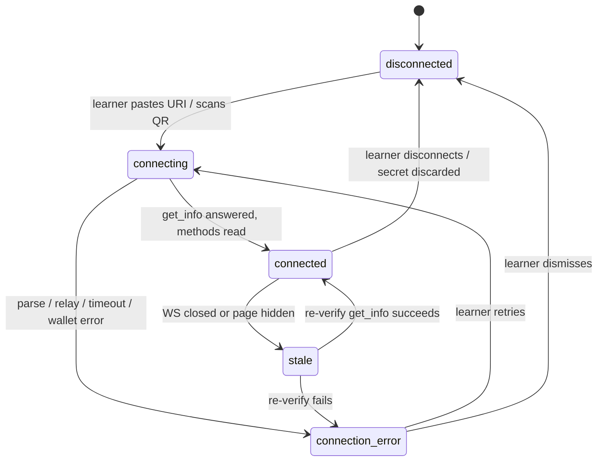

# KAOS Bitcoin Academy — Targeted Architecture Corrections

**Document type:** Technical correction and test-planning report (no implementation, no execution)
**Assessment date:** November 1, 2026
**Corrects:** `reports/ARCHITECTURE-REVIEW-ADDENDUM.md` (November 1, 2026)
**Context:** `reports/ARCHITECTURE-DISCOVERY-REPORT.md` (October 30, 2026)
**Governing specification:** `PRD.md` — sole authoritative source, immutable
**Status:** Recommendations only. No decision in this document is approved. No test was executed.

---

## 1. Executive Summary

Four defects in the addendum are corrected here. Two were wording problems, one was a security question left unresolved, and one was a state-model error. None changes the product requirements; all change what may be built and what may be claimed.

**Correction A — "NWC cannot receive" was too broad.** NIP-47 does define inbound invoice creation (`make_invoice`), and its `get_info` result carries a `methods` array for runtime capability discovery. The accurate statement is narrower and more useful: **the learner's NWC connection cannot be used by the academy to receive**, because `make_invoice` on that connection creates an invoice payable to the *learner's* wallet. An **academy-controlled** wallet reached over its **own** NWC connection can serve as the receiving component — if that wallet actually implements `make_invoice` and `lookup_invoice`. Protocol support is not implementation support, and NIP-47 guarantees neither.

**Correction B — the LNbits escalation concern is probably unfounded, but the documentation is genuinely wrong.** The published authentication page shows `GET /api/v1/wallet` called with an **invoice key** returning a body containing both `adminkey` and `inkey`. The **v1.6.2 source code does not do this**: the endpoint requires an invoice key and returns only `name` and `balance` (plus `id` for admin keys). Sending with an invoice key is refused with 403 by an explicit `KeyType.admin` check. So the documented example is stale or erroneous. **However**, a documentation defect is not proof of runtime safety on an arbitrary instance, and the instance operator always holds both keys by construction. The verdict is therefore: **no source-level evidence of escalation; LNbits remains conditional pending an isolated runtime test**, and any LNbits wallet used must hold only a demo float.

**Correction C — metadata is not a connection.** The addendum's "browser-held, record metadata only" model was directionally right but under-specified: the backend could end up treating a POSTed wallet alias as proof of a live wallet. The correction separates **connection lifecycle** from **payment lifecycle**, defines the only meaningful connectivity evidence (`get_info` answered by the wallet service), and requires the backend to store a `verificationLevel` rather than a `connected: true` flag. A reload always loses the connection, because the credential is memory-only — that is the honest cost of the security model.

**Correction D — "abandoned" cannot be observed.** Browser closure, OS process death and network loss are indistinguishable from the server's position, and MDN states plainly that `unload` and even `pagehide` are unreliable on mobile. A payment state must never depend on the browser announcing its own death. `abandoned` is removed from the payment state machine, replaced by an explicit, authenticated **`cancelled`** transition that is **not** reachable from disconnection, and by an analytics label computed from data the server already has.

**One additional finding worth the owner's attention.** LNbits' `GET /api/v1/payments/{payment_hash}` is deliberately callable **without any API key** and returns `paid` plus the preimage once settled (source-verified). This means settlement *status* can be confirmed with no credential at all, while amount and wallet details require the owning key. That materially lowers the cost of the receiving integration and reduces what the invoice key is needed for.

**Verdict:** the project is **ready to authorise the validation spike** described in §8, and **not yet ready for architecture approval**. LNbits usage stays conditional on Test B. No live payment is authorised by this document.

---

## 2. Scope and Evidence Method

### 2.1 Scope

Four corrections: the NWC receiving statement, LNbits invoice-key security, the browser-held connection lifecycle, and the payment state model. Plus a consistency pass over the addendum, a spike specification, and a decision-dependency review.

Out of scope by instruction: implementation, dependency installation, live wallet or LNbits connections, real payments, credential extraction, deployment, `docs/`, and OD-001.

### 2.2 Method

1. Verified protected-file integrity before and after (the `PRD.md` checksum validates against `PRD-MD-SHA256.txt`; both prior reports hash to their recorded values).
2. Read the current NIP-47 specification directly from the `nostr-protocol/nips` repository (19,299 bytes) and quoted the relevant sections.
3. Read the LNbits authentication documentation and **the v1.6.2 source at the release tag**, not just the docs. This was decisive: documentation and code disagree.
4. Checked MDN for the browser lifecycle behaviour that Correction D depends on.
5. Marked every claim with an evidence grade. Nothing was executed.

### 2.3 Evidence grades

| Grade | Meaning |
|---|---|
| **[V]** | Verified in official documentation or official source code on the access date |
| **[C]** | Conclusion inferred from verified evidence plus PRD wording |
| **[R]** | Recommendation; not binding |
| **[A]** | Assumption; not verified, must be tested |
| **[D]** | Decision reserved to the project owner |

### 2.4 What this report does not establish

- It does not establish how **any specific wallet** behaves. No wallet was contacted.
- It does not establish how the **chosen LNbits instance** behaves at runtime. Only v1.6.2 source was read.
- It does not establish that `make_invoice` is usable on any particular academy wallet.
- It does not test, install, or run anything.

---

## 3. Correction A: NWC Receiving Clarification

### 3.1 The defect

The addendum's Executive Summary says, in bold, **"NWC cannot receive."** That sentence is then contradicted eleven sections later by Option C, which proposes an academy wallet driven over its own NWC connection using `make_invoice`. The contradiction is real and would mislead anyone reading only the summary.

The sentence that should have been written is narrower, and it is the one that matters architecturally:

> **A learner's NWC connection cannot be used by the academy to receive payments.** NWC does define inbound invoice creation (`make_invoice`); whether it helps the academy depends on *whose* wallet holds the connection.

### 3.2 Proposed replacement wording

For the owner to apply to the addendum later (this report does not edit it):

> **NWC is not a payment processor.** The protocol defines both `pay_invoice` (outbound) and `make_invoice` (inbound), but each acts on the wallet that holds the connection. The learner's connection therefore gives the academy an outbound rail *from the learner*, never an inbound rail *to the academy*. Receiving requires a wallet the academy controls, reached either through **its own NWC connection** (`make_invoice` + `lookup_invoice`) or through an **invoice service** such as LNbits. A second component is mandatory; which of the two forms it takes is a wallet-capability and operations decision, not a protocol one.

### 3.3 Answers to the eight questions

**1. Can NWC support invoice creation through `make_invoice`?**
**[V]** Yes. NIP-47 defines `make_invoice` with `amount` (msats), `description`, `description_hash`, `expiry` (seconds from creation) and `metadata`. The response contains `invoice` (the BOLT11 string), `payment_hash`, `expires_at`, `state` and `amount`.

**2. What wallet capabilities are required?**
**[C]** The wallet service must:
- implement `make_invoice` and return a valid BOLT11 invoice;
- implement `lookup_invoice` so settlement can be observed (otherwise the academy has no receiver-side confirmation);
- have **inbound liquidity** sufficient for the invoice amount — a wallet with no inbound capacity can create an invoice that no one can pay;
- support the encryption mode the client offers (`nip44_v2`, with `nip04` as legacy);
- remain reachable on the relay for the duration of the payment window.

**3. How does capability discovery work?**
**[V]** Two mechanisms, both defined by NIP-47:
- **Info event (kind 13194)**, published by the wallet service, whose content is a **space-separated** list of supported capabilities, e.g. `pay_invoice get_balance`. It may carry an `extensions` tag and a mandatory-in-practice `encryption` tag (`nip44_v2 nip04`); the absence of the encryption tag implies `nip04` only.
- **`get_info`**, whose result includes `"methods": ["pay_invoice", "get_balance", "make_invoice", "lookup_invoice", "get_info"]` — described in the spec as "list of supported methods **for this connection**".

**[C]** `get_info` is the stronger signal because it is a live, per-connection answer from the wallet service rather than a possibly stale replaceable event. A robust client checks both and trusts neither alone until a real request succeeds.

**4. Does NIP-47 guarantee every wallet implements `make_invoice`?**
**[V]** No. The specification header is `draft` `optional`, and it states: "This NIP defines the core protocol and a small common command set. Additional methods, metadata conventions, pairing flows, and more granular authorization behavior MAY be defined by optional NWC extension specifications." Nothing obliges a wallet to implement any particular method.
**[C]** Consequence: `make_invoice` must be treated as an optional capability to be discovered, exactly like `pay_invoice`. Any design that assumes it is a protocol-level guarantee is wrong.

**5. What does the learner's NWC connection actually accomplish?**
**[C]** It gives the academy (or the browser) a way to:
- ask the learner's wallet to **pay** an invoice, with the learner approving inside their own wallet;
- read the learner's balance (if permitted) and the wallet's identity and capabilities;
- correlate a wallet with a learner account.

It is an outbound payment rail **from** the learner, plus an identity/capability handshake. It is not a receiving facility.

**6. Why does the learner's connection not automatically give the academy a receiving wallet?**
**[C]** Because `make_invoice` on that connection creates an invoice **payable to the learner's wallet**. The payment hash belongs to the learner's wallet service, the preimage is the learner's, and the funds land in the learner's balance. The academy would be asking the learner to invoice themselves. Receiving requires an invoice the *academy* can see settled in a wallet *the academy* controls.

**7. Can an academy-controlled NWC wallet replace LNbits as the receiving component?**
**[C]** Yes, conditionally: if the academy's wallet implements `make_invoice` and `lookup_invoice`, advertises them, has inbound liquidity, and stays reachable. Then the academy can create invoices and confirm settlement through `lookup_invoice` (`state` is one of `pending`, `settled`, `accepted`, `expired`, `failed`), with no LNbits and no API keys at all. If the wallet lacks `make_invoice`, it cannot.

**8. Does this change the PRD requirement?**
No. FR-010 ("Users can complete a guided Lightning payment") and AC-013 ("The platform can generate or handle a real Lightning payment request") require the platform to handle a real request and verify it. They do not name a vendor. Both receiving forms satisfy the same requirement; the choice is **[D-01]**.

### 3.4 Both wallet roles, side by side

| | Learner wallet | Academy wallet |
|---|---|---|
| Who holds the connection URI | The learner's browser (recommended) | The academy's backend or owner |
| Direction exercised | Outbound (`pay_invoice`) | Inbound (`make_invoice`), status (`lookup_invoice`) |
| Who approves spending | The learner, in their wallet app | The academy, by policy (no per-invoice human) |
| What it proves | That a payment was authorised by the learner | That the academy's invoice was settled |
| PRD role | FR-009, AC-012 | FR-010, AC-013, AC-014 |
| Failure mode | Wallet unsupported, no funds, relay unreachable | Wallet lacks `make_invoice`, no inbound liquidity |

### 3.5 Revised architecture



### 3.6 Academy NWC receiving vs LNbits receiving

| Dimension | A2 — Academy wallet over NWC | A1 — LNbits invoice key |
|---|---|---|
| Invoice creation | `make_invoice` **[V protocol]**; **wallet-dependent [A]** | `POST /api/v1/payments` `out:false` **[V source + docs]** |
| Settlement verification | `lookup_invoice` returns `state`/`settled_at` **[V protocol]** | `GET /api/v1/payments/{hash}` returns `paid`/`status` **[V source]** |
| Capability certainty | Low until tested: wallet may omit `make_invoice` | High: endpoint is present in the release source |
| Credential on server | NWC URI for the **academy's own** wallet (a spending-capable credential if the wallet permits sends) | Invoice key (receive-scoped) |
| Hosting | None beyond the wallet | Requires a running LNbits instance + Lightning backend |
| Operational dependency | Wallet vendor uptime | Instance uptime; PHP/Python stack, DB |
| Webhooks | None; polling only | Optional; docs warn to re-verify server-side |
| Inbound liquidity | Required; may be zero on a fresh custodial account | Provided by the LNbits funding source |
| Cost | Wallet-dependent | Hosted plan or self-host |
| Failure visibility | Errors arrive as NIP-47 error responses over a relay (easy to miss) | HTTP status codes and JSON bodies (easy to log) |
| PRD compliance | Meets FR-010/AC-013 if it works | Meets FR-010/AC-013 if it works |
| Verdict | Elegant, fewer moving parts, **unproven** | More infrastructure, **better documented**, still conditional |

**[R]** Keep both as candidates. Test B establishes whether A1 is safe; Test A establishes whether a wallet supports A2's capabilities. Decide **[D-01]** on evidence, not preference.

### 3.7 Remaining assumptions

| ID | Assumption | Why it matters | Resolved by |
|---|---|---|---|
| A-A1 | At least one realistically available academy wallet implements `make_invoice` **and** `lookup_invoice` | Otherwise A2 is impossible | Test A |
| A-A2 | `get_info.methods` accurately reflects what the wallet will actually do | Clients must trust the advertisement | Test A |
| A-A3 | The academy wallet has inbound liquidity for demo amounts | An invoice that cannot be paid fails AC-014 silently | Test A |
| A-A4 | Relay delivery is reliable enough within the demo window | Otherwise `unknown` states dominate | Test C (fixtures) + Test E later |

---

## 4. Correction B: LNbits Credential Security

### 4.1 The question

The addendum recommended an LNbits **invoice key** for receiving, then flagged that the documentation example appeared to return `adminkey` to a caller using an invoice key. It marked the behaviour unverified and required a zero-balance test. This section resolves as much as can be resolved without touching a live instance.

### 4.2 Verified facts

**[V] Documentation (1 November 2026).** The authentication page states the permission matrix:

| Key | Permissions (documented) |
|---|---|
| Admin key | Read, write, **send** |
| Invoice key | Read, **receive only** |

and gives this example, verbatim:

```bash
curl https://your-lnbits.com/api/v1/wallet \
  -H "X-Api-Key: YOUR_INVOICE_KEY"
```

with the response:

```json
{
  "id": "wallet-uuid",
  "name": "My Wallet",
  "balance": 50000,
  "adminkey": "a1b2c3...",
  "inkey": "d4e5f6..."
}
```

**[V] Source code, tag `v1.6.2` (released 2026-09-18).** The same endpoint:

```python
@wallet_router.get("")
async def api_wallet(key_info: WalletTypeInfo = Depends(require_invoice_key)):
    res = {
        "name": key_info.wallet.name,
        "balance": key_info.wallet.balance_msat,
    }
    if key_info.key_type == KeyType.admin:
        res["id"] = key_info.wallet.id
    return res
```

**No key material is returned to an invoice key.** The `id` is withheld from invoice keys as well.

**[V] Source code, v1.6.2 — send path.** `POST /api/v1/payments` resolves the caller with `require_base_invoice_key`, then:

```python
if invoice_data.out is True and key_info.key_type == KeyType.admin:
    ... pay_invoice(...)
if invoice_data.out:
    raise HTTPException(403, "Invoice (or Admin) key required.")
```

An invoice key that asks to send is refused explicitly.

**[V] Source code, v1.6.2 — key type resolution.** `_extract_key_type` raises `403 Invalid adminkey` only when an **admin** key was expected and not supplied. An admin key is therefore accepted wherever an invoice key is accepted; the reverse is not true.

**[V] Source code, v1.6.2 — payment status.** `GET /api/v1/payments/{payment_hash}` is defined with a raw `x_api_key` header, and the comment states the intent: *"We use X_Api_Key here because we want this call to work with and without keys."* Without a key it returns `{"paid": true, "preimage": "..."}` once settled; with the owning key it also returns `details`.

**[V] Source code, v1.6.2 — payment listing.** `GET /api/v1/payments` accepts `require_base_invoice_key` and list payments **scoped to that wallet** (`wallet_id=key_info.wallet.id`). The invoice key can read the wallet's own payment history, including amounts and preimages.

### 4.3 What an invoice key can and cannot do

| Capability | Permitted | Evidence |
|---|---|---|
| Create an incoming invoice | **Yes** | `out:false` path, invoice-key dependency **[V]** |
| Read its own wallet balance | **Yes** | `GET /api/v1/wallet` **[V]** |
| Read payment status for a known hash | **Yes** (and even **without any key**) | `GET /api/v1/payments/{hash}` **[V]** |
| List that wallet's payments, history, stats | **Yes** | wallet-scoped list endpoints **[V]** |
| Update payment labels | **Yes** | owner-scoped **[V]** |
| **Send / pay an invoice** | **No** — 403 | explicit `KeyType.admin` check **[V]** |
| Rename wallet, manage shares, reset keys | **No** — admin-key dependency **[V]** |
| Read another wallet's payments | **No** — scoped by `wallet_id` **[V]** |
| Retrieve the admin key via `GET /api/v1/wallet` | **No** in v1.6.2 source **[V]**; **documented as yes** **[V]** — contradiction |
| Retrieve the admin key via any other documented endpoint with an invoice key | **Not found** in the reviewed v1.6.2 routes **[C]** |
| Create invoices with an arbitrary `webhook` URL or `extra` metadata | **Yes** — relevant to abuse, not theft **[C]** |

### 4.4 Security verdict

> **No source-level evidence that an invoice key can obtain or act with admin authority in LNbits v1.6.2. The documentation example that suggests otherwise is inconsistent with the release it documents. LNbits is safe enough to proceed to an isolated runtime test, and remains conditional until that test passes.**

Three qualifications, stated because they are true and not because they are convenient:

1. **A documentation defect is a real risk**, not a cosmetic one. Anyone integrating from the docs would build against a response shape that does not exist, and — more seriously — an operator might hand out an invoice key believing it is receive-only when the *deployed* version genuinely does return the admin key. Old deployments are exactly the ones that matter here.
2. **The instance operator holds both keys by construction.** The keys live in the LNbits database. If the academy uses a hosted LNbits service, that operator can read the wallet's keys and move its funds. For a demo float this is acceptable custody risk; for anything larger it is not.
3. **Compromise of an invoice key is not harmless.** It cannot steal funds, but it can: enumerate the wallet's payment history and preimages (privacy), create unlimited invoices (resource exhaustion and invoice-spam against the academy wallet), and register `webhook` URLs pointing at attacker infrastructure so that future payment events are delivered to them (metadata leakage). It is a scoped but real credential, and must be handled as one.

### 4.5 Exploitation consequences, by scenario

| Scenario | Attacker capability | Fund loss | Other impact |
|---|---|---|---|
| Invoice key leaked (v1.6.2 behaviour) | Create invoices, read history/preimages, set webhooks | **None** | Privacy loss, invoice spam, webhook redirection |
| Invoice key leaked (documented behaviour) | Retrieve `adminkey` → full send rights | **Total wallet balance** | Complete wallet takeover |
| Admin key leaked | Send, rename, reset keys | **Total balance** | Total takeover |
| LNbits instance compromised | Read the database (both keys, balances) | **Total balance** | All wallets on that instance |
| No key at all | Read `paid` + preimage for a **known** payment hash | None | Confirms payment existence to anyone who has the hash |

### 4.6 Minimum safe configuration

**[R]** If LNbits is chosen as the receiving service:

1. **A dedicated wallet**, used only for academy demo receipts. Never the wallet that holds operating funds.
2. **Float cap:** keep the balance at the level needed for the demo (tens to low hundreds of sats); sweep anything above it out, using the admin key, from the LNbits UI.
3. **Invoice key only on the server.** The admin key stays in the owner's password manager or the LNbits dashboard session; it is never placed in an environment variable, CI secret, or repository.
4. **Pin and record the version** (`GET /api/v1/status` returns `settings.version` to an authenticated account, or read it from the dashboard). Record it next to the test evidence.
5. **Do not log the key** — no request/response logging that includes `X-Api-Key`, no error handlers that echo headers.
6. **Rotate both keys** after the hackathon, using `PUT /api/v1/wallet/reset/{wallet_id}`.
7. **Prefer self-hosting or a vendor with a clear custody statement** if the demo will hold more than a trivial float — and note that self-hosting needs a database and a Lightning backend, which is heavier than Termux can carry.
8. **Treat the instance as a trust boundary**: it sees invoice amounts, memos and payer preimages. Memos must therefore contain no learner-identifying information.

### 4.7 Isolated test procedure (for the later spike)

**Preconditions:** a disposable LNbits **account** (not a production wallet), **verified zero balance**, known version, no funds attached to the Lightning backend, owner approval to contact that instance. No admin key is used on the server during the test.

| Step | Action | Expected | Interpretation |
|---|---|---|---|
| B1 | Record version and instance URL | A version string | Evidence baseline |
| B2 | `GET /api/v1/wallet` with `X-Api-Key: <inkey>` | `{name, balance}` only; no `adminkey`, no `inkey`, no `id` | **PASS** if absent. **FAIL** if any key field appears |
| B3 | Confirm `balance == 0` | `0` | Precondition for B4 |
| B4 | `POST /api/v1/payments` `{"out": false, "amount": 1, "unit": "sat", "memo": "spike-b"}` with `<inkey>` | `201`; `payment_request`, `payment_hash`, `checking_id` | Invoice creation works with receive-scoped key |
| B5 | `GET /api/v1/payments/{payment_hash}` with `<inkey>` | `paid: false`, `status: pending` | Status lookup works |
| B6 | Same call **without** any key | `paid: false` only | Confirms unauthenticated status path |
| B7 | `POST /api/v1/payments` `{"out": true, "bolt11": "<1-sat invoice>"}` with `<inkey>` | `403` "Invoice (or Admin) key required." | **PASS** if 403. **FAIL** if accepted — even if the payment then fails for lack of funds |
| B8 | Redact and archive all responses | Transcripts contain no key material | Evidence hygiene |

**Overall pass:** B2 shows no key material **and** B7 is refused **and** B4/B5 work.
**Overall fail:** any key field is returned, or B4 does not work, or B7 is accepted.
**Stop condition:** if B7 is accepted, abandon the invoice-key model immediately; the wallet must be treated as spend-capable, and **[D-01]** reopens.

**Risk:** B7 could, in principle, move funds if the balance is not zero. The zero-balance precondition is therefore mandatory and must be re-checked immediately before B7, not merely assumed from B3.

---

## 5. Correction C: NWC Connection Lifecycle

### 5.1 The defect

The addendum said `POST /api/wallet/connect` records "connection metadata only". That is correct as far as it goes, but it leaves a dangerous ambiguity: a client can POST *any* alias, pubkey and method list. If the backend stores that as "connected", the academy is asserting something it cannot know. The backend must never be able to claim a live wallet connection under this model.

### 5.2 Separate the two machines

The brief's eight proposed states mix connection life and payment life. They are independent: a payment can be `paid` while the browser connection is gone, and a connection can be `connected` while no payment exists. Recommended split:

**Connection lifecycle (browser-authoritative, 5 states):**



**Payment lifecycle (server-authoritative, see §6).** The connection state has **no** authority over the payment state. That is the point.

### 5.3 What counts as evidence of connectivity

| Signal | Proves | Does not prove |
|---|---|---|
| URI parses to pubkey + relay + secret | Nothing about the wallet | Wallet exists, is online, or is authorised |
| WebSocket to the relay opens | The **relay** is reachable | The wallet is listening |
| Info event 13194 retrieved | A wallet service once published capabilities on that relay | It is online **now** |
| `get_info` request answered by the wallet service | The wallet service is **live**, holds its pubkey, and this connection is authorised (it decrypted the request) | That `pay_invoice` will succeed |
| `get_info.methods` contains `pay_invoice` | The wallet **claims** the capability | That the claim is accurate in practice |
| `pay_invoice` returns a response | Transport, authorisation and method support | That the invoice was settled — a preimage is stronger evidence, and receiver-side settlement is authoritative |

**[C]** `get_info` is the minimum meaningful liveness check: it is a request/response round trip through the wallet service, authenticated by the connection secret and answered by a signed, encrypted event. Everything weaker is hearsay.

### 5.4 What the backend may store

| Field | Safe to store | Notes |
|---|---|---|
| Wallet service pubkey | Yes | Public key; identifies the wallet service |
| Relay URL | Yes | Operational metadata |
| Alias, color, network, block height | Yes | From `get_info`; treat as untrusted display data |
| `methods[]` | Yes | A claim, stored as a claim |
| `connectedAt`, `lastReportedAt` | Yes | Client-reported timestamps |
| `verificationLevel` | Yes | `client_reported` or `challenge_signed` |
| The NWC URI or its `secret` | **Never** | Not sent under the recommended model |
| The client pubkey derived from the secret | Only if a signed challenge is adopted | It is a stable pseudonym linking the wallet to the account |
| Session cookies, seed words, `nsec`, `xprv` | **Never** | Out of scope of any endpoint |

### 5.5 Preventing fabricated metadata

Three layers, in order of strength:

1. **Never treat metadata as proof.** The API returns `verificationLevel`, `firstRecordedAt` and `lastReportedAt` — never `connected: true`. Payment state and achievements are gated on **receiver-side settlement**, never on connection metadata.
2. **Schema rejection.** `POST /api/wallet/connect` uses a strict schema; any of the keys `secret`, `uri`, `connectionUri`, `nsec`, `xprv`, `mnemonic`, `privateKey` causes a `400` with a generic message. Body size capped. This prevents an accidental secret upload from being silently stored.
3. **Optional signed challenge (recommended).** `POST /api/wallet/challenge` issues a server-signed nonce (5-minute TTL, bound to the session). The browser signs it with the NWC client key (Schnorr/secp256k1) and posts `{nonce, signature, walletPubkey, metadata}`. The backend verifies the signature against `walletPubkey`, proving possession of the secret without receiving it, and marks `verificationLevel: challenge_signed`.

**[C]** Be honest about what layer 3 proves: possession of the secret, at that moment, by that browser. It does **not** prove the wallet service is online (anyone can generate a keypair), and it does not prove the wallet still authorises the connection. It prevents casual forgery and makes the record non-repudiable; it does not turn the backend into an oracle of wallet liveness. Only the browser can observe that, and only while the tab is alive.

### 5.6 Browser-to-backend data flow

```mermaid
sequenceDiagram
    autonumber
    participant U as Learner
    participant B as Browser (memory only)
    participant R as Relay
    participant W as Learner wallet
    participant A as Academy API
    participant DB as MongoDB

    U->>B: Paste NWC URI
    B->>B: parse; keep secret in a closure, never a global
    B->>R: subscribe; fetch kind 13194
    R-->>B: capabilities (space-separated) + encryption tag
    B->>R: get_info (encrypted, signed)
    R->>W: deliver request
    W-->>R: response event
    R-->>B: get_info result (alias, network, methods[])
    alt answered within timeout
        B->>B: state = connected (lastVerifiedAt = now)
        B->>A: POST /api/wallet/connect<br/>{walletPubkey, relay, alias, network, methods, nonce?, signature?}
        A->>A: strict schema; reject secret-bearing fields; verify signature if present
        A->>DB: upsert connection record<br/>verificationLevel = client_reported | challenge_signed
        A-->>B: {connectionId, verificationLevel, recordedAt}
        Note over A: API never returns connected=true
    else timeout / wallet error
        B->>B: state = connection_error (reason)
        Note over B,A: nothing is posted; no server record is created
    end
```

### 5.7 Endpoint semantics (specification only — not implemented)

**`POST /api/wallet/connect`**

- Auth: session required.
- Body: `{walletPubkey, relay, alias?, network?, methods[], clientVerifiedAt, nonce?, signature?}`; strict, size-capped, secret-bearing fields rejected with `400`.
- Effect: upsert one record per `(userId, walletPubkey)`; `verificationLevel = challenge_signed` only when the signature verifies, else `client_reported`.
- Response: `{connectionId, verificationLevel, firstRecordedAt, lastReportedAt, note: "Live connection state is known only to this browser."}`.
- Must **not** return a boolean `connected`.

**`GET /api/wallet/status`**

- Auth: session required.
- Response: `{connection: null | {walletPubkey, alias, network, methods, verificationLevel, firstRecordedAt, lastReportedAt, isStale (computed: lastReportedAt older than N minutes)}, sessionHint: "live_state_browser_only"}`.
- The UI derives "Connected" **only** from its own in-memory state, and labels the server record as "Connection on file".

**`DELETE /api/wallet/connect`**

- Auth: session required; ownership enforced by `userId`.
- Effect: delete the record; append an audit event (no wallet identifiers beyond the pubkey).
- Response: `{status: "recorded_connection_removed", walletSideRevocationRequired: true}`.
- Must not imply that the wallet-side authorisation was revoked — only the learner can do that, in their wallet.

**`POST /api/wallet/challenge`** (optional, recommended)

- Issues `{nonce, expiresAt}` signed by the server, bound to the session.

### 5.8 Lifecycle events on mobile

| Event | Observed behaviour | What the app must do |
|---|---|---|
| Tab reload | Secret is gone (memory only) | State → `disconnected`; prompt to reconnect; **never** claim the old connection is live |
| App backgrounded (learner switches to wallet app to approve) | WS may be suspended; the response may never arrive | Payment is unaffected — verification is receiver-side. On return, `visibilitychange` → re-run `get_info` |
| OS kills the process | No event is guaranteed | On next load, no secret exists → `disconnected`. Payment continues to reconcile server-side |
| Network loss | WS closes; requests fail | State → `stale`, then `connection_error` after retries; payment remains `unknown` until reconciled |
| Wallet-side revocation | Next request errors or times out | Cannot be distinguished from relay failure; classify as `revoked_or_unreachable` and tell the learner to reconnect |

**[V]** MDN is explicit that lifecycle signals are unreliable: "Especially on mobile, the `unload` event is not reliably fired… the user switches to a different app… later closes the browser from the app manager", and `pagehide`, "like `unload`, is not reliably fired, especially on mobile". Chrome has stopped firing `unload` by default.

**[C]** Therefore no connection or payment state may be derived from a browser lifecycle event. Such events are telemetry only.

### 5.9 User-facing messages

| Situation | Message | Must not say |
|---|---|---|
| Secret parsed, verification running | "Checking your wallet…" | "Connected" (not yet proven) |
| `get_info` succeeded | "Wallet connected in this browser. Keep this tab open while you pay." | "Your wallet is linked to your account" |
| Metadata recorded, tab still open | "Connection on file — verified by your browser at 14:32." | "Connected" as a server fact |
| Tab reloaded | "Reconnect your wallet to continue. Your wallet details are not stored." | "Session expired" (it did not expire; it was never stored) |
| Payment in progress, tab hidden | "Your payment will complete even if you close this page. Come back to see the result." | "Payment cancelled" |
| `get_info` timed out | "We couldn't reach your wallet. Check your connection and try again." | "Wallet disconnected" (we do not know that) |
| Request rejected after revocation | "Your wallet didn't accept this request. Reconnect it, or check the connection in your wallet app." | "You revoked access" (we cannot know) |

---

## 6. Correction D: Payment State and Browser Disconnection

### 6.1 The defect

The addendum added an `abandoned` state intended to mean "the learner walked away". The server cannot observe that. It can observe that no payment arrived, which is also what a slow payment, a lost relay response, or a crashed tab looks like. Encoding an unobservable fact as a state invites a false negative: **a learner who paid but closed the tab could be recorded as having abandoned the payment.** That is the one error the PRD cannot tolerate.

**[V]** MDN confirms the browser cannot be relied on to report closure; **[C]** therefore the state must be derived only from receiver-side evidence and explicit learner action.

### 6.2 Revised state machine

```mermaid
stateDiagram-v2
    [*] --> created
    created --> invoice_issued: receiving wallet returns bolt11 + hash + expiresAt
    created --> failed: invoice creation error (receiver errored)
    invoice_issued --> payment_requested: learner confirms; pay_invoice dispatched
    invoice_issued --> cancelled: learner cancels explicitly (and receiver confirms unpaid)
    invoice_issued --> expired: receiver reports expired
    payment_requested --> payment_pending: wallet accepted the request (no settlement yet)
    payment_requested --> unknown: relay timeout / no response / tab gone
    payment_pending --> verifying: payer reports success OR receiver shows paid
    unknown --> verifying: reconciler finds receiver-side settlement
    verifying --> paid: receiver settled AND amount matches AND hash matches
    verifying --> failed: receiver reports failure
    payment_requested --> expired: receiver reports expired
    payment_pending --> expired: receiver reports expired
    unknown --> expired: expiry + grace elapsed, receiver confirms unpaid
    cancelled --> paid: late settlement arrives (cancel is not absorbing)
    cancelled --> expired: expiry reached unpaid
    paid --> [*]
    failed --> [*]
    expired --> [*]
```



`unknown` is a **reconciliation queue**, not a terminal outcome. `cancelled` is a **request**, not a guarantee: an invoice already in flight can still settle, so reconciliation continues until expiry.

### 6.3 Transition table

| From → To | Condition | Evidence required | Who may trigger |
|---|---|---|---|
| `created → invoice_issued` | Receiver returned `bolt11`, `payment_hash`, `expiresAt` | Receiver API response | API |
| `created → failed` | Receiver rejected invoice creation | Receiver error response | API |
| `invoice_issued → payment_requested` | Learner pressed confirm; `pay_invoice` dispatched | Client event + authenticated request | Browser (via API) |
| `invoice_issued → cancelled` | Learner pressed cancel **and** receiver confirms unpaid | Receiver status | API, after receiver check |
| `payment_requested → payment_pending` | Wallet accepted, no settlement yet | Payer response or receiver status | Reconciler |
| `payment_requested → unknown` | Timeout, relay error, no response, tab gone | Absence of evidence | Reconciler (timer) |
| `* → verifying` | Any indication of possible settlement | Payer success **or** receiver `paid` | Reconciler |
| `verifying → paid` | Receiver settled, amount and hash match | Receiver-side settlement | Reconciler only |
| `verifying → failed` | Receiver reports failure | Receiver error state | Reconciler only |
| `* → expired` | Receiver reports expired, **or** `now > expiresAt + grace` **and** receiver confirms unpaid | Receiver status | Reconciler only |
| `cancelled → paid` | Settlement arrives after cancellation | Receiver-side settlement | Reconciler only |
| `unknown → expired` | Expiry + grace elapsed, receiver confirms unpaid | Receiver status | Reconciler only |

**Hard rules:**

1. **Only the reconciler may set `paid`.** Never the browser, never the payer's report alone.
2. **Disconnection never changes payment state.** No `visibilitychange`, `pagehide`, `unload` or beacon handler may transition a payment.
3. **`failed` requires receiver evidence or a confirmed absence of settlement** after a grace period — not a payer error alone, because payer errors are routinely reported after a payment has already settled (timeout, lost response, wallet UI glitch).
4. **No retry of `pay_invoice` while the outcome is unknown.** Duplicate payment is worse than a delayed one. Look up first.

### 6.4 Explicit cancellation vs the rest

| Situation | State | Why |
|---|---|---|
| Learner taps "Cancel payment" | `cancelled` (after receiver confirms unpaid) | The only observable form of "walked away" |
| Learner closes the tab | **No transition** | Unobservable; payment may still settle |
| Invoice expires | `expired` | Defined by the receiver, not by the browser |
| Wallet rejects the payment | `unknown` → then `failed`/`expired` after reconciliation | A rejection can follow a settlement |
| Relay never responds | `unknown` | Transport failure is not payment failure |
| Receiver shows settled, amount/hash match | `paid` | The only authoritative outcome |
| Receiver shows settled, amount mismatch | `failed` + manual review + alert | Possible underpayment or wrong invoice |

### 6.5 Duplicate prevention

| Source of duplication | Control |
|---|---|
| Double-click "Pay" | Disable at dispatch; `Idempotency-Key` per intent; server returns the existing intent |
| Two open tabs | One active intent per `(userId, purpose, activityRef)`; the second tab receives the existing intent |
| Webhook replay | Webhook is a **hint**; always re-read receiver status; `paid` is absorbing |
| Repeated reconciliation | Conditional update `{status: {$in: [...]}}`; unique index on `paymentHash` |
| Learner retries after unknown | New intent only after the prior one is terminal; otherwise the existing intent is returned with its state |

### 6.6 Recovery after reconnection

On mount **and** on `visibilitychange → visible`:

1. `GET /api/wallet/payments/{id}` returns `{status, amountMsat, verifiedAt?, invoiceExpiresAt, evidenceSummary, resolutionNote?}`.
2. `unknown` → "We're still confirming this payment. Your wallet may already have sent it. Do not pay again." plus a "check again" control.
3. `expired` with no settlement → "This invoice expired and no payment was received. You can start a new one."
4. `paid` → show amount, hash and time; unlock the activity (idempotently).
5. Past `expiresAt + grace` while still `unknown` → `expired` with `resolutionNote: "no settlement observed"`, and a support path. Never `failed`, never `abandoned`.

### 6.7 What happens to "abandoned"

**[R] Remove it from the payment state machine.** Retain it only as a **derived analytics label**, computed from data the server already has: `invoice_issued`, no `payment_requested` event, and more than N minutes elapsed. It never appears as a payment status, never gates an activity, and never contradicts receiver evidence. If the owner prefers, drop the label entirely; nothing depends on it.

---

## 7. Cross-Cutting Consistency Review

The addendum is **not edited**. The statements below would need correction if it is ever revised. Line references are to the addendum as delivered.

### 7.1 Statements requiring correction

| # | Addendum location | Current statement (abridged) | Problem | Proposed correction |
|---|---|---|---|---|
| X1 | §1 Executive Summary | "**NWC cannot receive.**" | Overbroad; contradicts §4.4 Option C | "A learner's NWC connection cannot be used by the academy to receive." |
| X2 | §1 Executive Summary | "A second component — an academy-controlled receiving wallet that issues invoices — is mandatory." | Correct, but implies LNbits | Add: "reached either through its own NWC connection or an invoice service." |
| X3 | §4.1 actor table | "Academy receiving wallet (**LNbits, invoice key**)" | Presumes the vendor | "(LNbits invoice key, or academy wallet over its own NWC connection)" |
| X4 | §4.4 security caveat | "If that behaviour is real, the invoice key is an escalation path… unverified" | Now largely resolved by source | Replace with the §4.4 verdict: docs inconsistent with v1.6.2 source; conditional pending runtime test |
| X5 | §4.6 | `abandoned` state and its diagram edge | Unobservable | Remove from the machine; retain as analytics label (§6.7) |
| X6 | §4.6 | `unknown` drawn as terminal | Contradicts §4.3 Q6 | Mark `unknown` as a reconciliation state that resolves |
| X7 | §4.6 | No `cancelled` state | Explicit cancellation is the only observable abandonment | Add `cancelled`, explicitly non-absorbing |
| X8 | §4.7 | "a scheduled job expires stale records" | Expiry by clock alone can contradict a late settlement | Require receiver confirmation of unpaid state before `expired` |
| X9 | §5.3 | "`POST /api/wallet/connect` records connection metadata only" | Correct but leaves "connected" ambiguous | Add `verificationLevel`; forbid `connected: true` in responses (§5.7) |
| X10 | §12.2 component table | "Receiving wallet → LNbits" | Vendor-locked | "LNbits **or** academy NWC wallet; decision D-01" |
| X11 | §12.1 context diagram | Shows receiving wallet as LNbits only | Same | Add the NWC receiving path |
| X12 | §14 SR-2 | "Docs example [V], behaviour [A]" | Understates the source evidence now available | "No source-level escalation in v1.6.2; docs inconsistent; runtime test pending" |
| X13 | §15 D-01 options | Options listed, recommendation "(a) primary" | Recommendation should be evidence-conditional | "(a) and (b) both tested in the spike; decide on results" |
| X14 | §17 | "the wallet/payment vertical … no component has been proven" | Still true, but add the receiving capability nuance | Add: "and the receiving component may be either of two forms" |

### 7.2 Statements that remain correct

| Addendum statement | Status after review |
|---|---|
| §4.2 "invoice creation proves nothing about payment" | Correct and central |
| §4.3 Q5 "receiver-side evidence is authoritative" | Correct |
| §4.3 Q8 "verification is independent of the browser" | Correct — reinforced by §6 |
| §4.4 LNbits `out:true` requires admin key | Correct — confirmed in source |
| §5.1 URI is a bearer credential, not a seed phrase | Correct |
| §5.3 browser-held model recommendation | Correct, now specified further in §5 |
| §6.1 `SameSite=Lax` excludes `fetch()` | Correct (MDN) |
| §6.3 single-origin topology | Correct |
| §7.3 "no LNbits-only fallback preserves FR-009" | Correct and unaffected |
| §13 traceability IDs and wording | Unchanged; no requirement added or reworded |

### 7.3 No PRD impact

Nothing in this report adds, removes, re-words or re-prioritises a PRD requirement. AC-012/AC-013/AC-014 are cited as written. OD-001 remains open and untouched.

---

## 8. Proposed Validation Spike

**Status: not executed. Planning only. Requires separate owner authorisation (D-11).**
**Total estimate: 1.5–2 working days.** Four tests, one of which (D) is independent and can run first or in parallel.

### 8.1 Test A — Learner NWC connection

| | |
|---|---|
| **Objective** | Prove that a learner wallet can be connected over NWC from a browser, that capability discovery works, and that the secret never leaves the page |
| **Preconditions** | Owner-approved test wallet; **no funds**; NWC connection flow available; browser with devtools; a small unpaid invoice (1 sat) created for the pay test |
| **Tools** | Any NWC-capable test wallet **[A — candidate to be chosen by the owner]**; browser harness page; a relay; a BOLT11 invoice from Test B or a disposable source |
| **Procedure** | 1. Create the NWC connection in the wallet, with the smallest budget the wallet allows. 2. Record the granted permissions and budget verbatim. 3. Paste the URI into the harness; confirm the URI is held in a closure and appears in no global, storage or network call. 4. Subscribe to kind 13194; record content and `encryption` tag. 5. Send `get_info`; record `methods`, `network`, `alias`, `block_height`; note latency. 6. Assert `methods` contains `pay_invoice`. 7. Send `pay_invoice` for the 1-sat invoice; record the wallet prompt and the resulting response or error. 8. Inspect devtools: no request body contains `nostr+walletconnect://` or `secret=`; no log line does either. 9. Reload the page; confirm the secret is gone and the state resets. |
| **Expected evidence** | info event content; `get_info` JSON; approval prompt screenshot; error/preimage; devtools network trace with no secret; post-reload state |
| **Pass** | `get_info` answered within 10 s; `methods` includes `pay_invoice`; the wallet prompts for approval; **no secret in any network request, log or storage** |
| **Fail** | No response; `pay_invoice` absent; secret transmitted, logged or persisted; wallet requires an unsupported encryption mode |
| **Note on funds** | The `pay_invoice` call is expected to **fail for insufficient funds**. That failure is a **PASS for transport and method support** and proves nothing about settlement. No payment may be authorised during this test. |
| **Risks** | Accidental spend if the wallet has a balance (precondition: zero); wallet UI differences; relay reachability |
| **Duration** | 2–3 h |
| **Informs** | D-02, D-05, D-06; AC-012 |

### 8.2 Test B — LNbits receiving and credential security

| | |
|---|---|
| **Objective** | Establish whether an invoice key is genuinely receive-scoped on the chosen instance, and whether receiving-only integration works |
| **Preconditions** | Disposable LNbits instance/account; **verified zero balance**; known version; owner approval; no production wallet; no real funds |
| **Tools** | HTTPS client (`curl`); LNbits access; the wallet-api/authentication docs as reference |
| **Procedure** | Execute B1–B8 from §4.7. Re-check the balance immediately before B7. Redact keys from every captured response |
| **Expected evidence** | Version string; redacted request/response transcripts; HTTP status codes; confirmation that no key material appears |
| **Pass** | No key material returned to the invoice key; invoice creation and status lookup succeed; `out:true` refused with 403 |
| **Fail** | Any key field returned; `out:true` accepted; invoice creation unavailable |
| **Risks** | A funded instance would make B7 dangerous — zero balance is mandatory; hosted instances may expose data to the operator (custody, not escalation) |
| **Duration** | 2–3 h |
| **Informs** | D-01, D-05, D-14; AC-013 |

### 8.3 Test C — Payment lifecycle design

| | |
|---|---|
| **Objective** | Prove the state machine, idempotency and reconciliation logic **without any real payment** |
| **Preconditions** | The state machine from §6; fake receiver and fake payer interfaces; a fake clock |
| **Tools** | Unit/integration test runner; recorded fixtures; no network |
| **Procedure** | 1. Implement (later, under separate approval) fakes for receiver and payer. 2. Cover every transition in §6.3, including illegal ones. 3. Replay a duplicate webhook; assert `paid` is absorbing. 4. Drive `unknown` → `paid` and `unknown` → `expired` with the fake clock. 5. Assert that firing `visibilitychange`/`pagehide`/`unload` **never** changes payment state. 6. Cancel an intent, then deliver settlement; assert `cancelled → paid`. 7. Assert no path reaches `paid` without receiver evidence. |
| **Expected evidence** | Test list with pass/fail; transition coverage table; assertion that disconnection is inert |
| **Pass** | All transitions covered; zero paths to `paid` without receiver evidence; disconnection provably inert |
| **Fail** | Any code path marks `paid` from client input; any lifecycle event mutates payment state |
| **Risks** | Fixtures that are too optimistic; mitigated by recording real payload shapes during A/B (not real payments) |
| **Duration** | 2–3 h |
| **Informs** | D-01, D-03, D-06; AC-014, AC-015 |

### 8.4 Test D — Termux compatibility

| | |
|---|---|
| **Objective** | Resolve the build/runtime assumptions that the discovery report left untested |
| **Preconditions** | Separate approval to install dependencies in a throwaway directory |
| **Tools** | Node (present), npm (present), a scratch project |
| **Procedure** | 1. Create a Vite React-TS project. 2. Install. 3. `npm run build`. 4. Record whether Rollup/esbuild native binaries resolve. 5. Run one Vitest test. 6. Record Node 26 `engines` warnings. |
| **Expected evidence** | Command transcripts; `dist/` contents; exit codes |
| **Pass** | Build exits 0 and emits `dist/`; Vitest runs |
| **Fail** | Native binary errors, unresolved platform packages, or a build that cannot complete |
| **Risks** | Installing into the project tree — use a scratch directory |
| **Duration** | 1 h |
| **Informs** | D-11; CI strategy; AC-017 |

### 8.5 Execution order

| Order | Test | Why this position | Estimate |
|---|---|---|---|
| 1 | **B** | Highest-risk security question; needs no wallet, no funds, no code | 2–3 h |
| 2 | **D** | Cheap, independent, unblocks tooling assumptions; can run in parallel with B | 1 h |
| 3 | **A** | Requires a chosen test wallet and the invoice from B | 2–3 h |
| 4 | **C** | Depends on interface knowledge from A and B | 2–3 h |

**[R]** Do not schedule a real payment (Test E) in this spike. A real mainnet payment requires its own approval after D-01, D-03 and D-06 are decided.

### 8.6 Evidence standard

A test counts as passed only if its evidence is recorded **at the time of execution** — command transcripts, redacted response bodies, timestamps, versions. Screenshots alone are insufficient for API behaviour. No result may be inferred from documentation.

---

## 9. Updated Project-Owner Decision Dependencies

### 9.1 Classification

| ID | Decision | Independent of spike? | Can be decided now? | Blocking |
|---|---|---|---|---|
| D-01 | Academy receiving-wallet architecture | **No** — needs B (and A for the NWC option) | After spike | Yes |
| D-02 | NWC credential custody | **Yes** — a security-policy choice, not an empirical one | **Yes** | Yes |
| D-03 | Payment/funding direction | **Yes** — product policy | **Yes** | Yes (blocks Test E, not the spike) |
| D-04 | Session/deployment topology | **Yes** | **Yes** | Yes |
| D-05 | LNbits role and fallback status | **No** — depends on B (safety) and A (feasibility of the alternative) | After spike | Yes |
| D-06 | Wallet acceptance-test environment | **Partly** — depends on what A shows is possible | After A | Yes |
| D-07 | Offline scope | **Yes** | **Yes** | No |
| D-08 | Mnemonic display in simulation | **Yes** | **Yes** | No |
| D-09 | Curriculum scope at submission | **Yes** | **Yes** | Yes (in practice) |
| D-10 | Dependency batch approval | **Partly** — Test D needs a scratch-project approval | **Yes** (narrow scope) | Yes |
| D-11 | Spike authorisation | **Yes** — it is the prerequisite | **Yes** | Yes |
| D-12 | OD-001 documentation structure | **Yes** | **Yes** | No |
| D-13 | Schedule re-baseline | **Yes** | **Yes** | Yes (in practice) |
| **D-14** | **LNbits hosting/custody model** (new, from §4.4) | **Yes** — policy + cost | **Yes** | No, until D-01 selects LNbits |

### 9.2 What the spike can and cannot settle

**It can settle:** whether the invoice key is receive-scoped on a real instance; whether a wallet supports `make_invoice`/`pay_invoice`; whether the browser can hold the secret without leakage; whether Termux builds the app.

**It cannot settle:** whether to accept the residual risk of a hosted LNbits operator; whether learners should spend real sats; whether the curriculum fits the deadline. Those remain owner decisions regardless of test results.

### 9.3 Standing constraints

- No decision above is approved by this report.
- LNbits remains **conditional**.
- NWC credential custody remains **pending**; D-02 can be decided now, but Model 1 is only recommended, not adopted.
- Real-money testing remains **prohibited** until D-03 and D-06 are explicitly approved.
- OD-001 remains open.

---

## 10. Sources and References

All accessed **1 November 2026** unless stated otherwise.

| # | Title | URL | Supports |
|---|---|---|---|
| S1 | NIP-47: Nostr Wallet Connect | https://github.com/nostr-protocol/nips/blob/master/47.md | `make_invoice`, `lookup_invoice`, `get_info.methods`; info event content is **space-separated**; `draft`/`optional`; encryption negotiation; state values (`pending`, `settled`, `accepted`, `expired`, `failed`) |
| S2 | LNbits — Authentication | https://docs.lnbits.com/api/authentication | Permission matrix (admin = send; invoice = receive-only); the `GET /api/v1/wallet` example that returns `adminkey` and `inkey` to an invoice key |
| S3 | LNbits — Payments API | https://docs.lnbits.com/api/core/payments | `out:false` vs `out:true`; invoice creation; status lookup; `extra` metadata; webhook re-verification warning |
| S4 | LNbits v1.6.2 — `wallet_api.py` | https://github.com/lnbits/lnbits/blob/v1.6.2/lnbits/core/views/wallet_api.py#L55-L62 | `api_wallet` returns only `name`/`balance` (and `id` for admin) — **no key material** |
| S5 | LNbits v1.6.2 — `payment_api.py` | https://github.com/lnbits/lnbits/blob/v1.6.2/lnbits/core/views/payment_api.py | `out:true` requires `KeyType.admin` (403 otherwise); invoice-key list/status access; unauthenticated status endpoint |
| S6 | LNbits v1.6.2 — `decorators.py` | https://github.com/lnbits/lnbits/blob/v1.6.2/lnbits/decorators.py | `require_invoice_key` / `require_admin_key`; `_extract_key_type` semantics |
| S7 | LNbits release v1.6.2 | https://github.com/lnbits/lnbits/releases/tag/v1.6.2 | Version under review; released 2026-09-18 |
| S8 | MDN — Window: `unload` event | https://developer.mozilla.org/en-US/docs/Web/API/Window/unload_event | `unload` and `pagehide` unreliable on mobile; Chrome stopped firing `unload` by default; use `visibilitychange` for best-effort state saving |
| S9 | `PRD.md` (project) | local, immutable | FR-009, FR-010, AC-012–AC-015, §12, §13, §16, §25 |

**Unverified / not relied on:** the historical origin of the LNbits documentation example; runtime behaviour of any specific LNbits deployment; `make_invoice` support in any named wallet; hosted-wallet/PSP invoice APIs.

---

## 11. Final Assessment

**Verdict: conditionally ready for the validation spike; not ready for architecture approval.**

**The four corrections, summarised:**

1. **NWC receiving** — the blanket claim was wrong; the accurate constraint is that the *learner's* connection cannot receive for the academy. The academy's own wallet over its own NWC connection is a legitimate receiving option, conditional on `make_invoice`/`lookup_invoice` support that must be tested.
2. **LNbits security** — the escalation concern is not supported by v1.6.2 source, and the documentation example is demonstrably inconsistent with it. LNbits is safe **enough to test**, not yet safe **to adopt**. The instance operator remains a custody risk, and the invoice key remains a scoped credential that must be protected.
3. **Connection lifecycle** — metadata is not a connection. The backend stores a `verificationLevel` and never a `connected` flag; only the browser may claim a live connection, and only while the tab lives. Reload requires reconnecting — an accepted cost of memory-only custody.
4. **Payment states** — `abandoned` is unobservable and is removed. `cancelled` is explicit, authenticated, non-absorbing and always verified against the receiver. Disconnection is inert by design, and only the reconciler may set `paid`.

**What is ready:** the spike plan in §8, with pass/fail conditions that can be executed without spending money.

**What is not ready:** any implementation. Three decisions (D-01, D-05, D-06) depend on spike results; two (D-02, D-03) are policy decisions the owner can make today; D-11 authorises the spike itself.

**Recommended next action (not performed):** authorise Test B and Test D first — together they cost under half a day, touch no funds, and resolve the security question that gates the entire receiving architecture.

No implementation, installation, connection, payment, credential extraction or deployment was performed in producing this report.

---

*End of report.*
