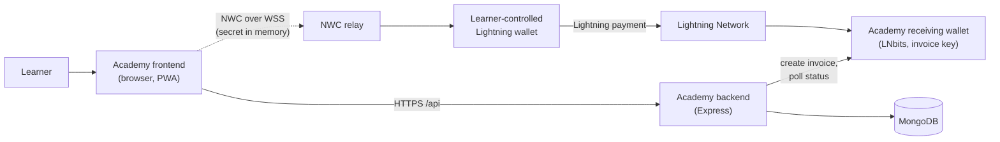
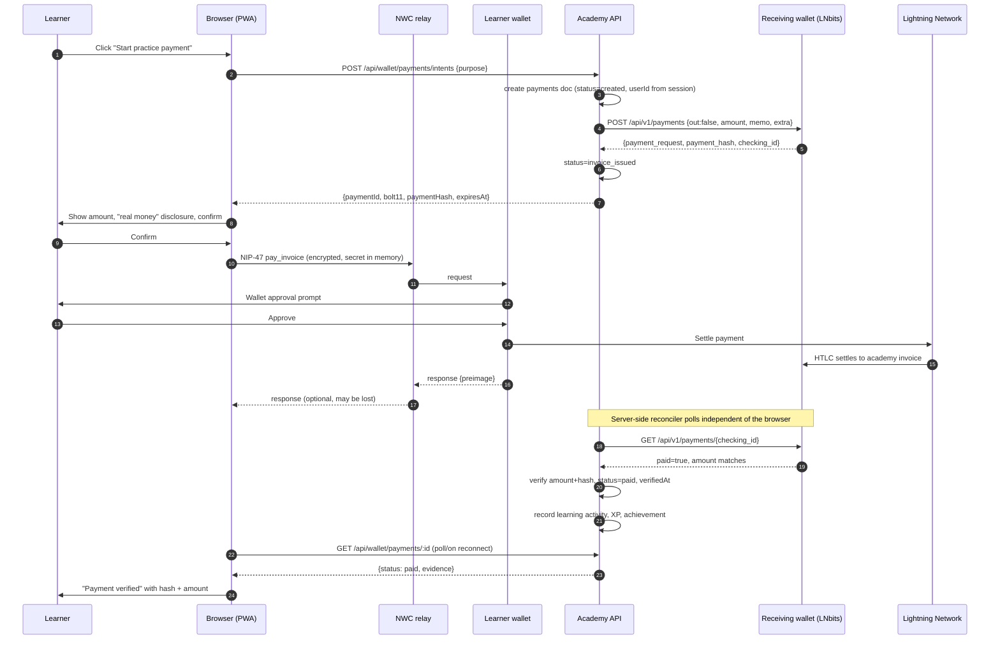
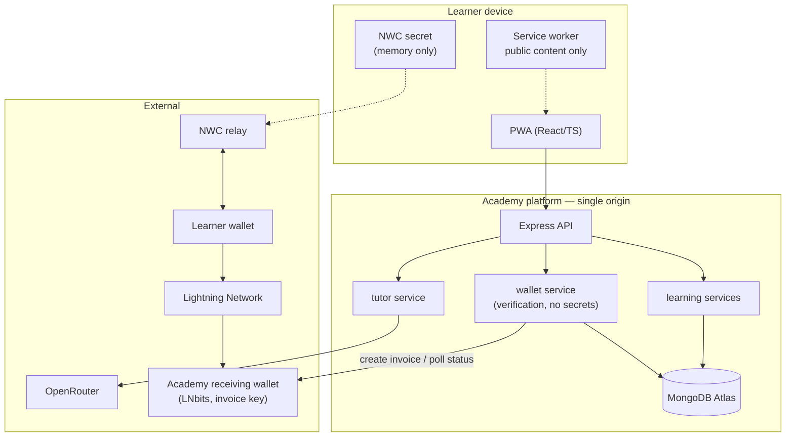
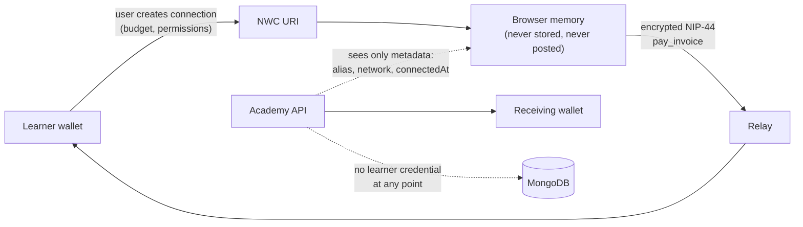
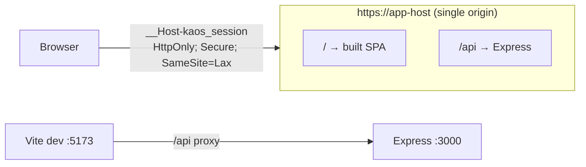
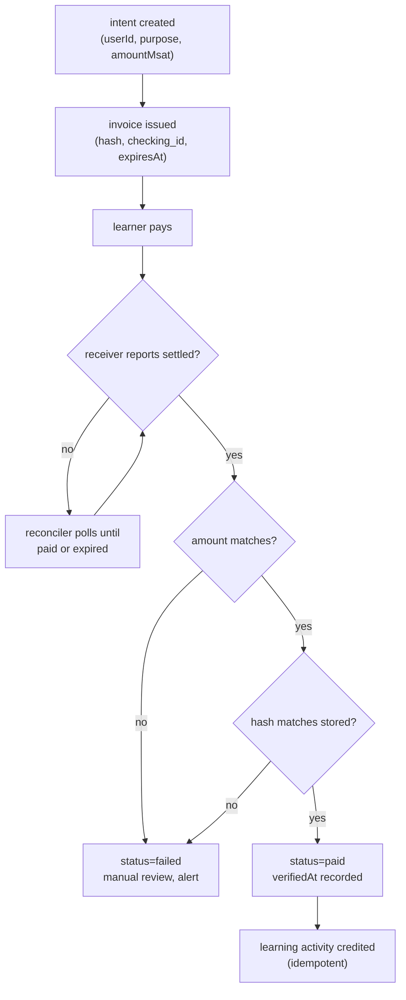

# KAOS Bitcoin Academy — Architecture Review Addendum

**Document type:** Architecture investigation and recommendation (no implementation)
**Assessment date:** November 1, 2026
**Parent document:** `reports/ARCHITECTURE-DISCOVERY-REPORT.md` (October 30, 2026)
**Governing specification:** `PRD.md` — sole authoritative source, immutable
**Status:** Recommendations only. Every decision below is **Pending project-owner approval** unless already approved in the record.

---

## 1. Executive Summary

The October 30 discovery report correctly identified the wallet as the single risky deliverable. It did not, however, establish **how the academy receives a payment**, and in two places it contains recommendations that would not work as written. This addendum resolves those questions to the point where an architecture baseline can be decided, and it names the decisions that only the project owner can make.

**Four findings change the architecture.**

1. **NWC cannot receive.** NIP-47's `pay_invoice` makes the *holder's* wallet pay. The original report recommended NWC for learner connectivity and never specified an academy receiving wallet, yet FR-010 and AC-013/AC-014 require the platform to handle a real payment request and verify a completed payment. **A second component — an academy-controlled receiving wallet that issues invoices — is mandatory.** It was missing. This is the most consequential gap in the original report.

2. **The credential recommendation was self-contradictory.** The report states that no wallet secret crosses to the browser and then proposes that the NWC URI be "posted once to the server." Those cannot both be the design. Both models are now analysed; the recommendation is **browser-held, in-memory credentials** for the hackathon, because it removes a honeypot and — critically — the payment flow no longer depends on the credential holder's network staying alive, since settlement is verified receiver-side.

3. **The `SameSite=Lax` recommendation fails on the topology the report also proposed.** MDN's specification is explicit: `Lax` cookies are sent only for same-site requests and top-level navigations with safe methods, and specifically **not for `fetch()`**. A frontend on `*.netlify.app` calling an API on `*.onrender.com` is cross-site, so the session cookie would never be sent. The fix is a **single-origin deployment**, not a CORS flag.

4. **LNbits is not a compliance fallback for FR-009.** The original report treats "switch to LNbits" as a fallback if NWC fails. Traced against the PRD's exact wording, an academy-hosted LNbits wallet is not "a compatible Lightning wallet" that the learner connects, and AC-012 would not be honestly satisfied. LNbits is a **receiving service**, not a learner-wallet substitute. If NWC fails, there is no LNbits-only fallback that preserves FR-009 — that must be said plainly rather than papered over.

**Additional finding, schedule.** The PRD's roadmap (§18) allocates Oct 30 – Nov 2 to "Approved specification, architecture and wallet evaluation", and the discovery report set a **November 2** fallback trigger for the wallet spike. Today is November 1. No spike has been authorised or executed, so the trigger cannot fire on evidence. The schedule needs explicit re-baselining by the owner; this is a governance item, not an engineering one.

**Verdict:** **Conditionally ready for architecture approval**, with six blocking decisions listed in §15. None of them is technically unsolvable; all of them change code if decided late.

---

## 2. Scope and Methodology

### 2.1 Scope

In scope: the wallet/payment lifecycle, NWC credential custody, session and deployment topology, LNbits/PRD compliance, Termux feasibility, PWA caching, curriculum delivery, AI tutor safety, and a revised architecture with traceability.

Out of scope by instruction: implementation, dependency installation, Git, deployment, account creation, `docs/` creation, and resolving OD-001.

### 2.2 Method

1. Re-read the governing documents and verified integrity before and after (`PRD.md` checksum validated against `PRD-MD-SHA256.txt`).
2. Traced every wallet-related PRD statement to its exact identifier and wording.
3. Checked each technical claim against primary documentation, recording title, URL and access date (§16).
4. Separated the result into verified facts, evidence-backed conclusions, recommendations, assumptions and decisions.

### 2.3 Evidence grades used in this document

| Grade | Meaning |
|---|---|
| **[V]** | **Verified** in official documentation on the stated access date. Quotable. |
| **[C]** | **Conclusion** drawn from verified evidence plus PRD wording. Defensible, but an inference. |
| **[R]** | **Recommendation.** Not binding; owner may reject. |
| **[A]** | **Assumption.** Not verified. Must be tested before reliance. |
| **[D]** | **Decision required.** Only the project owner may resolve it. |

### 2.4 Honest limitation

I did not execute any code, call a Lightning wallet, or open an LNbits instance. Therefore every statement about *runtime* behaviour of wallets, relays and LNbits beyond their documented API is marked **[A]**. Where the documentation is ambiguous — notably LNbits key exposure (§4.4) — the ambiguity is flagged rather than resolved in the report's favour.

---

## 3. Findings from the Original Report

### 3.1 What holds up

| Original claim | Verdict |
|---|---|
| Wallet is the critical dependency; validate early | Correct and confirmed by §18 of the PRD |
| All six playground simulations can be browser-only | Correct; no backend needed for FR-007 |
| MongoDB free tier is sufficient | Correct; 512 MB / ~100 ops/s verified |
| Separate data-model decisions should be made before coding | Correct; the three named migrations remain the highest-value early decisions |
| Broadcast/confirmation must never touch the network | Correct and required by AC-009 |
| Termux needs CI for E2E and builds | Directionally correct; specifics remain **[A]** (§8) |
| Preimage ↔ payment hash is the strongest verification evidence | Correct, with a caveat added in §4.5 |

### 3.2 What is wrong, incomplete or contradictory

| # | Location in original report | Problem | Severity |
|---|---|---|---|
| F1 | §9.2, §9.6 | **No academy receiving wallet is specified.** NWC is an outbound protocol; the report never says who issues the invoice the learner pays. AC-013/AC-014 cannot be implemented from the report as written. | **Blocking** |
| F2 | §4.6 vs §9.2 | **Credential contradiction.** "No wallet secret … ever crosses to the browser" vs "an NWC URI … is posted once to the server". The URI *is* the secret and it travels browser → server. | High |
| F3 | §5.3 | **`SameSite=Lax` + separately hosted frontend/API is broken.** Lax cookies are not attached to cross-site `fetch()`. | High |
| F4 | §9.6 | **"Fallback: LNbits" is presented as a route to FR-009 compliance.** It is not; LNbits provides an academy wallet, not the learner's wallet. | High |
| F5 | §9.2 footnote | `make_invoice` marked "if supported — capability varies" but never converted into a design contingency. | Medium |
| F6 | §10.1 | Security map omits LNbits **key escalation** and **session fixation**; both are material. | Medium |
| F7 | §12.3 | Cold-start risk acknowledged but not connected to **webhook loss** in the payment design. | Medium |
| F8 | §9.5 | Matrix marks LNbits "Partially" satisfying FR-009 without drawing the compliance conclusion. | Medium |
| F9 | §16 | Roadmap inherits PRD dates; the November 2 wallet trigger is now unreachable on evidence (today is November 1). | **Schedule** |

### 3.3 Assessment of the original report overall

It is a sound systems document with a genuine hole at its most important seam. The frontend, database, AI and playground sections need no correction. The wallet section needs to be replaced by §4–§7 of this addendum.

---

## 4. Lightning Payment Architecture

### 4.1 Actors and responsibilities



| Actor | Responsibility | Trust |
|---|---|---|
| Learner | Decides to pay, approves in their wallet | Untrusted input; authenticated identity |
| Learner wallet | Holds learner funds; enforces its own budget; signs/settles payment | External; authoritative for *payer-side* outcome |
| Relay (NWC) | Transports encrypted request/response events; sees kinds and tags, not content **[V]** | Semi-trusted; may drop events |
| Academy frontend | Collects consent, holds NWC secret in memory (recommended), displays verified state | Untrusted (XSS surface) |
| Academy backend | Creates payment intent, requests invoice, **verifies settlement receiver-side**, records learning activity | Trusted; holds no learner wallet secret under the recommended model |
| Academy receiving wallet | Issues invoice, holds received sats, reports settlement | Trusted for *receiver-side* truth |
| Lightning Network | Moves value | Adversarial-but-correct; failures are normal |

### 4.2 Invoice generation vs payment vs verification

| Operation | NIP-47 method **[V]** | Direction | Who may perform it | What it proves |
|---|---|---|---|---|
| Create invoice | `make_invoice` | Inbound to the holder's wallet | Wallet holding the connection | That a payable request exists. **Nothing about payment.** |
| Pay invoice | `pay_invoice` | Outbound from the holder's wallet | Wallet holding the connection; user approves | That the payer's wallet reported settlement (with preimage) |
| Look up invoice/payment | `lookup_invoice` | Either | Wallet holding the connection | Current state: `pending`, `settled`, `expired`, `failed` **[V]** |
| Read balance/capabilities | `get_balance`, `get_info` | — | Wallet | That a connection is live and what it supports |

**[C] The critical consequence:** an invoice being created proves nothing about payment. The original report said this in prose; the architecture must *encode* it, which §4.5 does.

### 4.3 The seven lifecycle questions, answered

| # | Question | Answer |
|---|---|---|
| 1 | Who generates the invoice? | **The academy's receiving wallet**, on the academy backend's instruction. Never the learner. |
| 2 | Which wallet receives the payment? | The academy receiving wallet (LNbits wallet, or an academy wallet driven over its own NWC connection). |
| 3 | Who pays? | The learner, from the wallet they connected — subject to **[D-03]** (funding direction). |
| 4 | How is the invoice tied to learner and activity? | Server-side: the `payments` document is created *before* the invoice and stores `userId`, `purpose`, `lessonId`/`activityRef`, and later `paymentHash`. The `memo`/`extra` field carries a short reference for human debugging only — **never** as the authority for identity. |
| 5 | How is settlement independently confirmed? | Receiver-side: poll the receiving wallet for the invoice's status and require `paid`/`settled` **and** amount match **and** hash match. Payer-side preimage is corroboration, not the authority. |
| 6 | Timeout or unknown result? | Mark ambiguous, **never retry `pay_invoice`**, reconcile by polling `lookup_invoice`/LNbits status until a terminal state or invoice expiry. |
| 7 | Duplicate notifications / repeated requests? | Unique index on `paymentHash`; state transitions are conditional (`updateOne` with the expected prior status); webhooks are treated as *hints* and always re-verified. |

Plus the question the original report did not ask:

| # | Question | Answer |
|---|---|---|
| 8 | Payment succeeds but the frontend loses its connection? | **Nothing is lost.** Verification is server-side and independent of the browser. On reconnect the browser calls `GET /api/wallet/payments/:id` and renders the stored verified outcome. This is why receiver-side verification is architecturally superior to trusting the client's NWC response. |

### 4.4 Receiving architectures compared

#### Option A — Academy-controlled wallet with an API (node RPC)

| Aspect | Assessment |
|---|---|
| Mechanism | LND/CLN REST or gRPC on a node the academy operates |
| Verified? | Protocol exists; **not evaluated here** — requires running a node and channels |
| Fit | Rejected for MVP: PRD §16 excludes "Production-scale Lightning infrastructure"; operationally impossible from Termux |
| Verdict | **Rejected** |

#### Option B — LNbits as invoice/receiving service

**[V]** from LNbits documentation (accessed 1 Nov 2026):

- `POST /api/v1/payments` with `{"out": false, "amount": <sats>, "memo": …, "expiry": …, "webhook": …, "extra": {…}}` → `{payment_hash, payment_request, checking_id}`. Invoice key is sufficient for receiving.
- `POST /api/v1/payments` with `{"out": true, …}` (send) **requires the admin key**.
- `GET /api/v1/payments/{checking_id}` returns payment objects including `status`; invoice key is sufficient.
- Permission matrix: **Invoice key = "Read + receive only"**; **Admin key = "Read + write + send"**.
- Webhook delivery is optional and the documentation explicitly warns: *"Always verify webhooks server-side … Don't trust webhook data alone."*
- Default rate limit 200 req/min per IP.

| Aspect | Assessment |
|---|---|
| Receiving-only without admin key | **Yes, documented.** Create invoice and check status both accept the invoice key. No send capability. |
| Operational requirements | A running LNbits instance with a funded Lightning backend, reachable over HTTPS |
| Custody | The LNbits wallet operator controls the funds received. For *academy-owned demo receipts* this is acceptable; for learner funds it would breach PRD §16 ("holding user funds on behalf of learners"). |
| Cost | Hosted instance (paid) or self-hosted (needs Postgres + Lightning backend; no Docker on device) |
| Security consequence | Server holds a receive-only key. Compromise allows invoice spam and reading payment metadata — **not** fund movement, *provided* the key truly cannot escalate (see caveat below). |

> **Security caveat that must be tested before relying on key separation [A].** The LNbits authentication page's "Finding your keys" example shows `GET /api/v1/wallet` called *with an Invoice key* returning a response object that contains both `adminkey` and `inkey`. If that behaviour is real, the invoice key is an escalation path to the admin key, and "receive-only credential" is illusory. This may be documentation shorthand rather than actual behaviour. **It is unverified and must be tested on a disposable wallet with zero balance before any design depends on it.** If confirmed, the receiving wallet must hold only the demo float and be treated as a spend-capable secret.

#### Option C — Academy wallet driven over its own NWC connection

The academy connects to its **own** wallet via NWC and calls `make_invoice`/`lookup_invoice`.

| Aspect | Assessment |
|---|---|
| Advantage | One protocol for both sides; no LNbits hosting; no admin key anywhere near the server; symmetric with the learner side |
| Constraint | `make_invoice` support varies by wallet **[V]**: NIP-47 defines it, but capability advertisement (`info` event content) is per-wallet |
| Verification | `lookup_invoice` polling only — no webhooks |
| Verdict | **Viable secondary.** Attractive if the chosen academy wallet supports `make_invoice`; must be proven in the same spike. |

#### Option D — Hosted wallet/PSP API

Commercially hosted APIs that create invoices exist, but their current capabilities, custody terms and terms of service were **not verified** for this report. **[A]** Not recommended without a documented evaluation.

#### Recommendation

**[R] Option B (LNbits, invoice key only) as the primary receiving service; Option C as the documented alternative.**

Rationale: LNbits' receive path is precisely documented and gives a receive-only credential; Option C is elegant but rests on per-wallet capability that must be tested anyway. The decision belongs to the owner as **[D-01]**, and both options are cheap to test in one day.

### 4.5 Verification sequence

**Required evidence before a learning activity is recorded as paid:**

1. The invoice was created by our backend in this session (`payments._id` ↔ `paymentHash`).
2. The receiving wallet reports the invoice **settled/paid**.
3. The settled **amount** equals the amount we requested.
4. The **payment hash** matches our stored hash.
5. The transition was performed once (idempotent, conditional update).

Payer-side preimage, if present, is **corroboration**: `sha256(preimage) == payment_hash`. It is strong evidence that the payer settled, but it is not proof that *our* wallet received — which is why (2) is authoritative. **[C]**



### 4.6 State machine (and why the proposed model needs amendment)

The brief proposes `created → invoice_issued → payment_requested → payment_pending → paid / failed / expired / unknown`. It is close, but three changes are needed:

1. **`unknown` must not be terminal.** A relay timeout is a *lack of information*, not an outcome. If `unknown` is terminal, a successful payment can be recorded as unknown forever. It must be resolvable.
2. **Add `verifying`.** There is a real gap between "wallet reported something" and "receiver confirmed settlement"; collapsing it hides exactly the evidence the PRD demands.
3. **Add `abandoned`.** A learner who closes the tab before paying is not `expired` and not `failed`; conflating them corrupts AC-015 reporting.

```mermaid
stateDiagram-v2
    [*] --> created
    created --> invoice_issued: receiving wallet returned bolt11 + hash
    created --> failed: invoice creation error
    invoice_issued --> abandoned: learner cancels / navigates away
    invoice_issued --> payment_requested: learner confirms; NWC pay_invoice sent
    payment_requested --> verifying: payer reports success OR receiver shows paid
    payment_requested --> unknown: relay timeout / ambiguous response
    verifying --> paid: receiver settled, amount+hash match
    verifying --> failed: receiver reports failure
    unknown --> paid: reconciliation finds settlement
    unknown --> expired: reconciliation finds unpaid past expiry
    invoice_issued --> expired: invoice expiry reached unpaid
    payment_requested --> expired: expiry reached unpaid
    paid --> [*]
    failed --> [*]
    expired --> [*]
    abandoned --> [*]
```



`unknown` is therefore a **reconciliation queue state**: a background job re-polls until it resolves to `paid` or `expired`. **[R]**

### 4.7 Idempotency, expiration and recovery

| Concern | Mechanism |
|---|---|
| Duplicate `POST /payments` | `Idempotency-Key` header + one active intent per `(userId, purpose)`; return the existing record |
| Duplicate invoice | Unique index on `paymentHash`; reuse the open invoice for the same intent |
| Duplicate webhook / repeated poll | Conditional update `{status: {$in: [...]}}`; `paid` is absorbing |
| Expiry | Store `expiresAt` from the invoice; a scheduled job expires stale records; UI shows "invoice expired, create a new one" |
| Interrupted request | Server never depends on the browser to finish; reconciler owns resolution |
| Double payment risk | **Never** issue a second `pay_invoice` for an ambiguous result. Look up first. |

### 4.8 Funding and consent model

This is a product decision, not a technical one, and the PRD does not settle it.

| Model | Who pays | Teaching value | Risks | PRD fit |
|---|---|---|---|---|
| **M1. Learner pays academy** (e.g. 21 sats "practice payment") | Learner | Invoice → authorization → settlement, end-to-end | Learner spends real money; must not look like a fee for education | Consistent with "Require explicit user authorization for payments" and "Never imply … immune to financial loss" **[§12]**; needs care against "Free educational platform" optics |
| **M2. Academy pays learner** (e.g. 21 sats reward) | Academy | Learner receives, sees inbound settlement | Requires a *send*-capable academy credential (admin key or paying NWC wallet) → highest-risk secret; faucet abuse | Compatible, but concentrates risk |
| **M3. Learner pays own second wallet** | Learner | Self-payment | Needs two wallets; often fails without channel liquidity; poor for beginners | Technically real, pedagogically muddled |
| **M4. Testnet/signet/regtest** | Anyone | Protocol-accurate demonstration | Testnet Lightning support is thin and inconsistent across beginner wallets; AC-014's "verified" evidence becomes harder to defend | **Does not clearly satisfy** "real Lightning payment" / "without relying on mock payment results" **[§13, §25]** |

**[R] Recommendation: M1**, with a fixed, visible amount (≤ 1,000 sats; suggest 21 sats), an explicit disclosure screen ("This sends real sats on the Bitcoin Lightning Network. It is a practice payment to KAOS Bitcoin Academy. It is small, voluntary, and not refundable."), a server-side cap, one practice payment per learner, and **no gating of any educational content behind it**. AC-014 is then a demonstration activity, not a paywall — which keeps "Free educational platform" true.

**[D-03]** owner decision. If the owner will not accept learners spending real sats, **M2** is the only remaining model that satisfies "real payment", and it requires accepting a send-capable credential on the server — a materially worse security posture that must be explicitly acknowledged.

**On "test environment":** PRD §12 says "Use test environments where supported". For Lightning, beginner-friendly test environments are not reliably supported **[A]**. The mitigation is a tiny mainnet amount, not a testnet claim we cannot verify.

---

## 5. NWC Credential Custody

### 5.1 What the URI actually is

**[V]** A NWC connection URI looks like:

```
nostr+walletconnect://<wallet-service-pubkey>?relay=wss://…&secret=<32-byte-hex>[&lud16=…]
```

- The **`secret`** is the *client* key. The client signs requests with it and encrypts payloads to the wallet service's pubkey.
- Possession of the URI grants the ability to **send signed requests to the wallet service** on the relays listed — subject only to whatever budget/permission the user granted when creating the connection.
- It is **not** a seed phrase and **not** the wallet's main private key. It cannot derive other accounts, cannot sign on-chain transactions directly, and can be revoked by the user at any time without affecting the wallet.
- It **is** nevertheless a **bearer credential with spending authority**. If the wallet granted an unrestricted budget, theft of the URI is equivalent to theft capability up to that budget. Dismissing it as "not a seed phrase" would be wrong.

**[C]** Correct framing: *low blast radius, high consequence.* The URI must be treated like a scoped API token with a spend limit, not like a password and not like a seed.

### 5.2 Model comparison

| Dimension | Model 1 — browser-held | Model 2 — server-held |
|---|---|---|
| Where the secret lives | Browser memory only (never persisted) | MongoDB, encrypted at rest |
| Who can initiate payments | The browser (learner present) | The server (could act without the learner) |
| XSS exposure | Live session can be abused; nothing persists to steal later | Secret not in browser at all, so XSS cannot reach it |
| Server compromise | No learner secrets to steal | **All connections' secrets exposed at once** |
| Key management | None | Envelope encryption key, rotation, KMS-or-env decision |
| Logging risk | Must not log request bodies/URLs | Must redact DB reads, error objects, and query logs |
| Revocation | Learner revokes in wallet; browser discards | Must revoke wallet-side **and** delete server record |
| Wallet budgets | Enforced by wallet, unchanged | Same, but the server may keep retrying within budget |
| Mobile reality | Tab may be suspended when the learner switches to their wallet app | Server keeps working while the app is backgrounded |
| Verification reliability | **Unaffected** — receiver-side verification is server-side | Unaffected |
| PRD `/api/wallet/connect` shape | Needs reinterpretation: record metadata only | Matches naturally |
| Blast radius | One live session, one wallet | Every stored connection |

### 5.3 The contradiction, resolved

The original report said secrets never cross to the browser *and* that the URI is posted to the server. Both cannot hold. Under Model 1 the statement becomes true in the only sense that matters: **the academy backend never receives the credential**, and the browser never receives any *server* secret.

**[R] Recommendation: Model 1 for the hackathon**, with these consequences made explicit:

- `POST /api/wallet/connect` records **connection metadata only** (provider, wallet alias from `get_info`, network, connectedAt) so that `GET /api/wallet/status` and the dashboard have something truthful to show. The secret is not part of the request.
- All payment initiation happens in the browser, and the learner's own wallet performs the approval.
- The backend verifies settlement **receiver-side**, so the browser is never trusted and losing the tab does not lose the payment.
- The PRD's wallet endpoints remain "subject to the final integration design" **[§11]**, which is the latitude this uses. This is still **[D-02]** because it changes what `/api/wallet/connect` means.

**Trade-offs stated plainly:** Model 1 cannot support server-initiated or scheduled payments; it cannot recover a payment the learner starts and abandons mid-flow (though reconciliation still resolves what *did* happen); and it leaves an XSS-to-payment path that must be contained by CSP, no third-party scripts, and never persisting the URI. If the owner prefers server-side control, Model 2 must come with wallet-side budgets, per-user encryption, redaction, and a revocation path — with the honeypot risk accepted in writing.

**Never:** seed phrases, main wallet private keys, `nsec` keys, or `xprv` material. No field, endpoint or log for them exists in this design.

---

## 6. Authentication and Deployment Topology

### 6.1 What the cookie specification actually says

**[V]** MDN, `Set-Cookie` (accessed 1 Nov 2026):

- `SameSite=Lax` — sent only for same-site requests, plus cross-site **top-level navigations** that use a **safe** method. It explicitly **excludes `fetch()`** and excludes `POST`.
- `SameSite=None` — sent cross-site, but **`Secure` is mandatory**.
- `Secure` — HTTPS-only, with a **localhost exception**.
- `HttpOnly` — blocks `document.cookie`; the cookie is still sent on JS-initiated requests.
- `__Host-` prefix — requires `Secure`, `Path=/`, and **no `Domain`**, binding the cookie to the exact host.
- **[V]** Via CORS, `Set-Cookie` in a response is **ignored** unless the request is made with credentials, and `Access-Control-Allow-Credentials: true` cannot be combined with a wildcard origin.

### 6.2 Topology matrix

| Topology | SameSite behaviour | CORS | CSRF posture | Verdict |
|---|---|---|---|---|
| **1. Unrelated domains** (`app.netlify.app` + `api.onrender.com`) | They are **cross-site**. `Lax` → cookie **not sent** on `fetch` → auth silently fails. `None; Secure` → works only if the browser accepts third-party cookies | Credentials + exact `Origin` + `Allow-Credentials` | Needs explicit CSRF defence **and** third-party cookies | **Not recommended** |
| **2. Subdomains** (`app.example.com` + `api.example.com`) | Same-site (same registrable domain) → `Lax` is sent on `fetch` **if** the cookie `Domain` covers the API host or the cookie is host-scoped to it | Credentials + exact `Origin` | `Origin` check + SameSite | Workable, but needs a paid domain and careful `Domain` scoping |
| **3. Same origin** (SPA and API behind one host, `/api/*` proxied) | Same-origin throughout; `Lax` is irrelevant-but-correct | **None needed** | `Origin`/`Sec-Fetch-Site` check + SameSite | **Recommended** |

**Why not topology 1:** even where `SameSite=None` is accepted, support is not uniform. Safari and Firefox block third-party cookies by default; Chrome's policy has changed repeatedly (secondary reporting indicates Chrome retains third-party cookies by default as of 2026, but that is **not verified against primary Google documentation here**). Building authentication on a cookie class the target audience's mobile browsers may reject is a self-inflicted availability risk. **`credentials: 'include'` does not solve this** — it only permits cookies to *travel*; whether the browser will *send* them is the cookie policy's decision.

### 6.3 Recommended topology

```
Browser ──HTTPS──> one origin  (https://academy.example  or  https://kaos-academy.onrender.com)
                     ├── /            → static SPA (Express static or CDN passthrough)
                     ├── /api/*       → Express
                     └── /assets/*    → long-cache static
```

- **One host serves both.** Express serves the built SPA and the API; no CORS middleware is needed in production at all.
- Cookie: `__Host-kaos_session`; `HttpOnly; Secure; SameSite=Lax; Path=/` — the `__Host-` prefix forbids `Domain`, so a subdomain cannot overwrite it **[V]**.
- CSRF: because the cookie is `Lax` **and** state-changing routes are all `POST/PUT/DELETE` (which Lax does not send cross-site), the residual risk is same-site attackers. Add an `Origin`/`Sec-Fetch-Site` check on mutating routes as defence in depth.
- **Development:** Vite dev server proxies `/api` → `http://localhost:3000`, so dev is same-origin too, with no CORS configuration and no cookie divergence between environments.
- **Cost/dependency:** a custom domain (~$10–15/year) is **optional**; the platform host's own subdomain is a single origin and is free. If a CDN front is wanted later, the CDN must proxy `/api` to preserve single origin.

**Consequences of this choice:** the API serves the HTML, so a cold start delays first paint. Mitigations: keep-warm ping, paid instance for the demo week, and the service worker serving the cached shell on repeat visits. **[D-04]**

---

## 7. PRD Compliance and LNbits Fallback

### 7.1 What the PRD actually requires

Quoted exactly:

- **FR-009 (P0):** "Users can connect a compatible Lightning wallet"
- **FR-010 (P0):** "Users can complete a guided Lightning payment"
- **AC-012:** "A compatible Lightning wallet can be connected" — Integration test
- **AC-013:** "The platform can generate or handle a real Lightning payment request" — Integration test
- **AC-014:** "A guided payment can be completed and verified" — End-to-end test
- **AC-015:** "Payment failures are communicated accurately" — Negative test
- **§25:** "A complete demonstration can be performed without relying on mock payment results."
- **§16:** out of scope includes "Holding user funds on behalf of learners" and "Production-scale Lightning infrastructure".

### 7.2 Compliance table

| Architecture | PRD requirement satisfied? | Evidence | Gap | Owner decision |
|---|---|---|---|---|
| **NWC (learner wallet) + LNbits receiving** | **FR-009: Yes.** FR-010: Yes. AC-012/013/014: Yes, in principle | NIP-47 connect/pay **[V]**; LNbits receive + status **[V]** | Both halves must be proven end-to-end with real sats; LNbits key escalation unverified | **D-01, D-05** |
| **NWC (learner wallet) + academy wallet via NWC** | FR-009: Yes. FR-010: Yes | NIP-47 `make_invoice` **[V]**; wallet support for it **[A]** | Receiving depends on wallet capability advertisement | D-01 |
| **LNbits only (academy wallet; learner pays an invoice)** | **FR-009: No.** FR-010: partially (a payment can be made, but no learner wallet connection). AC-012: **No** | LNbits docs describe an academy-controlled wallet, not the learner's wallet **[V]** | The learner connects nothing; the connection step of the journey is absent | **D-05** |
| **LNbits per-learner accounts** (academy provisions wallets) | FR-009: **No** — a provisioned custodial account is not "a compatible Lightning wallet" the learner connects. Also risks §16 ("holding user funds") | — | Custody, identity, funding, and it contradicts the "connect your wallet" pedagogy | D-05 |
| **Hosted wallet/PSP** | Unverified | Not evaluated | Unknown custody/terms | D-01 |
| **Testnet/regtest only** | AC-013/014 defensible? **Weakly** | PRD §13/§25 demand real, verified results | Beginner wallets rarely support testnet Lightning **[A]** | D-06 |
| **Mock/simulated payment** | **No** — explicitly excluded | §25 "without relying on mock payment results"; AC-009 confines simulation to the playground | Would falsify the core acceptance criterion | Not offered |

### 7.3 Plain statement

**No LNbits-only fallback preserves FR-009.** If NWC cannot be made to work, the project faces a genuine requirement conflict, not a substitution: either the owner approves a documented deviation from FR-009/AC-012, or the wallet-connection requirement moves to another mechanism. The honest options are:

1. NWC works → FR-009 satisfied.
2. NWC fails, LNbits receiving still used → **FR-010/AC-013/AC-014 can still be satisfied**; **FR-009/AC-012 cannot**. A deviation would be required and must be recorded, not hidden.
3. NWC fails and no alternative learner-wallet mechanism is found → the wallet demonstration degrades to "academy wallet + learner pays an invoice", which is real money but not a wallet connection.

LNbits should therefore be adopted as **complementary infrastructure** (receiving), not as a fallback for the connection requirement. That is a correction to the original report's §9.6.

---

## 8. Termux and Development Environment

### 8.1 Confirmed

| Item | Status | Evidence |
|---|---|---|
| aarch64 Android, Node v26.4.0, npm 11.20.0, Git 2.56.0 | **[V]** | Measured 30 Oct 2026 |
| No Docker, no `mongod` | **[V]** | `command -v` |
| npm registry/network access | **[V]** | Packages fetched during earlier research |
| Storage shared partition accessible | **[V]** | `~/storage/shared/Download` |

### 8.2 Untested assumptions (must not be stated as facts)

| Claim in the original report | Real status | Cheapest test |
|---|---|---|
| Rollup 4 prebuilt binary will not run on Bionic | **[A]** — plausible (Termux is Bionic, not glibc), untested | `npm create vite`, `npm run build`, 10 minutes |
| esbuild works | **[A]** | Same spike |
| Vitest runs locally | **[A]** | Same spike |
| `mongodb-memory-server` downloads an x86_64 binary | **[A]** — very likely, unverified | `npm i`, run once, observe |
| Playwright has no Android/Termux browser | **[A]** — documented platforms do not include it, not checked for this report | `npx playwright install` attempt |
| Node 26 breaks package `engines` | **[A]** | Install and read warnings |

**Correction to the original report's tone:** it presents these as "high risk" almost as findings. They are **hypotheses**. The disciplined move is a single 30-minute spike that answers four of the six at once, then recording the results. Until that runs, no architecture decision should depend on the answer.

### 8.3 Work split that keeps Termux-first

| Task | Where | Why |
|---|---|---|
| Writing code, `vite dev`, unit tests | Termux | Local, fast, no reason to move |
| Production build | Termux first; CI if native resolution fails | Build must be reproducible where it ships |
| Integration tests (DB) | CI against an Atlas test database | `mongodb-memory-server` likely unusable locally **[A]** |
| E2E (Playwright) | CI only | Browser bundles are not Termux-supported **[A]** |
| Real wallet rehearsals | Physical Android device | Nothing else proves the beginner journey |
| Deployment | CI → host | Reproducible, auditable |

No technical reason found to abandon Termux-first. The recommendation is Termux-first **with CI as the verification authority**, which is a workflow addition, not a replacement.

---

## 9. PWA and Offline Security

### 9.1 Caching policy

| Content | Strategy | Rationale |
|---|---|---|
| App shell (HTML/JS/CSS/fonts) | Precache, versioned per deploy | Instant repeat loads on slow networks (§8.3, §15) |
| Public course/lesson **content** | Stale-while-revalidate, **deployment-versioned key** | Content is not learner-specific; PRD asks for graceful degradation |
| Course catalogue | Network-first, short cache | Cheap, changes rarely |
| `/api/auth/*` | **Never cache** (network-only, `no-store`) | Session material must never persist in Cache Storage |
| `/api/progress*` | **Never cache** | Per-learner; AC-004 requires server truth |
| `/api/quizzes/:id/attempts` | **Never cache** | Grading must be server-side and fresh |
| `/api/tutor/*` | **Never cache** | Conversations are personal (§13 privacy) |
| `/api/wallet/*`, payment status | **Never cache** | Money-adjacent; stale "paid" is catastrophic |
| QR codes / invoices | Never cache, never persist | Payment request material |
| Images/diagrams | Cache-first, immutable hashes | Bandwidth |

### 9.2 The shared-device problem

Caches are origin-scoped, not user-scoped. On a shared phone (a realistic context for the target audience), a cached **personalised** response would be served to the next learner after a logout. The rule that follows is absolute:

- **Only non-personalised content may enter the cache.** If a response varies by learner, it does not belong in Cache Storage or IndexedDB.
- On **logout**: `caches.delete()` for every runtime cache, clear IndexedDB stores, clear `localStorage`/`sessionStorage` keys used by the app, then navigate with `Cache-Control: no-store`.
- On **login as a different user**: force a cache purge before rendering the dashboard.
- The service worker must **not** serve cached HTML for authenticated routes if the session probe fails — fail closed to a login prompt, not to a stale page.
- Never cache `Set-Cookie`-bearing responses or 401/403.

### 9.3 Offline scope

Read-only offline (cached lesson text) satisfies "Handle temporary network failures gracefully" **[§8.3, §15]** without risking AC-004. Queued offline **writes** (progress, quiz attempts) are out of scope unless separately approved, because they introduce merge conflicts and duplicate-completion bugs that AC-004/AC-007 would have to absorb. **[D-07]**

---

## 10. Course Delivery Feasibility

### 10.1 The requirement, and the arithmetic

**§6 [PRD]:** "The initial curriculum will contain eight courses." Each course "should contain" an introduction, objectives, lessons, illustrations/demonstrations, knowledge checks, an assessment, and completion status.

Rough sizing for a credible beginner lesson: 700–1,200 words, 1 diagram, 2–4 knowledge checks.

| Item | Count | Effort each | Subtotal |
|---|---|---|---|
| Lessons (8 courses × 5) | 40 | 1.5–3 h (draft + accuracy review + formatting) | 60–120 h |
| Course assessments (10 questions) | 8 | 2 h | 16 h |
| Course intros + objectives | 8 | 1 h | 8 h |
| Diagrams | ~40 | 0.5 h | 20 h |
| Technical accuracy review pass | 8 | 2 h | 16 h |
| **Total** | | | **≈120–180 h** |

Against a 20-day window that also contains the entire platform build, this is **not achievable at full depth by one developer**. Pretending otherwise would be the single most likely cause of a failed submission.

### 10.2 Options (owner decision, not mine)

| Option | What ships | PRD position | Consequence |
|---|---|---|---|
| **A. All 8 courses complete** | 40 lessons, 8 assessments | Fully compliant with §6 | Not credible in the time available alongside P0 engineering |
| **B. Bitcoin 101 complete; 7 courses published with intro + 2–3 lessons, remainder marked "in development"** | Full demo path; honest catalogue | Partially compliant: "should contain" language gives some latitude, but "initial curriculum will contain eight courses" is still met at catalogue level | Best balance; needs owner approval as interpretation |
| **C. Fewer than 8 courses** | Complete but narrower | **Deviates from §6** | Would require a recorded deviation |
| **D. Auto-generated lesson text** | 8 "complete" courses | Likely violates "Accuracy before simplicity" and the §6 content requirements | Not offered as a shortcut for a Bitcoin education product |

**[R] Recommendation: B**, with the eight-course catalogue live, Bitcoin 101 complete end-to-end (the AC-002/§25 "introductory learning journey"), and every other course clearly showing what exists. The owner must approve this as an interpretation of §6 **[D-09]**.

### 10.3 Sequencing

Content is the longest non-engineering task and it gates the demo. Author Bitcoin 101 **in parallel with backend work** (Nov 3–8), not after the platform is finished. Ship lessons as data (seed script), not as hardcoded components.

### 10.4 Accuracy review requirement

§23 lists "Content quality — Review technical lessons before publication" as a risk mitigation. Every published lesson therefore needs a review pass; for Lightning and wallet lessons, a second pass specifically for safety claims (no guarantees, no investment promises, no "your funds are safe" language).

---

## 11. AI Tutor Security

| Concern | Control | PRD basis |
|---|---|---|
| API key handling | Key only in server env; provider called from `services/ai`; bundle grep in CI for key prefixes | §13 "API keys remain server-side" |
| Prompt injection | Learner text delimited and labelled untrusted; system policy restated after the user turn; role markers stripped; 2,000-char cap; model has **no tools and no DB access** | §5.1, §13 |
| Bitcoin misinformation | Lesson-scoped grounding (deterministic retrieval by `lessonId`), explicit uncertainty phrasing, refusal of protocol claims outside the curriculum | §5.1 "must not invent … protocol specifications" |
| Financial advice | Hard refusals on price prediction, investment advice, "should I buy"; no numbers presented as forecasts | §5.1, §16 |
| Wallet-safety guarantees | Fixed safety footer rendered by the frontend (not generated); refuse "is my wallet safe" absolutism | §5.1, §12 |
| Privacy | No email/IP/identifier in prompts; conversation retention documented; deletion supported; logs redacted | §13 |
| Rate limiting | 10/min and 100/day per user; global budget guard; kill switch | §13 "Request rate limits" |
| Provider failure | 20 s timeout → one retry → deterministic fallback message quoting the relevant lesson passage | §19 negative testing "AI provider failure" |
| Cost control | Token accounting per conversation; monthly ceiling; capped `max_tokens` | §20 metrics, operational prudence |
| Output filtering | Reject/redact private-key and seed-phrase shapes, unauthorised URLs, credential requests; log the *fact*, never the content | §12, §13 |

**[GAP retained]** AC-011 ("handles unsupported questions safely") needs an authored adversarial set — at least 15 prompts — or the criterion cannot be demonstrated. This is content work, not architecture, and it must be scheduled.

Nothing here adds requirements beyond the PRD; every control maps to §5.1, §12 or §13.

---

## 12. Revised Architecture Proposal

### 12.1 System context



### 12.2 Components

| Component | Responsibility | PRD support | Security implication | Still to test |
|---|---|---|---|---|
| SPA + service worker | Learning experience, simulation, consent UI | FR-002–005, FR-007, FR-008, FR-011, §8.3 | No secrets persisted; CSP enforced | PWA install on target device |
| Express API (single origin) | Auth, content, progress, quizzes, tutor proxy, wallet verification | FR-001–FR-011 | Serves HTML and API; cookie scope is one origin | Cold start behaviour |
| Learning services | Courses, lessons, progress, XP | FR-002–006, FR-012 | Ownership scoping on every query | — |
| Tutor service | Grounded AI, filters, limits | FR-008 | No PII, no tools, budget guard | Model quality on curriculum |
| Wallet service | Payment intent, invoice request, **receiver-side verification**, reconciliation job | FR-009, FR-010, AC-012–015 | Holds only the receiving wallet's **invoice key**; never a learner secret | Key-escalation behaviour (§4.4) |
| Receiving wallet | Issues invoices, holds demo sats | FR-010 | Custody of *academy* funds only | Uptime, fee behaviour |
| Learner wallet + NWC | Learner-side authorization and payment | FR-009, FR-010 | Learner's own custody; wallet-side budget | Wallet compatibility matrix |

### 12.3 Credential custody model (recommended)



### 12.4 Authentication/deployment model



### 12.5 Payment verification data flow



### 12.6 Technology choices (recommended, subject to D-10)

| Layer | Choice | Why | Alternative rejected |
|---|---|---|---|
| Frontend | React + TS + Vite + Tailwind + React Router (PRD-specified) | PRD §9.1; static, CDN-friendly | Next.js (unneeded server runtime) |
| State | TanStack Query + auth context | Server cache + simple session | Redux (ceremony) |
| PWA | `vite-plugin-pwa` | Workbox precache, versioned caches | Hand-rolled SW (error-prone) |
| API | Express 5 on Node | PRD §9.1; async error propagation | Fastify (not specified, no throughput need) |
| Validation | zod at every edge | Runtime + type source of truth | Joi/celebrate (less TS-native) |
| Sessions | Opaque server sessions, Mongo store | Instant revocation, simple | JWT pair (rotation complexity) |
| DB | MongoDB Atlas + Mongoose | PRD §9.1; free tier suffices | PostgreSQL (not specified) |
| AI | OpenRouter, server-side | PRD §9.1; one key, model fallback | Direct provider SDK (lock-in) |
| Receiving | LNbits (invoice key) | Documented receive + status; no send capability on server | Own node (out of scope) |
| Learner wallet | NWC (NIP-47) | Only mobile-friendly learner-wallet connection identified | LNURL-auth (auth only), WebLN (desktop extension) |
| Crypto (playground) | `@noble/secp256k1` + WebCrypto SHA-256 | Pure JS, auditable, no native build | Node `crypto` secp256k1 (not in browser) |

### 12.7 Known limitations and unresolved risks

1. NWC is `draft` **[V]**; wallet behaviour will vary.
2. LNbits invoice-key escalation is documented-ambiguous **[A]**.
3. Real payments mean real money and real failure modes; the demo depends on network conditions.
4. Single-origin hosting puts HTML behind a possibly-cold API.
5. Curriculum depth vs timeline is unresolved (**[D-09]**).
6. The wallet spike has not run, and its original November 2 deadline is tomorrow.

---

## 13. Requirements Traceability

Priority and wording preserved exactly from `PRD.md`.

### 13.1 Functional requirements

| ID | Priority | Requirement | Proposed component | Responsibility | Verification | Status | Decision/dependency |
|---|---|---|---|---|---|---|---|
| FR-001 | P0 | Users can register and authenticate | API auth + sessions | Backend | Functional test | Design complete | D-02 |
| FR-002 | P0 | Users can access the course catalogue | Learning service + catalogue UI | Backend/frontend | Functional test | Design complete | Content seeding |
| FR-003 | P0 | Users can view lessons | Lesson service + reader | Backend/frontend | Functional test | Design complete | Content |
| FR-004 | P0 | Users can complete lessons | `lessoncompletions` unique | Backend | Database test | Design complete | D-04 |
| FR-005 | P0 | Users can complete quizzes | Quiz + attempts | Backend | Functional test | Design complete | Content |
| FR-006 | P0 | Learning progress is persisted | `usercourses` + completions | Backend | Integration test | Design complete | D-04 |
| FR-007 | P0 | Users can access the Bitcoin playground | Client simulations | Frontend | Demonstration | Design complete | D-08 |
| FR-008 | P0 | Users can interact with the AI tutor | Tutor service | Backend | Functional test | Design complete | Provider key |
| FR-009 | P0 | Users can connect a compatible Lightning wallet | Browser NWC + metadata endpoint | Frontend + backend | Integration test | **Unproven** | **D-02, D-05** |
| FR-010 | P0 | Users can complete a guided Lightning payment | Intent → invoice → NWC pay → verify | Backend + frontend + receiving wallet | End-to-end test | **Unproven** | **D-01, D-03** |
| FR-011 | P0 | Users can view their learning dashboard | Dashboard + progress API | Frontend | Functional test | Design complete | — |
| FR-012 | P1 | Users can earn XP and achievements | Achievement service | Backend | Functional test | Schema designed, UI deferred | Must not delay P0 |
| FR-013 | P1 | Users can access multiple learning paths | `courses.path` | Backend | Functional test | Field designed only | — |
| FR-014 | P2 | Users can receive completion certificates | — | — | — | Deferred | — |
| FR-015 | P2 | Users can access community learning features | — | — | — | Out of MVP (§16) | — |
| FR-016 | P2 | Developers can access advanced technical courses | Course content | Content | Review | Deferred | — |

### 13.2 Acceptance criteria

| ID | Criterion | Component | Verification | Status | Decision/dependency |
|---|---|---|---|---|---|
| AC-001 | A new learner can register and sign in | Auth | Functional test | Ready | D-02 |
| AC-002 | A learner can access published courses | Catalogue | Functional test | Ready | Content |
| AC-003 | Lessons display correctly on mobile | Reader | Responsive test | Ready | Device test |
| AC-004 | Lesson completion is persisted | Progress | Database test | Ready | D-04 |
| AC-005 | Learners can submit quiz answers | Quiz API | Functional test | Ready | — |
| AC-006 | Quiz results are calculated correctly | Scoring | Unit test | Ready | — |
| AC-007 | Progress updates after lesson completion | Progress service | Integration test | Ready | D-04 |
| AC-008 | The Bitcoin playground supports its documented exercises | Simulations | Demonstration | Ready | Content |
| AC-009 | Simulations are visibly distinguished from real transactions | Simulation layout | UX review | Ready | D-08 |
| AC-010 | The AI tutor answers questions using educational context | Tutor | Functional test | Ready | — |
| AC-011 | The AI tutor handles unsupported questions safely | Tutor + filters | Negative test | **Test set not authored** | — |
| AC-012 | A compatible Lightning wallet can be connected | Browser NWC | Integration test | **Blocked on spike** | **D-02, D-05** |
| AC-013 | The platform can generate or handle a real Lightning payment request | Receiving wallet | Integration test | **Blocked on receiving wallet** | **D-01** |
| AC-014 | A guided payment can be completed and verified | Full flow | End-to-end test | **Blocked** | **D-01, D-03, D-06** |
| AC-015 | Payment failures are communicated accurately | State machine | Negative test | Design ready | D-01 |
| AC-016 | Wallet secrets are not exposed in logs or frontend bundles | Bundle + redaction | Security review | Design ready | D-02 |
| AC-017 | The application is accessible through a public deployment | Single-origin host | Deployment test | Design ready | D-04 |
| AC-018 | The repository includes setup and architecture documentation | README + this report | Documentation review | Partially met | OD-001 |

No requirement was added, removed, re-worded or re-prioritised.

---

## 14. Security and Operational Risk Register

| ID | Risk | Likelihood | Impact | Evidence basis | Mitigation | Owner decision |
|---|---|---|---|---|---|---|
| SR-1 | NWC wallet incompatibility or onboarding failure | High | High | NIP-47 is `draft` **[V]** | Spike day 1; guided UI; documented fallback | D-05 |
| SR-2 | LNbits invoice key can escalate to admin key | Unknown | High | Docs example **[V]**, behaviour **[A]** | Test on zero-balance wallet; keep float minimal | D-01 |
| SR-3 | Ambiguous payment recorded as failed, learner charged | Medium | High | Relay delivery is not guaranteed **[C]** | `unknown` reconciliation; never blind retry | — |
| SR-4 | Cross-site cookie auth silently broken | Medium | High | MDN SameSite **[V]** | Single-origin topology | D-04 |
| SR-5 | XSS exfiltrates in-memory NWC secret | Low–Medium | Medium | Browser model **[C]** | Strict CSP, no third-party scripts, no persistence | D-02 |
| SR-6 | Duplicate payment on double-click / retry | Medium | High | — | Idempotency key + unique hash + conditional transitions | — |
| SR-7 | Cold start during judging | High | Medium | Render docs **[V]** | Warm ping, paid week, cached shell | D-04 |
| SR-8 | Webhook missed while host sleeps | Medium | Medium | Render docs **[V]**; LNbits warning **[V]** | Polling is primary; webhook is a hint | — |
| SR-9 | Curriculum incomplete at submission | High | High | Effort estimate §10 | Scope decision now, not in week 3 | D-09 |
| SR-10 | Real-money mishap in demo | Low | High | — | Fixed tiny amount, cap, disclosure, rehearsal | D-03 |
| SR-11 | AI emits unsafe financial/security claim | Medium | High | §5.1, §13 | Grounding, refusals, output filter, adversarial set | — |
| SR-12 | Termux cannot build/serve production artefact | Medium | Medium | **[A]** | 30-minute spike; CI build | D-11 |
| SR-13 | PRD §6 eight-course requirement vs timeline | High | High | §6 **[V]** | Explicit interpretation approval | D-09 |
| SR-14 | Single-origin host outage removes site and API | Low | High | — | Documented runbook; static fallback page | D-04 |
| SR-15 | OD-001 unresolved when docs begin | Medium | Low | OD-001 open | Do not create `docs/` until resolved | D-12 |
| SR-16 | Schedule slip vs PRD §18 dates | **Occurred** | High | Today is Nov 1; no spike run | Re-baseline with owner | **D-13** |

---

## 15. Project-Owner Decision Register

All items are **Pending**. None is approved by this document.

| ID | Question | Options | Open recommendation | Consequence of delay | Blocks implementation? |
|---|---|---|---|---|---|
| **D-01** | **Academy receiving-wallet architecture** | (a) LNbits invoice key; (b) academy wallet over its own NWC; (c) own node; (d) hosted PSP | (a) primary, (b) tested as alternative | AC-013/AC-014 cannot be built or evidenced; the whole payment module stalls | **Yes** |
| **D-02** | **NWC credential custody** | (a) browser-held, in-memory; (b) server-held encrypted, persistent; (c) server-held ephemeral | (a) | `/api/wallet/connect` semantics, data model and threat model all stay unresolved | **Yes** |
| **D-03** | **Learner payment and funding model** | (a) learner pays academy ~21 sats; (b) academy pays learner; (c) self-payment; (d) testnet only | (a) with explicit disclosure and cap | Cannot design consent UI, caps, or the demo script; AC-014 direction unknown | **Yes** |
| **D-04** | **Session and deployment topology** | (a) single origin; (b) subdomains + custom domain; (c) unrelated domains + `SameSite=None` | (a) | Auth code, cookie flags, CORS and hosting choice all fork | **Yes** (cheap to decide, expensive to change) |
| **D-05** | **LNbits role and fallback status** | (a) receiving-only complement to NWC; (b) replace NWC (breaks FR-009); (c) not used | (a); record that (b) requires a formal deviation | Fallback plan remains misleading; risk of drifting into a non-compliant demo | **Yes** |
| **D-06** | **Wallet acceptance-testing environment** | (a) mainnet, tiny amounts; (b) signet/testnet where supported; (c) hybrid | (a) with a written amount cap | AC-014 has no defined evidence bar; test criteria cannot be written | **Yes** |
| **D-07** | Offline behaviour scope | (a) read-only cache; (b) queued writes | (a) | PWA scope ambiguous; AC-004 risk | No |
| **D-08** | Mnemonic display in wallet simulation | (a) none; (b) fixed illustrative phrase | (a) | Playground content cannot be finalised | No |
| **D-09** | **Curriculum scope at submission** | (a) 8 complete; (b) Bitcoin 101 complete + 7 partial; (c) fewer than 8 courses | (b), approved as an interpretation of §6 | Content work cannot start in the right order; §6 conflict surfaces in week 3 | **Yes** |
| **D-10** | Dependency batch approval | — | `@noble/secp256k1`, `nostr-tools`, `vite-plugin-pwa`, `pino`, `zod`, `express-rate-limit` | Nothing can be installed | **Yes** |
| **D-11** | Termux build spike authorisation | — | Run a 30-minute spike before assuming CI-only | Build strategy stays guesswork | No |
| **D-12** | OD-001 documentation structure | See `ENGINEERING-DECISIONS.md` | Unresolved; do not create `docs/` | Blocks AC-018 completeness only | No |
| **D-13** | **Schedule re-baseline** | (a) re-date milestones; (b) compress scope; (c) hold dates and accept risk | (a) with wallet spike moved to Nov 1–3 | The plan is already behind its own first milestone; every later date is fiction | **Yes** |

OD-001 remains **open** and is not resolved by this addendum.

---

## 16. Sources and References

All URLs accessed **1 November 2026** unless stated otherwise.

| # | Title | URL | What it supports |
|---|---|---|---|
| S1 | NIP-47: Nostr Wallet Connect | https://raw.githubusercontent.com/nostr-protocol/nips/master/47.md | URI structure and `secret` semantics; kinds 23194/23195/13194; `pay_invoice`, `make_invoice`, `lookup_invoice`, `get_balance`, `get_info`; preimage in response; `draft`/`optional` status; NIP-44 preferred encryption (verified by direct fetch, 19,299 bytes) |
| S2 | LNbits — Authentication | https://docs.lnbits.com/api/authentication | Admin key = read/write/send; invoice key = read/receive only; `X-Api-Key` header; permission matrix; the "finding your keys" response that contains `adminkey` (basis of SR-2) |
| S3 | LNbits — Payments API | https://docs.lnbits.com/api/core/payments | `POST /api/v1/payments` with `out:false` for invoices; `out:true` requires admin key; `GET /api/v1/payments/{checking_id}`; `extra` metadata; webhook requires server-side re-verification; default 200 req/min |
| S4 | MDN — `Set-Cookie` | https://developer.mozilla.org/en-US/docs/Web/HTTP/Reference/Headers/Set-Cookie | `SameSite=Lax` excludes `fetch()`; `None` requires `Secure`; `Secure` localhost exception; `HttpOnly`; `__Host-` prefix rules; CORS `Set-Cookie` ignored without credentials |
| S5 | MongoDB — Atlas Free Cluster Limits | https://www.mongodb.com/docs/atlas/reference/free-shared-limitations | 512 MB, ~100 ops/s, 500 connections, single free cluster, 30-day idle pause, no log download (accessed 30 Oct 2026) |
| S6 | Render — Deploy for Free | https://render.com/docs/free | 750 instance-hours/month, 15-minute spin-down, ~1-minute cold start, ephemeral filesystem (accessed 30 Oct 2026) |
| S7 | Chrome third-party cookie status (secondary reporting) | https://www.cookiebot.com/en/google-third-party-cookies | Chrome retains third-party cookies by default in 2026; used only to avoid a false claim, **not** treated as primary evidence |

**Not verified / not used as fact:** Google's primary policy documentation on third-party cookies; Playwright platform support for Termux; Rollup and esbuild behaviour on Bionic; `mongodb-memory-server` on aarch64; hosted wallet/PSP invoice APIs; wallet-specific NWC budget behaviour.

---

## 17. Final Assessment

**Verdict: Conditionally ready for owner architecture approval.**

The architecture is coherent and buildable, and the four corrections in this addendum close the gaps that would have caused failure in the integration window. But six decisions are genuinely blocking, and they are all cheap now and expensive after coding begins:

1. **D-01** receiving-wallet architecture — without it, AC-013/AC-014 cannot exist.
2. **D-02** NWC credential custody — decides the threat model and `/api/wallet/connect` semantics.
3. **D-03** who pays whom — decides the consent UI, the caps and the demo script.
4. **D-04** single-origin topology — decides cookie flags, CORS and hosting.
5. **D-05** LNbits role — receiving complement, **not** an FR-009 substitute.
6. **D-06** acceptance-test environment — decides what counts as evidence for AC-014.
7. **D-09** and **D-13** are not architectural but are blocking in practice: curriculum scope and a re-baselined schedule.

**What is ready:** frontend, backend, database, AI tutor, playground, PWA policy, security controls and traceability. These need no further architectural work before implementation.

**What is not ready:** the wallet/payment vertical, in the specific sense that no component has been proven to work with real sats, and no receiving wallet has been selected.

**Recommended next action (for owner approval, not performed):** authorise a single one-day spike covering (a) one wallet's NWC connect + pay, (b) LNbits invoice create + status poll on a zero-balance wallet, (c) the invoice-key escalation test, and (d) a Vite build on Termux. That spike resolves SR-1, SR-2 and SR-12 together and makes D-01, D-02 and D-05 decidable on evidence rather than opinion.

The specification governs the implementation, not the other way around. This document does not amend it, and no requirement above was changed.

---

*End of addendum. No implementation was performed. No project file other than this report was created or modified.*
