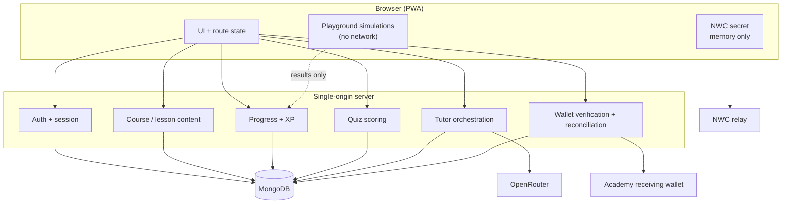
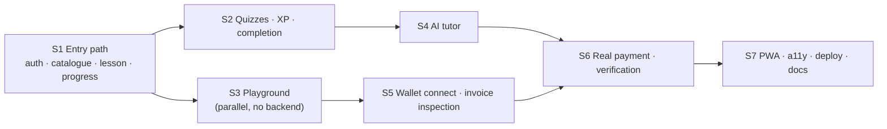

# KAOS Bitcoin Academy — Product, Learning Architecture and Technology Audit

**Date:** November 1, 2026
**Mode:** Read-only research, inspection and recommendation. Nothing executed.
**Governing spec:** `PRD.md` (immutable; checksum verified before and after)
**Repository state:** documentation only — no `package.json`, no source, no dependency manifest.
**Status:** recommendations are **not** approvals. Owner decisions remain pending and are listed in §13–§14.

---

## 1. Executive Summary

The product is coherent and buildable. Three things were missing, and this audit supplies them: **a learning model** (not just a course list), **a content architecture** (how lessons are stored, versioned and reviewed), and **a defensible reason for the real payment** (not merely a technical demonstration).

**Five decisions shape the build:**

1. **Learning model: "Learn → Check → Practise → Prove."** Every lesson ends in a knowledge check; every module ends in a scenario assessment; simulations are *labs* linked from the lesson that needs them, not a separate arcade. This prevents the academy becoming a pile of articles and quizzes, and it satisfies the PRD's rule that gamification "must reward demonstrated understanding, not merely time spent on platform" (§5.1 Module D).

2. **Content is data, not code.** Lessons are Markdown documents in MongoDB, seeded from the repository, rendered through a strict sanitizer. This lets content be authored, reviewed, versioned and published without redeploying, and it keeps a single source of truth for the AI tutor's grounding.

3. **Curriculum: eight courses in the catalogue, one course complete.** Bitcoin 101 is authored end to end for submission; the other seven publish their first module and are clearly marked as continuing. The PRD's eight-course catalogue is satisfied; the claim "eight complete courses" is not made because it would not be true in 18 days (§5).

4. **The payment is a capstone, not a feature.** It is unlocked after Bitcoin 101, Wallets, Using Bitcoin, Lightning and Staying Safe, behind a readiness check. It is optional, capped, disclosed, and unlocks **no content**. Free access is an approved product decision (§24), so the payment cannot be a fee, and will not be presented as one.

5. **The recipient question is genuinely open.** Sending practice sats to the academy is the simplest and most honest option *if it is disclosed literally*. Routing them to a community or educational recipient is more meaningful *if a real partner exists and consents*. That is an owner decision, not an engineering one (§8).

**Verdict:** if the owner approves D-15, D-04 and D-09, Slice 1 begins immediately. No product requirement blocks it.

---

## 2. Recommended Technology Stack

The stack is already proposed by PRD §9.1. This section explains what each piece owns and where it earns its place — and, where relevant, what is deliberately **not** included.

### 2.1 Frontend

| Choice | Why it is needed | Responsibility | Alternatives | Risks | Slice 1? |
|---|---|---|---|---|---|
| **React + TypeScript + Vite** | PRD §9.1; static build fits free hosting and a slow-network audience | UI, routing, client state | Next.js (server runtime the PRD does not need), Svelte | Vite native binaries on Termux — unverified, Test D | **Yes** |
| **Tailwind CSS** | PRD palette and mobile-first layout; no separate CSS architecture to maintain | Design tokens, responsive layout | CSS Modules, vanilla-extract | Utility soup if undisciplined; pin a design-token layer | **Yes** |
| **React Router** | PRD §9.1; deep links to lessons, resumable URLs | Page architecture, route-level code splitting | TanStack Router | None material | **Yes** |
| **TanStack Query** | Server state is the majority of state (courses, progress, tutor) | Caching, retries, loading/error states | Redux Toolkit Query, SWR | Over-fetching if keys are sloppy | **Yes** |
| **React Hook Form + Zod resolver** | Forms are few but validation must match the server | Form state + client validation | Controlled inputs by hand | Duplicate schemas unless shared | Slice 1 (auth) |
| **No global state library** | Session + a little UI state; server cache covers the rest | — | Redux, Zustand | Add Zustand only if a real need appears | — |

**Rendering strategy:** the app is a single-page application. No SSR — the audience needs a cached shell and cheap hosting, not SEO-driven dynamic pages. Route-level `lazy()` keeps the first load small.

**PWA:** `vite-plugin-pwa`, precaching the shell and public content only. Authentication responses, progress, tutor conversations, wallet and payment data are **never** cached (established in the addendum). Offline is read-only; queued writes are deferred (D-07).

**Accessibility:** the PRD palette already passes WCAG AA on `#17140F` — `#FFFFFF` 18.37:1, `#A8A29E` 7.28:1, `#F5B942` 10.41:1 (computed during the discovery phase). Requirements that need engineering discipline, not libraries: visible focus rings, 44 px touch targets, status conveyed by text as well as colour, and no interaction that depends on hover.

### 2.2 Backend

| Choice | Why | Responsibility | Alternatives | Risks | Slice 1? |
|---|---|---|---|---|---|
| **Node + Express + TypeScript** | PRD §9.1; small surface, easy to audit | HTTP API | Fastify (no throughput need) | Express 5 async error handling must be centralised | **Yes** |
| **Zod at every boundary** | One schema per contract, shared with the client types | Request/response validation | Joi, Valibot | Version drift if client and server schemas are duplicated instead of shared | **Yes** |
| **`express-session` + `connect-mongo`** | Instant revocation; no token rotation complexity | Session identity | JWT pair (revocation is harder) | Store must be reachable; cookie flags depend on D-04 | **Yes** |
| **`argon2`** | Password hashing that is memory-hard by default | Credential storage | bcrypt | Build/runtime on Termux to verify (native module) | **Yes** |
| **`helmet`, `express-rate-limit`, `pino`** | Baseline security headers, abuse limits, structured logs | Hardening + observability | Manual equivalents | Logs must redact cookies, keys and payment hashes | **Yes** |
| **Central error middleware** | PRD §13: safe error responses | Stable `{error:{code,message}}` envelope | Per-route try/catch | Stack traces leaking — forbid in production | **Yes** |

**Session over JWT** because logout, wallet revocation and account switching must be immediate, and because the app is same-origin (D-04). JWT would add rotation, revocation lists and clock-skew handling for no benefit here.

### 2.3 Database

| Choice | Why | Responsibility | Alternatives | Risks | Slice 1? |
|---|---|---|---|---|---|
| **MongoDB Atlas + Mongoose** | PRD §9.1; document-shaped course content; free tier sufficient | Persistent learning records | PostgreSQL (relational progress is a good fit too) | No joins — must denormalise deliberately; transactions need a replica set | **Yes** |

**Is MongoDB appropriate?** Yes, with one caveat. Course/lesson documents are naturally hierarchical (course → modules → lessons → sections), read-heavy, and schema-flexible across lesson types; embedding is the right model. The caveat is progress: it is relational in shape (user × lesson × time). Recommendation: a separate `progress` collection with a unique compound index `{userId, lessonId}`, plus a derived `courseProgress` recomputed on write — not an array embedded in the user document, which would grow unbounded and race under concurrent completions.

**Content versioning:** each lesson carries `status` (`draft|published|archived`), `version` (integer), `updatedAt` and `reviewedBy`. Publication is a status change, not a redeploy. Lessons are addressed by a stable `slug`, never by `_id`, so content can be replaced without breaking links. Draft content is invisible to learners but visible to the AI tutor only in preview environments.

**Indexes that must exist from day one:** `users.email` (unique), `progress.{userId,lessonId}` (unique), `progress.{userId,updatedAt}` (dashboard), `lessons.{courseId,order}`, `lessons.slug` (unique), `sessions` (TTL), `conversations.{userId,createdAt}`.

### 2.4 AI tutor

| Choice | Why | Responsibility | Alternatives | Risks | Slice 1? |
|---|---|---|---|---|---|
| **OpenRouter, called server-side with `fetch`** | One key, provider fallback, no SDK lock-in | Model access | Direct provider SDK | Vendor availability; pricing changes | No (Slice 4) |
| **Primary model `openai/gpt-oss-120b`, fallback `openai/gpt-4o-mini`** | Verified pricing: $0.020/$0.075 and $0.150/$0.600 per 1M tokens (1 Nov 2026) | Explanation quality at low cost | Mistral Nemo ($0.029/$0.030) | Model availability rotates | No |
| **Server-composed grounding, no tools, no DB access** | Prevents fabricated balances, payments and protocol facts | Context assembly | Retrieval/vector DB | Over-grounding makes answers stiff | No |

**No vector database.** Retrieval is deterministic: the tutor is scoped to the current `lessonId` (and its course objectives + glossary). Embeddings add infrastructure and an evaluation burden for a corpus that fits in a prompt. Revisit only if the tutor must answer across the whole catalogue.

### 2.5 Bitcoin and Lightning

Unchanged from the architecture reports and still conditional: **NWC for the learner's wallet**, and a **separate academy receiving wallet** (LNbits invoice key, or an academy wallet over its own NWC connection). The learner connection is outbound only; receiving is a second component. Simulations are client-side and never touch a network.

### 2.6 Deployment and operations

| Choice | Why | Responsibility | Alternatives | Risks | Slice 1? |
|---|---|---|---|---|---|
| **Single origin: Express serves the built SPA and `/api`** | Cookies work without third-party-cookie dependence (D-04) | Hosting topology | Separate Netlify + Render (breaks `SameSite=Lax` auth) | Cold start delays first paint | **Yes** |
| **Render free web service** | 750 instance-hours/month; free | Runtime | Fly.io, Railway | Spins down when idle; ephemeral filesystem; ~1 min cold start (previously observed, approximate) | **Yes** |
| **MongoDB Atlas M0** | 512 MB, ~100 ops/s, free | Database | Self-hosted (impossible on Termux) | 30-day idle pause | **Yes** |
| **Health endpoint + structured logs** | Detect cold starts and failures during judging | Observability | Full APM (not free) | Logs must be redacted | **Yes** |
| **Atlas backup** | M0 has no point-in-time restore | Recovery | Manual `mongodump` to the device | Content and progress loss | Before public demo |

**Backups:** the PRD asks for persistent progress, and M0 does not provide managed backups. The smallest defensible practice is a scheduled logical export of the content and progress collections before the demo, stored outside the project directory. This is an operational task, not application code.

---

## 3. System Responsibility Map

Every question below has exactly **one** owner of truth. Ambiguity here is how data leaks and wrong payment states get built.

| Question | Owner of truth | Never |
|---|---|---|
| Is this user authenticated? | Session store | Client flags, localStorage |
| Is this lesson published? | `lesson.status` | Frontend route list |
| Has this learner completed this lesson? | `progress` unique record | Local state, XP counters |
| What is this learner's score? | Server scoring on submit | Client-computed score |
| Is a wallet connected **right now**? | The browser only | The backend record |
| Has this invoice settled? | The receiving wallet | The browser, the payer, the tutor |
| What did the tutor say? | Conversation records | Reconstructed from memory |
| Is this a simulation? | A mandatory `SimulationBadge` component + `data-simulation` marker | Styling alone |

---

## 4. Learner Journey

### 4.1 First visit → practical competence

| Stage | What happens | Purpose | PRD anchor |
|---|---|---|---|
| **1. Arrival** | One-screen promise: "Understand Bitcoin. Try it safely. No prior knowledge needed." Three entry points: Start, Browse courses, How it works | Remove intimidation; state that no wallet or money is required | §8.1 |
| **2. Preview** | One introductory lesson readable without an account, with a persistent "Save your progress" prompt | Let the learner experience the teaching before trusting it with an account | §8.1 step 3 ("Register or begin the available introductory experience") |
| **3. Registration** | Email + password; no wallet, no phone number, no crypto knowledge | Minimum data; PRD privacy | §13 |
| **4. Course discovery** | Catalogue with level, time estimate, and "start here" ordering | Show a path, not a menu | FR-002 |
| **5. Module navigation** | Course → modules → lessons, with completion ticks and resume | Orientation; never lose the thread | §5.1 Module A |
| **6. Lesson loop** | Read → check → practise → prove (below) | Understanding, not consumption | FR-003/004 |
| **7. Module assessment** | Scenario questions with explanations | Test transfer, not recall | FR-005 |
| **8. Dashboard** | Continue learning, progress, XP, next lesson | Re-entry point for returning learners | FR-011 |
| **9. Revision** | "Review weak spots" from missed questions; tutor scoped to those lessons | Retention | §5.1 Module C/D |
| **10. Capstone** | Wallet connection + guided payment, after readiness check | Convert theory into verified experience | FR-009/010 |

### 4.2 The lesson loop

**Learn** (concept, ≤ 6 minutes of reading) → **Check** (1–2 inline questions with immediate feedback) → **Practise** (a simulation lab or a guided exercise, where the lesson calls for one) → **Prove** (lesson completion + a short scenario question that cannot be answered by skimming).

The "Prove" step is what stops passive completion. It is one question, server-scored, and it explains *why* each option is right or wrong.

### 4.3 Progression model

- **Linear within a course, open across courses.** Any published course can be started; nothing is locked except the payment capstone.
- **No time gating.** The PRD explicitly rewards understanding over time spent.
- **Resume, don't restart.** `lastAccessedAt` drives "Continue" on the dashboard.
- **Returning learners** see: current course, next lesson, recent achievement, and a short "pick up where you left off" card.
- **Reinforcement:** missed quiz questions feed a review queue; the tutor can be asked to re-explain the exact lesson.

---

## 5. Proposed Curriculum

Eight courses, as required by PRD §6. Each is designed as **modules of 3–5 lessons**, not as a reading list. Levels: **B** beginner, **B+** beginner-plus, **I** intermediate.

### 5.1 Course map

| # | Course | Level | Modules | Practical activity | Assessment | Outcome |
|---|---|---|---|---|---|---|
| 01 | **Bitcoin 101** | B | M1 What money is and why Bitcoin exists · M2 Bitcoin in plain language · M3 What Bitcoin is *not* · M4 Your first safe steps | "Spot the claim" — sort 6 statements into fact / hype / scam | 8-question scenario quiz | Explain Bitcoin to a friend and name three risks |
| 02 | **Money and Bitcoin** | B | M1 Functions of money · M2 Scarcity, inflation, purchasing power · M3 Centralised vs decentralised · M4 Local context: remittances and unstable currencies | Fictional inflation calculator (no real figures asserted) | Scenario quiz | Explain *why* scarcity matters without predicting price |
| 03 | **How Bitcoin Works** | B+ | M1 Transactions and UTXOs · M2 Hashing and blocks · M3 Mining and proof-of-work · M4 Nodes and consensus | Block builder + hash avalanche lab | Label a transaction diagram | Describe how a payment becomes final |
| 04 | **Bitcoin Wallets** | B+ | M1 Keys and addresses · M2 Seed phrases and custody · M3 Wallet types · M4 Backups and common mistakes | Fictional wallet creation lab (never a real mnemonic) | Custody scenario quiz | Choose a wallet type and explain the trade-off |
| 05 | **Using Bitcoin** | B+ | M1 Receiving · M2 Sending and fees · M3 Confirmations and mempool · M4 Practical safety | Simulated send/receive with mempool states | Fee and confirmation scenarios | Predict what happens at each fee level |
| 06 | **Lightning Network** | I | M1 Why Lightning · M2 Channels and routing · M3 Invoices · M4 Authorisation, settlement, failure | Invoice anatomy inspector | Read a real invoice and identify every field | Explain expiry vs failure before touching a wallet |
| 07 | **Staying Safe** | B | M1 Scams and phishing · M2 Custody risk · M3 Everyday opsec · M4 Recovery and support | Scam triage sorting exercise | Triage 8 scenarios | Refuse a plausible scam and say why |
| 08 | **Beyond Bitcoin** | I | M1 Nostr and identity · M2 Applications and payments · M3 Developer paths · M4 Next steps | Explore a block explorer; read an invoice | Short guided project | Name one path to keep learning |

**Required prior knowledge:** 01 → none. 02, 03, 04, 05, 07 → 01. 06 → 03 + 05. 08 → 06. The payment capstone requires 01, 04, 05, 06, 07.

### 5.2 Realistic initial scope

| Deliverable at submission | Scope | Why |
|---|---|---|
| Bitcoin 101 | **Complete** (4 modules, ~10 lessons, 2 assessments) | It is the "introductory learning journey" named in §25 |
| Courses 02–08 | **First module published**, remainder visibly "in development" | Keeps the eight-course catalogue honest without pretending |
| Playground | 6 simulations | Required by FR-007 / AC-008 |
| Tutor | Lesson-scoped Q&A | FR-008 |

This is an interpretation of §6, not a silent change: the catalogue contains eight courses; content is staged. It requires **D-09** approval.

### 5.3 Content quality

| Requirement | Mechanism |
|---|---|
| Technical accuracy | Every published lesson passes a named reviewer; Lightning/wallet lessons get a second safety pass |
| Consistent terminology | A single glossary (`glossary` collection) with one canonical definition per term; lessons link terms instead of redefining them |
| Sequencing | Each lesson declares `requires: [lessonSlug]`; the seeder rejects a published lesson whose prerequisites are unpublished |
| Review and update | `status` + `version` + `reviewedAt`; a published lesson cannot be edited in place without a version bump |
| Distinguishable from AI output | Every lesson has an author and reviewer; AI-drafted passages are reviewed and rewritten for voice; the tutor's answers are labelled as tutor output, never merged into lesson text |
| Comprehension testing | 5 learners per course module answer the "Prove" question; a question missed by ≥ 3 is rewritten before publication |

**African-first accessibility rules:** 200–250 words per screen section; one new term per 150 words; every technical term defined on first use and in the glossary; local examples (airtime, mobile money, remittances, market trading) with no invented statistics; no assumption of a funded wallet, a bank account, or uninterrupted data; images ≤ 100 KB, diagrams as inline SVG; no video required for any lesson.

---

## 6. Lesson Content Template

| # | Section | Purpose | Budget | Rule |
|---|---|---|---|---|
| 1 | **Introduction** | Why this matters to *this* learner | 80–120 words | Start with a situation, not a definition |
| 2 | **Learning objectives** | What you will be able to do | 3 bullets | Verbs: explain, identify, predict, choose |
| 3 | **Concept explanation** | The idea, in order | 400–700 words | One new term per 150 words; define on first use |
| 4 | **Practical examples** | Two worked examples | 150–250 words | One local, one general |
| 5 | **Visual / interactive** | Diagram or lab | 1 item | Lab is linked, not embedded; simulations labelled |
| 6 | **Knowledge checks** | 2–3 inline questions | 3 questions | Immediate feedback with an explanation |
| 7 | **Summary** | The five things to remember | 5 bullets | No new concepts |
| 8 | **Next step** | What this unlocks | 1 sentence | Deep link to the next lesson |

**Worked skeleton (01 · M2 · "What Bitcoin actually is"):** a market-trader scenario asks why a mobile-money balance can be frozen but a Bitcoin balance cannot be — then explains the ledger, then a diagram of a shared record, then a "which part is decentralised?" check, then three summary bullets, then "next: what Bitcoin is not".

**Deliberate omissions:** no price charts, no "number go up" framing, no projected returns, no claims about adoption that cannot be sourced.

---

## 7. Bitcoin and Lightning Learning Progression

Three environments, one progression. The distinction must be enforced by the interface, not by prose.

| Environment | What it teaches | Where it lives | What it can never do |
|---|---|---|---|
| **A. Conceptual** | Money, keys, addresses, transactions, fees, confirmations, channels | Lessons + diagrams | Imply that reading produces competence |
| **B. Safe experimentation** | Transaction structure, hashing, blocks, wallet mechanics, invoice anatomy | Playground, client-side only | Send, sign, or broadcast anything; be mistaken for a real transaction |
| **C. Real-world Lightning** | Invoice, approval, settlement, verification, failure | Wallet lab, after readiness | Hold learner funds; request seeds; hide the amount |

### 7.1 Concept → environment map

| Concept | A: Lesson | B: Lab | C: Real |
|---|---|---|---|
| Private key ↔ address | 04 M1 | Fictional key/address generator | — |
| Seed phrase custody | 04 M2 | Backup/restore drill (fictional) | — |
| Transaction structure | 03 M1 | UTXO builder | — |
| Fees and confirmation | 05 M2–M3 | Mempool simulator | — |
| Block and proof-of-work | 03 M2–M3 | Block builder + hash avalanche | — |
| Lightning channels | 06 M1–M2 | Channel balance visualiser | — |
| Invoice anatomy | 06 M3 | Invoice inspector | Inspect the real invoice before paying |
| Approval and settlement | 06 M4 | Simulated payment states | **The guided payment** |
| Verification | 06 M4 | "Which evidence proves payment?" exercise | Receipt with hash and amount |

### 7.2 Simulation integrity rules (AC-009)

1. Every simulation page carries a persistent banner: **"Simulation — no Bitcoin is involved."**
2. Simulation results are never stored as payments, never produce a receipt, and never appear in the wallet section.
3. The wallet section uses a different visual container and an explicit "Real network" label.
4. The word "transaction" in a simulation is always qualified ("simulated transaction").
5. The payment receipt is the only artefact with a payment hash, and it is visibly distinct from lab output.

### 7.3 What a learner must be able to do before C

- Distinguish an address from an invoice.
- State that a Lightning invoice encodes an amount, a recipient and an expiry.
- Explain that approving in the wallet is the authorisation step, not clicking a button on the website.
- Explain that an expired invoice means *nothing was sent*.
- Explain that verification means the receiver confirmed settlement.

---

## 8. Payment Educational Purpose and Recipient Options

### 8.1 The ten questions

| # | Question | Answer |
|---|---|---|
| 1 | What learning objective does a real payment achieve? | Convert four abstract ideas — invoice, authorisation, settlement, verification — into one observed event the learner caused. Nothing else in the academy can produce that observation. |
| 2 | Which lessons first? | Bitcoin 101, Wallets, Using Bitcoin, Lightning, Staying Safe. |
| 3 | What must be understood before connecting? | Keys/addresses vs invoices; custody; that the wallet — not the site — authorises; fees exist; loss is possible. |
| 4 | What should the learner identify in an invoice? | Amount in sats, description, recipient node/payee, expiry, network (mainnet), and that it is single-use. |
| 5 | What does approving teach? | That the wallet is the authority; the site only *requests*. This is the single most important safety concept in the course. |
| 6 | How is settlement explained? | "Your wallet reported success. The receiver independently confirmed the money arrived. We trust the receiver's record, not the browser's message." |
| 7 | What happens on disconnect, low balance, refusal, timeout? | Each has its own message and none is called "failed" unless the receiver says so (§9.3). |
| 8 | Expired vs failed? | Expired = the request closed before payment; no money moved. Failed = an attempt was made and did not complete. Unknown = not yet confirmed — never shown as failure. |
| 9 | How is the learner protected? | Fixed tiny amount, explicit confirmation screen, no auto-pay, no stored secret, no seed phrase ever, clear "this is real money" disclosure, and an easy exit. |
| 10 | **Why does the recipient receive the funds?** | Because the learner is making a real, voluntary transfer as practice; the recipient is the counterparty that makes settlement observable. The payment is **not** tuition, **not** a subscription, and unlocks **no content**. |

Question 10 is the one that cannot be answered by engineering. The recipient must be named on the confirmation screen, and the reason must be true.

### 8.2 Recipient options

| Option | Advantages | Disadvantages | Trust implications | Operational requirements | Educational value |
|---|---|---|---|---|---|
| **A. Academy-controlled receiving wallet** | Simplest; one counterparty; full control of amount, timing and disclosure; receipt can be precise | Money visibly goes to the academy; risk of reading as a fee despite wording; sats accumulate | High if disclosed literally; "practice transfer, not a fee" must be explicit and repeated | Receiving wallet, invoice key, float management, disclosure copy | High — the learner sees a real transfer complete |
| **B. Designated educational/community recipient** | Strongest narrative; supports the ecosystem; feels less self-interested | Requires a real, consenting partner; custody and accounting questions; partner may be unreachable during the demo | High if the partner is real and named; catastrophic if implied and not arranged | Partner agreement, recipient wallet, disclosure, evidence of destination | High, plus civic meaning |
| **C. Learner's own second wallet** | No third party; no custody question | Requires two wallets; often fails without channel liquidity; "recipient receives" is the learner themselves | Neutral | None | Low — it teaches mechanics but not counterparty trust |
| **D. Merchant / voucher purchase** | Real-world utility (airtime, goods) | Merchant integration, refunds, price volatility, out of hackathon scope | Depends on merchant | Merchant integration | Very high, but not feasible now |
| **E. Regtest / signet only** | No real funds; safe rehearsal | Not a real network payment; cannot satisfy AC-014 as written | None | Node or hosted regtest | Medium as rehearsal, insufficient as evidence |

**[R] Recommendation: A, with literal disclosure, unless the owner can secure a real partner for B.** Option A is chosen for feasibility, not because it is the most meaningful. Option B is better education *if* the partnership is real; inventing a recipient would be worse than choosing A.

**Minimum practical amount: 21 sats** (symbolic, tiny, well above Lightning's 1-sat floor). It must be fixed in code, displayed before approval, and capped server-side. The owner decides the exact value and who funds it (**P-01, P-02**).

**Explicitly rejected:** presenting the payment as a fee, a donation without a recipient, an investment, or a "verification charge".

---

## 9. Proposed Guided Payment Experience

### 9.1 The seven stages

| Stage | Learner sees | Learner does | Learns | System verifies | Can go wrong | Failure communicated as |
|---|---|---|---|---|---|---|
| **1. Prerequisites** | "You've completed the five lessons that make this make sense" + list | Taps Continue | That this is earned, not gated content | Completion records for 01, 04, 05, 06, 07 | Learner skipped a lesson | "Finish *Lightning: Invoices* first" with a deep link |
| **2. Readiness check** | 6 scenario questions (address vs invoice, expiry, approval, verification) | Answers | Whether they are ready | Server-side score ≥ 5/6 | Score below threshold | "Review these two lessons, then come back" — no shame language |
| **3. Wallet connection** | "Connect a Lightning wallet. We never see your keys." | Pastes an NWC URI or scans a QR | Wallet holds the authority, not the site | `get_info` answered by the wallet; methods include `pay_invoice` | No NWC support; relay unreachable; wallet refuses | "We couldn't reach your wallet" (never "disconnected" when it is unknown) |
| **4. Invoice inspection** | A real invoice with each field highlighted: amount, description, recipient, expiry, network | Reads, then ticks "I understand this is real money" | What an invoice actually is | Server created the invoice; amount and expiry match the intent | Invoice already expired; wrong amount | "This invoice expired before payment. Nothing was sent." |
| **5. Payment approval** | "Your wallet will ask you to approve 21 sats" | Approves **in the wallet** | Authorisation happens in the wallet; the site can only request | Request dispatched; wallet-side approval is visible to the learner | Balance too low; user refuses; wallet errors; relay timeout | Distinct messages per cause (§9.3) |
| **6. Settlement verification** | "Confirming with the receiver…" | Waits, or leaves and returns | Verification is receiver-side, not a website claim | Receiver reports settled, amount and hash match | Late settlement; tab closed; network loss | "We're still confirming. Do not pay again." |
| **7. Learning reflection** | Receipt: amount, hash (shortened), time, what was verified; three reflection prompts | Answers "what did your wallet do that this site could not?" | Consolidation — the actual learning | Receipt is derived from verified data only | Learner closes early | Receipt remains retrievable from the dashboard |

### 9.2 Design rules

- **No auto-payment.** Every payment is an explicit, per-invoice action.
- **The site never claims to have paid.** It reports what the receiver confirmed.
- **The learner can always leave.** Verification continues server-side; the receipt appears later.
- **One active payment intent per learner.** A second attempt returns the existing intent.

### 9.3 Failure taxonomy (AC-015)

| Situation | Learner message | Never say |
|---|---|---|
| Wallet unreachable | "We couldn't reach your wallet. Check your connection, then try again." | "Wallet disconnected" |
| Insufficient balance | "Your wallet doesn't have enough sats for this practice payment." | "Payment failed" |
| Learner refuses in wallet | "You cancelled in your wallet. Nothing was sent." | "Payment failed" |
| Relay timeout, no evidence | "We're still confirming this payment. Do not pay again." | "Failed" / "Expired" |
| Invoice expired unpaid | "This invoice expired and no payment was received." | "Payment failed" |
| Receiver reports failure | "The payment didn't complete. No money left your wallet for this attempt." | "Something went wrong" |
| Settled after expiry | "Payment confirmed — it arrived just after the invoice expired." | "Expired" |

---

## 10. AI Tutor Role

### 10.1 What the tutor is for

A **teaching assistant scoped to the lesson the learner is reading**, not a general Bitcoin oracle and not a wallet interface.

| Allowed | Not allowed |
|---|---|
| Explain a concept in simpler words | Predict prices or give investment advice |
| Give a second example, including local ones | Assert a wallet balance, payment status, or confirmation count |
| Generate practice questions from the current lesson | State protocol facts outside the curated corpus without hedging |
| Check understanding and correct misconceptions | Request seeds, keys, or NWC URIs |
| Point to the exact lesson that answers a question | Claim a payment succeeded or failed |
| Admit uncertainty and stop | Produce a "guaranteed safe" wallet statement |

### 10.2 Context assembly

Server-side, deterministic, and bounded:

1. System policy (role, refusals, tone, uncertainty rules).
2. Course objectives + current lesson body (truncated to a character budget, not a token guess).
3. Glossary entries for terms used in that lesson.
4. A **server-composed progress summary**: course title, current lesson, completion band (`none|started|half|complete`), last quiz band (`below|at|above`). No email, no identifiers, no payment data.
5. The learner's question, delimited as untrusted input.

**Should the tutor see progress?** A narrow summary, yes — it lets the tutor say "you've just finished invoices, so let's use that" instead of re-explaining from zero. It must never be raw records, and it must never include payment status: a tutor that says "your payment succeeded" is a tutor that can lie about money.

### 10.3 Failure and cost behaviour

- 20 s timeout → one retry → deterministic fallback that quotes the relevant lesson passage.
- Rate limit: 10 requests/minute and 100/day per learner; global daily token ceiling.
- Every conversation stores the lesson context id, model, token counts and a safety flag — never the API key, never the raw prompt with PII.
- The tutor is never a dependency: lessons, quizzes and the playground work with the provider down.

### 10.4 Minimal scope for submission

Lesson-scoped Q&A, "explain simpler", "give an example", and 3 suggested questions per lesson. Deferred: revision mode across a whole course, generated quizzes, voice, multilingual, progress-aware study plans.

---

## 11. Implementation Roadmap

| Slice | User-visible result | PRD | Tech | Depends on | Acceptance | Testable without external services | Needs external infra |
|---|---|---|---|---|---|---|---|
| **S1** Nov 3–6 | Register, read a real lesson, completion persists, dashboard updates | FR-001–004, FR-011; AC-001–004, AC-007 | React, Express, Mongo, sessions | D-15, D-04, D-09 | AC-001–004, AC-007 | UI, validation, scoring logic, auth flow (with a local/CI Mongo) | Atlas |
| **S2** Nov 6–8 | Quizzes with feedback, XP, course completion | FR-005, FR-006, FR-012 (partial); AC-005, AC-006 | Server scoring | S1 | Score correctness, idempotent attempts | Fully (unit + integration) | Atlas |
| **S3** Nov 4–8 | Six labelled simulations | FR-007; AC-008, AC-009 | Client-only crypto/hash libs | None | Every simulation labelled; no network calls | Fully | None |
| **S4** Nov 9–11 | Tutor answers from the current lesson; refuses unsafe asks | FR-008; AC-010, AC-011 | OpenRouter, grounding | S1, S2 | Adversarial set passes; provider-down fallback | Prompt assembly + refusal logic | OpenRouter key |
| **S5** Nov 11–13 | Connect a wallet, inspect a real invoice, see capabilities | FR-009; AC-012, AC-016 | NWC (browser-held) | Spike, D-02 | `get_info` round trip; secret never transmitted | URI parsing; state machine | Relay, wallet, receiving wallet |
| **S6** Nov 13–16 | Complete and verify a 21-sat practice payment with a receipt | FR-010; AC-013–015 | Receiving wallet + reconciler | S5, D-01, D-03, D-06 | Verified settlement; expiry vs failure correct | State machine with fakes | Receiving wallet, funds, real invoice |
| **S7** Nov 16–19 | Installable, fast, accessible, publicly deployed, documented | AC-017, AC-018 | PWA, CI, Render | All | Lighthouse, mobile checks, cold-start rehearsal | Build + a11y checks | Render |

**Critical path:** S1 → S2 → S5 → S6. S3 and S4 run in parallel and must not be allowed to delay S6.

---

## 12. Cost and Feasibility Assessment

### 12.1 Recurring costs (verified 1 Nov 2026 unless noted)

| Service | Free tier | Limit that actually bites | Paid escape | Cost |
|---|---|---|---|---|
| Render web service | 750 instance-hours/month | Spins down when idle; ephemeral filesystem; ~1 min cold start (approximate, observed earlier) | Starter instance | ~$7/month (listed price; verify at signup) |
| MongoDB Atlas M0 | 512 MB (verified 30 Oct 2026), 100 ops/s | 30-day idle pause; no managed backups | Flex tier | > $0, not needed |
| OpenRouter | Pay per token | — | — | `gpt-oss-120b` $0.020 in / $0.075 out per 1M; `gpt-4o-mini` $0.150 / $0.600 |
| Domain | — | Optional; the platform subdomain is a single origin | Registrar | ~$12/year (not verified) |
| LNbits | Self-host or hosted | Hosting + funding source | Hosted plan | **Unverified** — depends on D-01 |

**Tutor cost per turn** (≈1,500 input + 350 output tokens): **$0.00006** on `gpt-oss-120b`, **$0.00044** on `gpt-4o-mini`. 1,000 turns: **$0.06** and **$0.44** respectively. Cost is not the constraint; rate limits and grounding quality are.

**Realistic hackathon run cost: $0–$7.** The only plausible paid item is a Render instance to avoid cold starts during judging.

### 12.2 Deadline assessment (Nov 20, 18 days)

| Category | Items |
|---|---|
| **Must have** | S1–S3, tutor, wallet connect, verified payment, deployment, README |
| **Simplify** | XP as a single counter (not a badge engine); one assessment per course; six simulations, not twelve; tutor = lesson-scoped Q&A only |
| **Defer** | Certificates (FR-014), multiple learning paths (FR-013), community features (FR-015), advanced developer tracks (FR-016), offline writes, i18n |
| **Highest risk** | Content authoring (17+ lessons) and the wallet vertical, in that order |
| **Integration risk** | Free-tier cold starts during the live demo; wallet/relay availability; OpenRouter latency |

**Content is the long pole, not code.** 17 lessons at 2 hours each is ~34 hours on top of ~80 hours of engineering in 18 days. The only honest mitigations are: draft with AI and review every line, publish depth-first (Bitcoin 101 complete) rather than breadth-first, and start authoring in parallel with S1 — not after it.

---

## 13. Unresolved Product Decisions

These are product decisions, separate from the engineering decision register (D-01…D-15). None is approved here.

| ID | Question | Options | Recommendation | Consequence of delay | Blocks |
|---|---|---|---|---|---|
| **P-01** | Who receives the practice payment, and why? | A academy · B community partner · C self · D merchant | A with literal disclosure, unless B is real | Slice 6 cannot be built or scripted | S6 |
| **P-02** | Amount and funding source | 21 sats learner-funded · academy-funded · both | 21 sats, learner-funded, capped | Consent copy and caps undefined | S6 |
| **P-03** | Does the preview lesson work without an account? | Yes · No | Yes, one lesson | Onboarding flow forks | S1 (small) |
| **P-04** | Curriculum depth at submission | 8 complete · Bitcoin 101 complete + 7 first modules · fewer courses | Bitcoin 101 + first modules | Content work cannot be sequenced | S1 content |
| **P-05** | Tutor access to progress | None · banded summary · full records | Banded summary | Tutor prompt design unresolved | S4 |
| **P-06** | Community partner, if B chosen | Identify/consent · not now | Not now | Only relevant if B | S6 |

---

## 14. Owner Approvals Required

| Approval | Why it is needed now |
|---|---|
| **D-15** — start implementation (scaffold, dependency batch, Atlas free cluster) | Nothing can be created without it; AGENTS.md forbids unapproved scaffolding |
| **D-04** — confirm single-origin topology | Cookie flags and CORS decisions are written in S1 |
| **D-09 / P-04** — curriculum scope | Determines what is authored first and what the catalogue claims |
| **D-07** — offline scope (read-only cache) | Determines the service-worker policy in S1 |
| **P-03** — preview without account | Small, but changes the S1 route guard |
| **P-01 / P-02** — recipient, amount, funding | Needed before S6, **not** before S1 |
| **D-02, D-01, D-06, D-11** | Wallet vertical; independent of S1–S4 |

**D-03, D-05, D-08, D-10, D-12 (OD-001), D-13, D-14 and P-05/P-06 remain pending** and do not block Slice 1.

---

## 15. Final Decision

**Yes — if the owner approves D-15, D-04, D-09 and P-03, the project is ready to begin Slice 1 immediately.**

Slice 1 is not a prototype or an infrastructure exercise: it delivers a working registration, a real Bitcoin 101 lesson, persistent completion, and a dashboard that reflects it — the spine every later slice attaches to.

**What remains genuinely unresolved is the wallet vertical**, and it is deliberately isolated: the product can ship, teach and be demonstrated without it, but AC-012–AC-015 cannot be claimed until the spike and D-01/D-02/D-06 are settled.

**No further audit is recommended.** The next action is implementation under approval.

---

## Appendix — Sources

| Source | URL | Accessed | Used for |
|---|---|---|---|
| OpenRouter model catalogue | https://openrouter.ai/api/v1/models | 1 Nov 2026 | Verified model IDs and per-token pricing |
| Render free-tier docs | https://render.com/docs/free | 1 Nov 2026 | 750 instance-hours, ephemeral filesystem, spin-down |
| MongoDB Atlas free-tier limitations | https://www.mongodb.com/docs/atlas/reference/free-shared-limitations/ | 1 Nov 2026 | 100 ops/s, 30-day idle pause (512 MB verified 30 Oct 2026) |
| NIP-47 | https://github.com/nostr-protocol/nips/blob/master/47.md | 1 Nov 2026 | `make_invoice`, `lookup_invoice`, `get_info.methods`, URI roles |
| LNbits v1.6.2 source | https://github.com/lnbits/lnbits/tree/v1.6.2/lnbits/core | 1 Nov 2026 | Invoice key scope, payment states, expiry-as-failed |
| `PRD.md` | local, immutable | — | §5–§8, §12–§18, §24–§25 |

*End of report. No application code, configuration, dependency, PRD, existing report or Git state was modified.*
