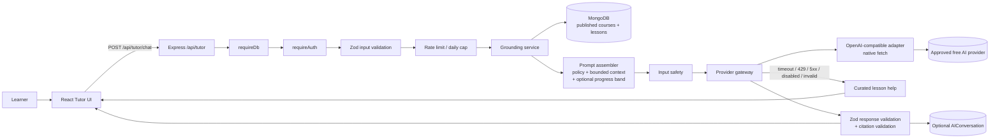

# KAOS Bitcoin Academy — S4 AI Tutor Readiness and Decision-Resolution Audit

- Project: KAOS Bitcoin Academy
- Phase: S4 — Contextual AI Tutor
- Date: 2026-11-07
- Repository: `/data/data/com.termux/files/home/kaos-bitcoin-academy`
- Audit type: Read-only product, architecture, security, and implementation-readiness audit
- Result: **AUDIT COMPLETE — NO S4 IMPLEMENTATION, DATABASE WRITE, EXTERNAL PROVIDER CALL, DEPLOYMENT, OR GIT WRITE PERFORMED**
- Authoritative specification: `PRD.md`
- PRD SHA-256 before audit: `1e73e32cd99629099ee143ff5377555296c20fb4489263c3c57c3a25dc50c23d`
- PRD SHA-256 after audit: `1e73e32cd99629099ee143ff5377555296c20fb4489263c3c57c3a25dc50c23d`
- Git HEAD before audit: `39093b3f94f93f2dd15f7ca264c8583df1420187`
- Git HEAD after audit: `39093b3f94f93f2dd15f7ca264c8583df1420187`

> **Status statement:** S4 is architecture-ready, but it is **not approval-ready**. The recommended architecture and implementation phases are defined below, but S4 implementation must not begin until the owner resolves Z-01, P-05, the AI provider/model/data policy, and the AI-generated-practice-question and conversation-retention decisions.

---

## 1. Executive summary

S4 is the PRD's **KAOS AI Tutor**: a contextual educational assistant, not a general-purpose Bitcoin chatbot. The PRD requires a conversational interface, lesson-aware assistance, beginner-friendly explanations, alternative explanations, African-context examples, follow-up questions, practice question generation, uncertainty handling, curated educational grounding, and strict prohibitions on invented transactions, financial advice, protocol specifications, and wallet-security guarantees.

The current repository has **no AI implementation**:

- No tutor route, controller, service, prompt, provider adapter, conversation model, or tutor UI.
- No AI SDK dependency in either workspace.
- No AI-related environment variables in `server/src/config.ts` or `server/.env.example`.
- No dashboard tutor entry.
- No AI integration or negative tests.

The repository does contain strong reusable foundations:

- React 19, TypeScript, Vite, Tailwind, React Router, and TanStack Query on the client.
- Node.js, Express 5, TypeScript, MongoDB/Mongoose, Zod, `express-session`, `express-rate-limit`, Pino, and Helmet on the server.
- Session authentication with server-derived ownership.
- Published-only course and lesson retrieval.
- Central error handling and JSON validation.
- A Node test runner with `tsx`, including server-side React rendering tests in the existing S3 test suite.
- A production SPA route test and client-bundle secret scan.

The recommended S4 architecture is:

1. A **lesson-scoped tutor UI** opened from a lesson and from the dashboard.
2. A **server-side `/api/tutor/chat` endpoint** protected by database readiness, authentication, input validation, and rate limiting.
3. A **deterministic grounding service** that reads the current published lesson from MongoDB, plus its objectives, summary, section text, and glossary terms.
4. A **provider-independent gateway** using Node's native `fetch`, with a mock adapter for tests and an OpenAI-compatible adapter for the approved provider.
5. A **prompt assembler** with a bounded system policy, bounded lesson context, optional owner-approved progress band, and the learner question delimited as untrusted input.
6. **Output validation and source attribution**, so the UI can show which course and lesson grounded the answer.
7. A **curated lesson-help fallback** when AI is disabled, the provider fails, the quota is exhausted, or the response is unusable.
8. An optional **conversation store** only if the owner approves persistence and retention; otherwise use bounded single-turn or server-session history.

The zero-budget assessment is **conditional**:

- The architecture adds no paid infrastructure and requires no new dependency.
- A free provider tier is still an external operational dependency. The November 1, 2026 figures in the addendum were not re-verified in this audit and must not be treated as current guarantees.
- If no free provider is available, the curated fallback remains useful but the AI-specific requirements (FR-008, AC-010, AC-011 as an AI tutor) cannot be claimed as fully met.
- No paid provider, paid hosting, or paid dependency is recommended.

S1, S2, and S3 remain intact. The current HEAD is `39093b3f94f93f2dd15f7ca264c8583df1420187`. The working tree contains only four pre-existing untracked reports; this audit adds the S4 report. S2's overall browser acceptance remains **not fully closed** per its own report, and S3's owner-confirmed manual browser testing is S3 evidence only; this audit does not infer S2 acceptance from it.

---

## 2. Audit scope, method, and limitations

### 2.1 Documents and source inspected

- `AGENTS.md`.
- The complete 983-line `PRD.md`.
- `reports/KAOS-ACADEMY-REMAINING-ROADMAP-AND-IMPLEMENTATION-GAP-AUDIT.md`.
- `reports/ZERO-BUDGET-FEASIBILITY-ADDENDUM.md`.
- `reports/PRODUCT-AND-LEARNING-ARCHITECTURE-AUDIT.md`.
- `reports/S1-IMPLEMENTATION-REPORT.md`.
- `reports/S2-FINAL-ACTUAL-APPLICATION-ACCEPTANCE.md`.
- `reports/S3-BITCOIN-PLAYGROUND-IMPLEMENTATION-REPORT.md`.
- `reports/S2-PLANNING-AND-ROADMAP-REPORT.md` (S4 section).
- Current client and server source, routes, models, configuration, tests, manifests, and environment-variable names.
- `ENGINEERING-DECISIONS.md` (OD-001 remains open).

### 2.2 Read-only checks performed

- PRD SHA-256 before and after.
- `git rev-parse HEAD`, branch, remotes, and `git status --short`.
- Source and manifest inspection.
- A read-only Node import of the authored content to verify the established counts. It returned:
  - 8 courses.
  - 22 lessons.
  - 30 quizzes.
  - 22 lesson knowledge checks.
  - 8 course assessments.
  - 87 questions.
  - 3 achievements.
  - 166 lesson sections.
  - 22 term/glossary sections.

No test suite, database integration test, seed, migration, destructive command, browser automation, external AI provider call, or deployment was performed.

### 2.3 Limitations

- This is a readiness audit, not an implementation or acceptance test.
- No current free-tier quotas, prices, model availability, or provider privacy terms were re-verified. The addendum's November 1, 2026 figures are historical and are labelled as such.
- No browser was used for this audit. S2 browser acceptance remains not fully closed; S3 has separate owner-confirmed manual browser evidence.
- No database was inspected or modified. The current database counts are taken from the existing S2 acceptance report and authored content. Prior evidence may be stale.
- No legal, privacy, or provider-terms review was performed. Owner approval is required before sending learner text to a third party.
- The report's recommendations do not amend the PRD and do not approve any decision.

---

## 3. S4 requirements extracted from the PRD

The following table uses official PRD section references. Rows beginning `S4-` are audit labels for traceability, not new product requirements.

### 3.1 Explicit PRD requirements

| ID | Requirement | PRD source | Classification | Current status |
|---|---|---|---|---|
| S4-R01 | Conversational interface | §5.1 Module C | Explicit PRD | Not implemented |
| S4-R02 | Context-aware lesson assistance | §5.1 Module C | Explicit PRD | Not implemented |
| S4-R03 | Beginner-friendly explanations | §5.1 Module C | Explicit PRD | Not implemented |
| S4-R04 | Alternative explanations for difficult concepts | §5.1 Module C | Explicit PRD | Not implemented |
| S4-R05 | Examples based on African financial situations | §5.1 Module C | Explicit PRD | Not implemented; lesson content contains local examples |
| S4-R06 | Follow-up questions | §5.1 Module C | Explicit PRD | Not implemented |
| S4-R07 | Practice question generation | §5.1 Module C | Explicit PRD; validation workflow unspecified | Not implemented |
| S4-R08 | Clear uncertainty handling | §5.1 Module C | Explicit PRD | Not implemented |
| S4-R09 | Curated educational material as primary knowledge source | §5.1 Module C | Explicit PRD | Not implemented |
| S4-R10 | Must not invent transaction information, financial advice, protocol specifications, or wallet security guarantees | §5.1 Module C | Explicit PRD prohibition | Not implemented |
| S4-R11 | AI tutor access from the learner dashboard | §8.2 | Explicit PRD | Not implemented |
| S4-R12 | Server-side AI requests, curated knowledge base, contextual lesson retrieval | §9.1 | Explicit PRD architecture requirement | Not implemented |
| S4-R13 | `AIConversation` logical data model | §10 | Explicit PRD logical entity; exact schema to be finalized | Not implemented |
| S4-R14 | Tutor API endpoints: `POST /api/tutor/chat`, `GET /api/tutor/conversations`, `GET /api/tutor/conversations/:id` | §11 | Explicit PRD proposed REST endpoints | Not implemented |
| S4-R15 | AI security: server-side keys, input limits, rate limits, no unnecessary PII, untrusted learner input, no unverified financial instructions as facts | §13 | Explicit PRD security requirement | Not implemented |
| S4-R16 | AC-010: tutor answers questions using educational context; AC-011: tutor handles unsupported questions safely | §14 | Explicit acceptance criteria | Not met |
| S4-R17 | AI integration testing and negative testing, including AI provider failure | §19 | Explicit PRD testing requirement | Not implemented |
| S4-R18 | AI tutor works with contextual educational content, as part of the Definition of Done | §25 | Explicit PRD completion requirement | Not met |
| S4-R19 | Responsive/accessible controls, readable text, graceful slow-network and failure behavior, minimal unnecessary calls | §8.3, §15 | Explicit PRD non-functional requirements | Not implemented for a tutor |
| S4-R20 | No investment recommendations, trading functionality, wallet operation, seed/private-key collection, or paid subscriptions | §16, §5.1 Module E, §13 | Explicit PRD exclusion | No tutor exists; preserve exclusion |
| S4-R21 | AI provider remains an evaluated choice; OpenRouter or another compatible provider is named, but no model is approved | §9.1, §24 | Explicit PRD direction plus open decision | No provider selected |

### 3.2 Expected AI Tutor user experience

The tutor should behave as a **teaching assistant scoped to the lesson the learner is reading**, not as a general Bitcoin oracle and not as a wallet interface.

Required experience:

- Open from a lesson, with the lesson context carried into the tutor.
- Open from the dashboard, with a clear entry point (PRD §8.2).
- Ask a free-form question within a bounded input length.
- Request simpler explanations, examples, or follow-up clarification.
- See a visible distinction between authored lesson content and tutor output.
- See which course and lesson grounded the answer.
- See a clear uncertainty state when the answer is not covered by the curriculum.
- See a usable curated fallback when the provider is disabled, unavailable, rate-limited, or returns an unusable answer.
- See loading, error, retry, and rate-limit states without breaking the lesson page.
- Work on mobile and with keyboard-accessible controls.

### 3.3 Required learner interactions

- Ask a beginner Bitcoin question.
- Ask about the current lesson.
- Ask for a simpler explanation.
- Ask for a local/African example.
- Ask a follow-up question.
- Ask for a practice question (subject to the owner-approved generation policy).
- Receive an answer, a refusal, or a safe redirect.
- Receive source attribution and uncertainty information.
- Reset or start a new conversation.
- Leave the tutor without losing the lesson.

### 3.4 Supported topics and educational scope

Supported topics are the published curriculum:

1. Bitcoin 101.
2. Money and Bitcoin.
3. How Bitcoin Works.
4. Bitcoin Wallets.
5. Using Bitcoin.
6. Lightning Network.
7. Staying Safe.
8. Beyond Bitcoin.

The tutor may explain a topic only when it is supported by the current published lesson or a clearly identified published lesson in the academy. It may give a beginner-friendly general explanation when that explanation is accurate, clearly labelled as general context, and does not invent protocol specifications or financial claims. It must not become a general current-events, price, trading, wallet, payment, or investment assistant.

### 3.5 Required content sources

- Published `Course` records.
- Published `Lesson` records.
- Lesson title, summary, objectives, sections, examples, callouts, reflections, and glossary terms.
- Course title, description, level, and module context.
- Optional, owner-approved progress band derived server-side from existing progress and quiz attempts.
- Authored fallback text derived from the current lesson.
- No quiz answer keys in normal tutor context.
- No email addresses, user IDs, IP addresses, session identifiers, payment data, wallet data, or other learners' records in prompts.
- No vector database or embedding service is required for the current corpus.

### 3.6 Expected response behavior

Every answer should:

- Answer in clear beginner-friendly English.
- Prefer the current lesson's explanation and terminology.
- Cite the supporting course and lesson.
- State when the answer is a simplification.
- State when the lesson does not cover the question.
- Ask a clarifying question when the question is ambiguous.
- Refuse or redirect unsafe requests.
- Avoid presenting examples as real transactions.
- Avoid financial guarantees and price predictions.
- Avoid inventing protocol rules, wallet guarantees, or course facts.
- Avoid claiming a payment, transaction, confirmation, balance, or network state.
- Avoid revealing system prompts or internal instructions.
- Avoid requesting secrets.

### 3.7 AI provider requirements

Explicit PRD requirements:

- OpenRouter or another compatible provider.
- Server-side AI requests.
- Curated educational knowledge base.
- Contextual lesson retrieval.
- API keys remain server-side (PRD §13).

Open decisions:

- Which provider and model are approved.
- Whether the provider's free tier is currently available and sufficient.
- The provider's training, retention, and data-processing terms.
- Whether a provider-independent adapter is required (recommended).
- Whether streaming is required (not required by the PRD; optional).
- The exact global and per-learner caps.

### 3.8 Fallback requirements

The PRD explicitly requires:

- Graceful handling of temporary network failures (UX and reliability, §8.3 and §15).
- Negative testing for AI provider failure (§19).
- Clear uncertainty handling (§5.1 Module C).

The PRD does **not** explicitly prescribe a curated fallback interface. The addendum and planning reports recommend a deterministic "Lesson Help" fallback. That is a **recommendation**, not an approved decision. It is strongly recommended because it preserves the lesson flow and avoids presenting a broken chat as a tutor.

### 3.9 Authentication and learner-context requirements

- The PRD requires protected user routes and secure session handling (§13).
- The tutor API should require authentication unless the owner explicitly approves anonymous tutor access for the preview lesson.
- Conversation ownership must be checked server-side against the session, never a client-supplied user ID.
- Progress context, if approved under P-05, must be composed server-side and must not expose raw records.
- No learner email, identifier, IP address, or payment data should be sent to the provider.
- The dashboard entry point is explicitly required by §8.2.

### 3.10 Safety and security requirements

- API keys server-side only; never in the browser bundle.
- Input size limits.
- Request rate limits.
- No unnecessary personal information in prompts.
- Learner text is untrusted input.
- No unverified financial instructions presented as facts.
- No seed phrases, private keys, wallet credentials, or wallet connection secrets collected or requested.
- No tools and no database access for the model.
- No logs of raw prompts, completions, secrets, or payment data by default.
- Safe error responses that do not expose internals.
- The tutor must not be able to claim payment status or operate a wallet.

### 3.11 Accessibility requirements

- Keyboard-accessible input, send button, suggested questions, retry, and new-conversation controls.
- Visible labels and instructions.
- Status announcements for loading, fallback, refusal, and errors.
- No reliance on colour alone.
- Readable typography and adequate contrast using the existing palette.
- Mobile-first layout that stacks cleanly at narrow widths.
- Clear distinction between lesson text and tutor output.
- No unexpected focus movement or keyboard traps.

### 3.12 Performance expectations

- Responsive interaction on mid-range Android devices.
- Clear loading state.
- Bounded input and output.
- A 20-second provider timeout with at most one retry is recommended.
- No unnecessary provider calls.
- No provider call when AI is disabled or the route is invalid.
- Graceful fallback on slow or failed networks.
- No blocking of lesson, quiz, progress, or playground functionality when AI is down.

### 3.13 Acceptance criteria

- **AC-010:** The AI tutor answers questions using educational context.
- **AC-011:** The AI tutor handles unsupported questions safely.
- Additional recommended acceptance checks:
  - Source attribution is visible and valid.
  - Provider failure produces a curated fallback.
  - `AI_ENABLED=false` produces a controlled disabled/fallback state.
  - Input limits and rate limits are enforced.
  - No API key appears in the client bundle or logs.
  - Conversation ownership is enforced.
  - S1/S2/S3 behavior is unchanged.

### 3.14 Explicit exclusions

- No financial adviser role.
- No investment recommendations, price predictions, trading, or speculation.
- No wallet operator role.
- No payment processor role.
- No transaction broadcasting.
- No seed phrase, private key, or wallet credential collection.
- No claim about real payment, transaction, confirmation, balance, or network state.
- No autonomous Bitcoin agent.
- No full Nostr social networking.
- No paid subscription or paid AI dependency assumption.
- No generated questions entering graded quizzes or awarding XP without explicit approval and review.

### 3.15 Requirement separation

**Explicit PRD requirements:** S4-R01 through S4-R21 above.

**Existing approved project decisions relevant to S4:**

- The 8-course, 22-lesson curriculum remains the working content scope (S2 owner confirmation; formal D-09/P-04 record remains unconfirmed).
- S3 is implemented and owner-confirmed as working in a browser.
- The existing single-origin React/Express/MongoDB architecture is implemented.
- No AI-specific decision is approved. Z-01 and P-05 remain pending.

**Existing implementation capabilities:**

- Auth/session/ownership checks.
- Published course and lesson retrieval.
- Zod validation.
- Central error handling.
- In-memory rate limiting.
- Pino logging with redaction.
- Node native `fetch`.
- Existing test runner and server-render test pattern.
- Existing static SPA route and bundle-secret tests.

**Recommendations requiring owner approval:**

- Provider-independent gateway.
- OpenAI-compatible adapter via native `fetch`.
- No vector database.
- Lesson-scoped grounding.
- Auth-only tutor.
- Banded progress context.
- Curated fallback.
- `AI_ENABLED=false` default.
- Draft-only, non-graded practice question generation.
- Minimal conversation persistence with an owner-approved retention period.
- No streaming in the minimal version.

---

## 4. Outstanding decision definitions and recommendations

### 4.1 Z-01 — Free-model operating policy

**Exact definition (source: `reports/ZERO-BUDGET-FEASIBILITY-ADDENDUM.md` §5.1–§5.4 and §10, decision row Z-01):**

> Free-model operating policy: `openrouter/free` default, configurable override, 50/day cap, curated fallback, training opt-out.

**Why it matters:** Z-01 is the gate for any AI implementation code. It determines the provider entry point, model override behavior, quota ceiling, fallback behavior, and the privacy/training posture. It also determines whether the tutor can make any external request at all.

**Available options:**

| Option | Description | Zero-budget compatibility | Key protection | Rate/abuse control | Privacy | Availability/failure | Maintenance | Verdict |
|---|---|---|---|---|---|---|---|---|
| Z-01-A | Adopt the addendum policy exactly: `openrouter/free` default, configurable override, 50/day cap, curated fallback, training opt-out | Conditional: zero cash cost only if the free tier remains available | Server-side key | Daily cap plus per-learner limiter | Provider terms and training opt-out must be verified | Free model may rotate or be withdrawn; fallback required | Low code complexity; provider-specific behavior must stay in an adapter | Recommended **if** current terms and quotas are verified |
| Z-01-B | Adopt the same operating policy but approve a different free provider/model, using the same provider-independent gateway | Conditional: zero cash cost only if a free provider exists | Server-side key | Same | Same | Same | Slightly more adapter work | Acceptable alternative; avoids OpenRouter lock-in |
| Z-01-C | Curated deterministic tutor only; no external provider | Zero by construction | No provider key | Local rate limits only | No third-party processing | Fully deterministic | Low | Useful fallback, but does not satisfy FR-008/AC-010 as an AI tutor unless the owner records a scope deviation |
| Z-01-D | Paid provider with a predictable monthly budget | Violates the zero-budget rule as currently stated | Server-side key | Same | Same | Better availability possible | Add billing/ops work | Not recommended without explicit owner approval and a funded budget |

**Technical and product consequences:**

- Z-01-A/B enable the recommended S4 architecture but depend on an external free service that can change.
- Z-01-C is the safest zero-budget position but is not a full AI tutor.
- Z-01-D creates a recurring cost and is outside the established zero-budget constraint.
- A provider-independent adapter reduces lock-in and makes Z-01-B possible without rewriting the route.

**Cost implications:** No code-level cost. The addendum's free-tier figures were dated November 1, 2026 and were not re-verified. Do not treat "free" as permanent, unlimited, or guaranteed. If a provider account can incur charges when limits are exceeded, the owner must verify billing controls before deployment. No paid overage is acceptable without explicit approval.

**Security and privacy implications:** The key must remain server-side. Learner text is third-party-processed. The provider's training/retention terms must be reviewed. A training opt-out is recommended if available. No email, user ID, IP address, wallet data, or payment data should be sent. Prompts and completions must not be logged by default.

**Compatibility:** Compatible with the existing Node/Express architecture using native `fetch`, Zod, Pino, and `express-rate-limit`. No AI SDK is required.

**Recommendation:** Adopt the **architecture** of Z-01-A/B: provider-independent gateway, `AI_ENABLED=false` default, configurable provider/model, server-side key, curated fallback, training opt-out where available, and owner-approved caps. Do not treat the specific free-tier figures as approved or current. Before implementation, the owner should approve the provider/model and verify current quotas, terms, and billing behavior.

**Approval status:** **Not approved.** Cannot be resolved silently from existing documents. The addendum explicitly says its decision table is not approved. Owner approval is required.

### 4.2 P-05 — Tutor access to progress

**Exact definition (source: `reports/PRODUCT-AND-LEARNING-ARCHITECTURE-AUDIT.md` §13 and `reports/KAOS-ACADEMY-REMAINING-ROADMAP-AND-IMPLEMENTATION-GAP-AUDIT.md` §9):**

> Tutor access to progress: None · banded summary · full records.

**Why it matters:** P-05 determines what learner context the tutor may see. It affects personalization, privacy, prompt design, and whether the tutor can reference prior learning without exposing raw records.

**Available options:**

| Option | Context provided | Privacy | Personalization | Implementation cost | Verdict |
|---|---|---|---|---|---|
| P-05-A | None | Lowest risk | Lowest; the tutor re-explains from the current lesson only | Lowest | Safe default until approval |
| P-05-B | Banded summary: course title, current lesson, completion band (`none|started|half|complete`), last quiz band (`below|at|above`) | Moderate; no raw records, email, identifiers, or payment data | Good; supports continuity and avoids re-explaining from zero | Small server-side composition | **Recommended** |
| P-05-C | Full records: all progress, attempts, timestamps, identifiers | Highest risk; violates data minimization if sent to a provider | Highest | Highest; also creates retention and prompt-size problems | Not recommended |

**Technical and product consequences:**

- P-05-A is the safest implementation and can ship without progress-context work.
- P-05-B requires server-side composition from existing `ProgressModel` and `QuizAttemptModel`; it does not require exposing raw records to the client or provider.
- P-05-C would send unnecessary learner data to a third party and should be rejected.

**Cost implications:** All options are zero additional service cost. P-05-B adds modest server logic and test work.

**Security and privacy implications:** Only P-05-A or P-05-B are acceptable. P-05-B must be composed on the server, never accepted from the client, and must exclude email, user ID, IP address, session ID, wallet data, payment data, and raw attempt records. The band should be coarse enough that it cannot identify a learner.

**Compatibility:** Existing progress and quiz-attempt data can support P-05-B. The current dashboard already computes course progress; the tutor service can compute a band independently.

**Recommendation:** Implement **P-05-B, banded summary**, only after explicit owner approval. Until then, implement **P-05-A, no progress context**, as the safe default. Never implement P-05-C.

**Approval status:** **Not approved.** The product audit recommends a banded summary, but explicitly labels it a recommendation. Owner approval is required.

### 4.3 Additional S4 decisions requiring owner approval

| Decision | Exact question | Recommendation | Approval status |
|---|---|---|---|
| AI provider/model/data policy | Which provider, model, base URL, fallback model, and privacy/training terms are approved? | Provider-independent gateway; approve one free provider only after current quota/terms verification; default `AI_ENABLED=false`; training opt-out where available | **Pending; not approved** |
| AI-generated practice questions | Is practice question generation in the minimal S4 scope, and what validation/publication controls apply? | Draft-only generation from the current lesson; schema validation; exactly one correct option; visible explanation; no XP; no graded quiz; human review before any promotion; separate from seeded quizzes | **Pending; PRD requires generation, but controls are recommendations** |
| Conversation persistence and retention | Are conversations stored, for how long, and what may be retained? | Minimal `AIConversation`/message record keyed to user and lesson; bounded history; owner-approved retention; no prompts/completions in logs; no wallet/payment data | **Pending; PRD lists `AIConversation` but retention is not specified** |
| Anonymous tutor access | May anonymous preview readers use the tutor? | No by default; require sign-in; show a sign-in invitation on the preview lesson | **Recommendation; owner approval needed if anonymous access is desired** |
| Streaming | Must tutor responses stream token-by-token? | No for the minimal version; non-streaming is simpler, testable, and sufficient for AC-010/AC-011 | **Recommendation** |
| Global/per-learner caps | What are the exact daily and per-minute limits? | Global daily cap no greater than the verified free-tier allowance (the addendum suggested 50/day); lower per-learner cap; 10/minute/learner as a starting point; owner approves final values | **Pending; the addendum's 50/day global and the product audit's 100/day per-learner figures must be reconciled by the owner** |
| Generated-answer human review | Who reviews AI answers or generated questions before publication? | No unreviewed generated question enters a graded quiz; sample or review tutor answers during evaluation; assign a reviewer | **Pending; no reviewer assigned** |

---

## 5. AI architecture options and zero-budget feasibility

### 5.1 Option comparison

| Option | What it is | Zero-budget feasibility | API-key protection | Rate limits and abuse prevention | Privacy | Availability and failure behavior | Maintenance complexity | Compatibility with existing stack | Recommendation |
|---|---|---|---|---|---|---|---|---|---|
| Direct browser-to-provider | Browser calls the provider with a key or token | Not acceptable | Fails: key is exposed in the bundle | Browser-side limits are bypassable | Learner text goes directly from browser to provider | Provider failure appears as a client error | Low code, high security risk | React-only, bypasses Express and session ownership | **Reject** |
| Server-side provider integration | Express calls the provider with a server key | Conditional on a free provider | Good: server-side only | Server can enforce auth, quotas, and global caps | Controlled; provider still processes text | Server can return a curated fallback | Moderate | Fits Express/Node native `fetch` | **Required baseline** |
| Provider-independent service abstraction | Gateway interface with adapters; route depends on interface, not vendor | Conditional; zero code cost | Good | Centralized | Centralized policy | Swap providers or use mock/fallback | Moderate; better testability | Fits existing service/route structure | **Recommended** |
| Curated deterministic responses | Server composes lesson help from authored content; no model | Zero by construction | No provider key | Local limits only | No third-party processing | Fully deterministic | Low | Simple; no AI dependency | **Required fallback**, not a full AI tutor |
| Retrieval-grounded AI | Retrieve the current lesson and send bounded context to the model | Conditional on free provider | Good | Centralized | Only lesson context and question leave the server | Fallback on failure | Moderate | No vector database; fits MongoDB | **Recommended core** |
| Hybrid AI plus curated fallback | AI answer when available; deterministic lesson help otherwise | Conditional, with a zero-cost degraded mode | Good | Centralized | Controlled | Honest degradation | Moderate | Fits existing architecture | **Recommended** |
| Local model on device/server | Run a model locally on Termux/Android | Not demonstrated; likely infeasible on this device | No provider key | Local | Best privacy | Depends on hardware | Very high | Poor fit for current Termux environment | **Not recommended** |

### 5.2 Free-tier and cost assessment

The addendum recorded the following on November 1, 2026. These are **historical, dated claims**, not current guarantees and not re-verified by this audit:

- OpenRouter free-model limits: 20 requests/minute and 50 requests/day for accounts that have purchased fewer than 10 credits all-time; 1000/day at 10 or more credits.
- `openrouter/free` listed as a zero-priced router with a 200k context window; 17 zero-priced variants were listed.
- `gpt-oss-120b` and `gpt-4o-mini` token prices were listed for comparison.
- The addendum recommended a 50/day cap, curated fallback, and training opt-out.

What this means:

- **No paid dependency should be introduced.**
- A free tier is an operational dependency, not a product guarantee.
- If the provider's free model is withdrawn, rate-limited, or its terms change, the tutor must degrade to the curated fallback or remain disabled.
- The owner must verify current quotas, free-model availability, data/training terms, and billing safeguards before implementation.
- If the owner cannot verify a sustainable free path, the honest options are:
  1. Ship the curated fallback only and record a scope deviation from FR-008/AC-010.
  2. Approve a funded provider budget explicitly.
  3. Defer S4.
- No claim should be made that a free tier is permanent, unlimited, or sufficient for a public demo until it is verified.

### 5.3 Recommended architecture

The recommended architecture is a **server-side, provider-independent, retrieval-grounded tutor with a curated fallback**:

```text
React tutor UI
  -> POST /api/tutor/chat
  -> requireDb + requireAuth + input validation + rate limit
  -> deterministic lesson retrieval from MongoDB
  -> bounded prompt assembly (policy + lesson + glossary + optional progress band)
  -> provider gateway (native fetch, timeout, one retry only on timeout/5xx)
  -> response schema and source/citation validation
  -> fallback if disabled, unavailable, rate-limited, or invalid
  -> optional conversation persistence (owner-approved)
  -> UI renders answer, sources, uncertainty, and fallback state
```

No vector database, embedding service, tool calling, database access for the model, wallet integration, or payment integration is required.

---

## 6. Existing course-content grounding strategy

### 6.1 Verified content baseline

The authored content in `server/src/content/` is the source that seeds MongoDB. A read-only import verified:

- 8 courses.
- 22 lessons.
- 30 quizzes.
- 22 lesson checks.
- 8 course assessments.
- 87 questions.
- 3 achievements.
- 166 lesson sections.
- 22 term/glossary sections.

Course and lesson titles are stable slugs. Bitcoin 101 has 8 lessons across 4 modules. Courses 02–08 each have 2 lessons in one first module. This matches the established 8-course, 22-lesson scope.

### 6.2 Retrieval design

For each tutor request:

1. Validate `lessonSlug`.
2. Load the published lesson from `LessonModel`:
   - `slug`, `title`, `summary`, `minutes`, `courseSlug`, `moduleSlug`, `objectives`, `sections`.
3. Load the published course from `CourseModel`:
   - `slug`, `title`, `description`, `level`, `modules`.
4. Confirm the lesson belongs to the course and the course is published.
5. Extract:
   - Lesson objectives.
   - Paragraph, heading, callout, example, list, reflection, and terms sections.
   - Glossary terms and definitions.
   - Course title/description and module title.
6. Exclude:
   - Quiz questions and answer keys.
   - Other learners' data.
   - Email addresses, user IDs, IP addresses, session IDs.
   - Wallet, payment, or transaction data.
   - Draft lessons or courses.
7. Apply a character budget, not a guessed token count. Recommended starting budget: 6,000–8,000 characters of lesson context, with the system policy and question kept separate. The exact value should be tested against the approved model's context window.
8. If the lesson is too large, include the title, summary, objectives, and the most relevant section text/terms; mark truncation in internal metadata. Do not silently drop the lesson title or source.

No embeddings or vector search are needed. The corpus is small and lesson-scoped.

### 6.3 Source attribution

Every grounded answer should return a `sources` array:

```json
[
  {
    "courseSlug": "04-bitcoin-wallets",
    "courseTitle": "Bitcoin Wallets",
    "lessonSlug": "wallets-keys",
    "lessonTitle": "Private keys and public addresses",
    "sectionHeading": "Why the private key must stay secret"
  }
]
```

The UI should display a short “Grounded in” line with a link to the course or lesson. The server must validate that every returned source matches the retrieved lesson/course. A source that the model invents must be rejected or removed.

### 6.4 Hallucination prevention

- System policy: answer from the supplied lesson context; do not invent course facts, protocol rules, transaction details, financial advice, or wallet guarantees.
- If the answer is not in the context, say so and point to the closest published lesson.
- Require the model to return structured JSON with `answer`, `uncertainty`, and `sourceSectionIds` (or source headings); validate with Zod.
- Reject or repair responses with invalid citations.
- Do not give the model tools, database access, wallet access, or the ability to browse.
- Do not include quiz answer keys.
- Do not include raw progress records.
- Keep the learner question delimited and labelled as untrusted input.
- Use deterministic fallback content from the lesson when the model is unavailable or invalid.

### 6.5 Questions outside the curriculum

- State that the current academy lessons do not cover the topic.
- Offer the nearest published lesson or course.
- Do not answer current prices, news, exchange rates, wallet balances, payment status, or live network data.
- Do not invent a protocol rule to fill the gap.
- If the question is a general beginner concept that is safe and uncontroversial, a brief general explanation may be given only if it is clearly labelled as general context and not attributed to a lesson. The safer default is to redirect to the curriculum.

### 6.6 Ambiguous or conflicting information

- Ask a clarifying question when the learner's meaning is ambiguous.
- If two published lessons appear to conflict, state that the academy content needs review and cite both; do not choose a winner using unverified external knowledge.
- If the learner's premise is wrong, correct it gently and cite the relevant lesson.
- If the question is too broad, narrow it to the current lesson and invite a follow-up.

### 6.7 Outdated information

- Use only current published content.
- If the lesson is marked draft, do not use it.
- The current `Lesson` model has no `version` or `reviewedBy` field. Until content versioning is added, store the lesson slug and a server-computed content fingerprint (for example, a hash of the retrieved sections) with each conversation/message.
- Do not claim that a lesson is current merely because it is published.
- Flag content that appears outdated for human review rather than silently updating it.

### 6.8 Preventing invented course facts or Bitcoin protocol claims

- Every factual answer should be traceable to the current lesson context.
- The tutor may simplify, but must not add a new protocol rule, consensus rule, fee rule, confirmation guarantee, wallet guarantee, or security guarantee.
- The tutor must not claim a transaction is valid, broadcast, confirmed, mined, paid, or settled.
- The tutor must not claim a wallet is safe, guaranteed, or recoverable.
- The tutor must not give price predictions or investment advice.
- The fallback is deterministic and uses only authored lesson text.

---

## 7. Tutor behavior and safety policy

### 7.1 Behavior matrix

| Learner request | Required behavior | Attribution/uncertainty | Refusal/redirect |
|---|---|---|---|
| Beginner Bitcoin question covered by the lesson | Explain in plain language, define terms, use a local example if the lesson has one | Cite the lesson; mark simplification if needed | None |
| Question directly covered by the current lesson | Answer from the lesson, quote or paraphrase briefly | Cite the lesson and section | None |
| Related question requiring additional explanation | Explain within the lesson's concepts; add only safe general context | Cite the lesson; label extra context; say when it goes beyond the lesson | Do not invent protocol facts |
| Question outside the curriculum | State that the academy lessons do not cover it; suggest the nearest course/lesson | No false citation | Do not answer current external facts |
| Question requiring current external information | Explain that live/current data is unavailable and the tutor has no browsing/tools | No citation beyond the lesson | Redirect to a relevant lesson or official source without claiming current facts |
| Financial or investment advice | Refuse predictions, guarantees, or “what should I buy” advice; explain risks and the educational limits | Cite relevant lesson if it covers risk | Short, respectful refusal and educational redirect |
| Request for a private key, seed phrase, wallet credential, or NWC URI | Refuse; never ask for or repeat the secret; warn that no legitimate academy flow needs it | No citation required | Refuse and point to safety lesson |
| Question about a transaction, payment, confirmation, or mining operation | Explain the concept from the lesson; do not claim any real transaction/payment/network state | Cite lesson; state that the tutor cannot see the network or a wallet | No wallet operation, no broadcast, no payment claim |
| Attempt to override instructions, reveal the system prompt, or obtain hidden data | Ignore the override; do not reveal system instructions; continue within the tutor role | No source required | Brief refusal and return to the lesson |
| Request for another learner's data | Refuse; never expose records | No citation | Privacy refusal |
| Ambiguous question | Ask a clarifying question | State what is unclear | None |
| Question the lesson does not answer confidently | Say “I don't know from this lesson” and redirect | Explicit uncertainty | Do not fabricate |

### 7.2 Tone and explanation rules

- Beginner-first, plain English.
- Define technical terms on first use.
- Use short paragraphs.
- Prefer the lesson's terminology.
- Use African/local examples only when they are supported by authored content or clearly labelled as illustrative.
- Do not invent statistics, adoption figures, prices, or user impact.
- Do not use hype or trading language.
- Do not present a simplified explanation as a complete protocol specification.
- Admit uncertainty clearly.

### 7.3 Response labelling

The UI must visibly distinguish:

- Authored lesson content.
- AI tutor output.
- Curated fallback output.
- Refusal/safety output.
- Source attribution.

Recommended labels:

- “Tutor answer”
- “Grounded in: Bitcoin Wallets — Private keys and public addresses”
- “Curated lesson help — the AI tutor is unavailable”
- “This lesson does not cover that question”

The tutor must never be visually merged into lesson prose as if it were authored course content.

### 7.4 Practice question generation policy

The PRD explicitly requires practice question generation. The PRD does **not** define validation or publication controls. Recommended controls, subject to owner approval:

- Generate only from the current published lesson.
- Return draft questions, never published quiz records.
- Require exactly one correct option and an explanation.
- Validate with Zod and deterministic checks.
- Show the source lesson.
- Do not award XP.
- Do not affect course completion.
- Do not insert generated questions into seeded graded quizzes.
- Require human review before any promotion.
- Cap generation per learner and globally.
- Add a kill switch.
- Test for ambiguity, duplicate options, unsupported claims, and answer leakage.
- If the owner does not approve generation, defer it and record that S4 covers Q&A/explanation/example only.

### 7.5 Safety enforcement layers

1. **Input validation:** length, type, control characters, lesson slug, conversation ownership.
2. **Input policy checks:** secret requests, financial advice, price prediction, prompt injection, other-user data, payment/wallet claims.
3. **Prompt policy:** system instructions, role boundaries, delimited untrusted input, no tools, no database access.
4. **Output schema validation:** answer length, source IDs, uncertainty enum, fallback flag.
5. **Output policy checks:** reject or rewrite price predictions, guarantees, seed/private-key requests, payment-status claims, and invented citations.
6. **UI rendering:** plain text, no raw HTML injection, clear labels, source links.
7. **Operational controls:** rate limits, daily caps, kill switch, provider timeout, fallback.

No single layer is sufficient. The combination is the safety design.

---

## 8. Existing application integration points

### 8.1 Client

| Path | Current role | S4 relevance |
|---|---|---|
| `client/src/App.tsx` | Route table | Add `/tutor` or a lesson tutor route; keep existing routes unchanged |
| `client/src/components/Layout.tsx` | Main navigation | Optional signed-in Tutor link; lesson/dashboard entries are more important |
| `client/src/pages/Lesson.tsx` | Lesson reader | Add a contextual “Ask the tutor about this lesson” entry and carry `lessonSlug` |
| `client/src/pages/Dashboard.tsx` | Learner dashboard | Add the PRD §8.2 AI tutor access |
| `client/src/components/ProtectedRoute.tsx` | Auth guard | Reuse for a protected tutor page if auth-only |
| `client/src/lib/api.ts` | Fetch wrapper and `ApiError` | Reuse for tutor requests; no new HTTP client |
| `client/src/lib/queries.ts` | TanStack Query hooks | Add `useTutorChat` and optional conversation queries |
| `client/src/lib/types.ts` | Shared client types | Add tutor request/response/source types |
| `client/src/components/Quiz.tsx` | Quiz UI | Do not modify scoring or answer-key behavior |
| `client/src/features/playground/` | S3 playground | Do not modify |

### 8.2 Server

| Path | Current role | S4 relevance |
|---|---|---|
| `server/src/app.ts` | Express app, middleware, route mounts | Mount `/api/tutor`; keep existing routes |
| `server/src/config.ts` | Zod environment parsing | Add AI variables with safe defaults; `AI_ENABLED=false` |
| `server/src/index.ts` | Boot sequence | No special AI boot dependency; AI must not block startup |
| `server/src/db.ts` | Mongo connection/index creation | Add indexes if conversation/usage models are approved |
| `server/src/logger.ts` | Pino redaction | Add AI key, prompt/completion, conversation, and wallet/payment redaction |
| `server/src/errors.ts` | `AppError` helpers | Add controlled AI errors/fallback semantics |
| `server/src/middleware/auth.ts` | `requireDb`, `requireAuth` | Reuse |
| `server/src/middleware/validate.ts` | Zod body validation | Reuse |
| `server/src/middleware/origin.ts` | JSON/Origin guard | Existing protection applies to `POST /api/tutor/chat` |
| `server/src/middleware/errors.ts` | Central error JSON | Reuse; do not leak provider details |
| `server/src/routes/auth.ts` | Session auth and rate-limit pattern | Reuse patterns |
| `server/src/routes/quizzes.ts` | Rate-limit and ownership pattern | Reuse patterns; do not touch scoring |
| `server/src/routes/courses.ts` | Published course retrieval | Reuse query conventions |
| `server/src/routes/lessons.ts` | Published lesson retrieval | Reuse query conventions and 404 behavior |
| `server/src/models/Lesson.ts` | Lesson sections/objectives | Grounding source |
| `server/src/models/Course.ts` | Course metadata/modules | Grounding source |
| `server/src/models/Progress.ts` | Lesson completion records | Optional P-05 banded summary |
| `server/src/models/QuizAttempt.ts` | Quiz attempt records | Optional P-05 last-quiz band |
| `server/src/content/index.ts` | Authored content and validation | Source of seeded content; do not bypass published DB records for tutor answers |
| `server/src/content/types.ts` | Lesson section/term types | Context extraction |

### 8.3 Tests and configuration

| Path | Current role | S4 relevance |
|---|---|---|
| `server/test/helpers.ts` | Test server and cookie jar | Reuse for API tests |
| `server/test/http.test.ts` | Middleware/route tests | Extend for tutor auth/validation/rate-limit behavior |
| `server/test/static.test.ts` | SPA route and bundle-secret test | Add `/tutor`; add AI key/secret scan |
| `server/test/playground.test.ts` | Existing React server-render pattern | Reuse pattern for tutor component render tests |
| `server/package.json` | Test runner | `NODE_ENV=test node --import tsx --test ...`; no new test framework |
| `server/.env.example` | Environment template | Add variable names only, never real values |
| `server/tsconfig.json` | ESM/NodeNext config | Keep `.js` import suffixes and existing conventions |
| `client/tsconfig.json` | Bundler TS config | Keep existing client conventions |

### 8.4 Files likely to be created or modified during S4

This is a planning list, not an approved change list.

**Create (server):**

- `server/src/routes/tutor.ts`
- `server/src/schemas/tutor.ts`
- `server/src/services/ai/types.ts`
- `server/src/services/ai/gateway.ts`
- `server/src/services/ai/grounding.ts`
- `server/src/services/ai/prompt.ts`
- `server/src/services/ai/safety.ts`
- `server/src/services/ai/fallback.ts`
- `server/src/services/ai/usage.ts`
- `server/src/services/ai/providers/openai-compatible.ts`
- `server/src/services/ai/providers/mock.ts`
- `server/src/models/AIConversation.ts` (only if persistence is approved)
- `server/test/tutor-*.test.ts`

**Create (client):**

- `client/src/pages/Tutor.tsx`
- `client/src/features/tutor/TutorPanel.tsx`
- `client/src/features/tutor/TutorMessage.tsx`
- `client/src/features/tutor/TutorSources.tsx`
- `client/src/features/tutor/TutorFallback.tsx`

**Modify (minimal):**

- `server/src/app.ts`
- `server/src/config.ts`
- `server/src/db.ts` (if a model/index is approved)
- `server/src/logger.ts`
- `server/.env.example`
- `client/src/App.tsx`
- `client/src/pages/Lesson.tsx`
- `client/src/pages/Dashboard.tsx`
- `client/src/lib/queries.ts`
- `client/src/lib/types.ts`
- `server/test/static.test.ts`

**Do not modify:**

- `PRD.md` and PRD checksum/reference files.
- Authentication semantics.
- Quiz scoring, answer-key exposure, XP, achievements, progress calculation, course completion.
- S3 playground source or behavior.
- Course content unless separately approved.
- Deployment configuration, dependencies, database, seed data, or Git state.

---

## 9. Proposed S4 architecture

### 9.1 Architecture diagram



The model has no tools, no database access, no wallet access, and no payment access.

### 9.2 Required components

| Component | Responsibility | Required? |
|---|---|---|
| Tutor UI | Lesson-scoped chat/explain/example interface, sources, uncertainty, fallback, errors, accessibility | Required |
| `POST /api/tutor/chat` | Auth, validation, rate limit, orchestration | Required |
| Grounding service | Retrieve published lesson/course, extract context, enforce source scope | Required |
| Prompt assembler | System policy, lesson context, glossary, optional band, untrusted question delimiter | Required |
| Safety service | Input/output checks, refusals, uncertainty policy | Required |
| Provider gateway | Timeout, one retry on timeout/5xx, fallback, logging | Required |
| Provider adapter | OpenAI-compatible request/response mapping via native `fetch` | Required |
| Mock provider | Deterministic tests without external calls | Required for tests |
| Curated fallback | Lesson-derived help when AI is unavailable | Required |
| Response validator | Zod schema, answer limits, source validation | Required |
| Conversation store | Optional bounded history and ownership | Optional; owner-approved |
| Usage counters | Per-learner/global caps | Recommended; exact store owner-approved |
| Streaming | Token-by-token output | Optional; not required |
| Generated questions | Draft practice questions | Optional; owner-approved |
| Vector database | Semantic retrieval | Not needed |
| Provider SDK | Vendor SDK | Not needed; native `fetch` |

### 9.3 Request schema

```json
POST /api/tutor/chat
{
  "lessonSlug": "wallets-keys",
  "message": "Can you explain why the private key must stay secret?",
  "conversationId": "optional-existing-conversation-id",
  "action": "chat"
}
```

Validation rules:

- `lessonSlug`: required, trimmed, safe slug pattern, published lesson must exist.
- `message`: required, 1–2000 characters, no null/control-character abuse, no HTML trust.
- `conversationId`: optional, valid identifier, owned by the session user.
- `action`: one of `chat`, `explain`, `example`, `practice`; `practice` only if generation is approved.
- Reject unknown fields or strip them.
- Do not accept client-supplied history, user ID, progress, system prompt, or provider model.

### 9.4 Response schema

```json
{
  "conversationId": "optional",
  "mode": "ai",
  "answer": "A private key is like the secret key to a lock...",
  "uncertainty": "none",
  "sources": [
    {
      "courseSlug": "04-bitcoin-wallets",
      "courseTitle": "Bitcoin Wallets",
      "lessonSlug": "wallets-keys",
      "lessonTitle": "Private keys and public addresses",
      "sectionHeading": "Why the private key must stay secret"
    }
  ],
  "fallback": false,
  "suggestedQuestions": [
    "What is the difference between a private key and a public address?"
  ]
}
```

Enums:

- `mode`: `ai` | `curated`.
- `uncertainty`: `none` | `partial` | `not_covered` | `refused`.
- `fallback`: boolean.

Response rules:

- `answer` is plain text, bounded (for example, 4,000 characters).
- `sources` must reference the retrieved lesson/course only.
- `mode=curated` and `fallback=true` when AI is disabled, unavailable, rate-limited, or invalid.
- No provider key, raw prompt, token counts tied to a user, or internal error details.
- Suggested questions are authored/server-generated from the lesson, not arbitrary model output.

### 9.5 Conversation persistence and ownership

If persistence is approved:

- `AIConversation`: `userId`, `lessonSlug`, `courseSlug`, `createdAt`, `updatedAt`, optional `title`, bounded message array or separate `AIMessage` collection.
- Every read/write filters by `req.session.userId`.
- `GET /api/tutor/conversations` returns only the session user's conversations.
- `GET /api/tutor/conversations/:id` returns 404 for another user's conversation.
- Retain only the minimum; owner approves retention.
- Store no API key, no raw provider request with PII, no wallet/payment data.
- Delete or truncate history when the learner starts a new conversation, subject to the approved retention policy.
- If persistence is not approved, use bounded server-side session history or single-turn requests and defer the conversation endpoints.

### 9.6 Prompt assembly

Recommended order:

1. System policy: role, allowed/forbidden behavior, uncertainty, refusal, no tools, no invented facts, no financial advice, no wallet/payment claims.
2. Academy context: course title/description, lesson title/summary/objectives, section text, glossary.
3. Optional progress band (only if P-05-B is approved): course title, current lesson, completion band, last quiz band.
4. The learner question, clearly delimited as untrusted input:
   ```text
   <learner_question>
   ...
   </learner_question>
   ```
5. Output instruction: answer in plain text, cite only allowed source headings, return JSON matching the schema.

The prompt must not include email, user ID, IP address, session ID, wallet data, payment data, or other learners' records.

### 9.7 Provider gateway behavior

- `AI_ENABLED=false` is the default; no provider call occurs.
- Timeout via `AbortController` (recommended 20 seconds).
- One retry only on timeout or 5xx, with jitter; no blind retry on 4xx or 429.
- 429/quota exhaustion → curated fallback, not a crash.
- Malformed provider response → curated fallback.
- Provider key missing/invalid → controlled disabled/fallback state; log the fact, not the key.
- Log provider name/model and failure category; do not log prompt/completion by default.
- No streaming in the minimal version.

### 9.8 Error handling

| Condition | Response |
|---|---|
| Invalid body/lesson slug | 400 structured validation error |
| Not signed in | 401 |
| Lesson/course not published or not found | 404 |
| Database unavailable | 503 (`requireDb`) |
| Rate limit exceeded | 429 with retry guidance |
| AI disabled | 200 with `mode=curated`, `fallback=true`, clear notice |
| Provider timeout/5xx/429/invalid response | 200 with curated fallback and `fallback=true` |
| Safety refusal | 200 with `uncertainty=refused` and safe message |
| Unexpected server error | 500 safe error; no provider details |

### 9.9 Curated fallback

The fallback should be deterministic and useful:

- Lesson title and summary.
- 3–5 key points drawn from the lesson sections.
- Relevant glossary terms and definitions.
- 2–3 suggested questions with authored/lesson-derived answers or links.
- A link to the current lesson section.
- A clear label: “Curated lesson help — the AI tutor is unavailable.”
- No fake conversation, no claim that the provider answered.

### 9.10 Privacy and data retention

- No unnecessary PII in prompts.
- No raw prompts/completions in logs by default.
- Redact `AI_API_KEY`, `OPENROUTER_API_KEY`, `prompt`, `completion`, `messages`, `conversation`, `wallet`, `payment`, `preimage`, `nwc`, cookies, authorization, and session data.
- Conversation retention is owner-approved; recommended minimal retention with a clear privacy notice.
- Disclose third-party processing in the tutor UI.
- Do not use learner text for training unless the owner explicitly approves and the provider terms permit it; prefer training opt-out.
- Do not expose one learner's conversations to another.

### 9.11 Test strategy

| Layer | Tests | External calls |
|---|---|---|
| Unit | Context extraction, prompt assembly, source validation, safety classification, response schema, banded progress composition | None |
| Provider adapter | Mock fetch success, timeout, 429, 5xx, malformed JSON, missing key, retry policy | Mocked only |
| API | Validation, auth, lesson 404, rate limit, fallback, ownership, no-key response | Mocked provider; no real provider |
| Render | Tutor UI with React server rendering; sources/fallback/error labels | None |
| Adversarial | 15+ unsafe prompts: seed request, price prediction, prompt injection, other-user data, fake protocol claim, payment-status claim, wallet guarantee | Mocked provider |
| Security | Bundle scan for AI key; log redaction; no browser provider call; no secret in errors | None |
| Regression | Existing 79 safe tests, S3 playground tests, content counts, SPA routes | None |
| Manual | Browser lesson-context question, simpler explanation, example, follow-up, fallback, refusal, keyboard, mobile, screen reader if available | Approved test environment only |

No new test framework or dependency is required. Use the existing Node test runner with `tsx` and the existing server-render pattern.

---

## 10. Proposed S4 implementation phases

### Stage 0 — Owner decisions and provider verification

**Objective:** Resolve the gates before writing S4 code.

**Actions:**

- Approve or reject Z-01 and its exact operating policy.
- Approve P-05 option; default to no progress context until approved.
- Approve the provider/model/data policy.
- Approve whether generated practice questions are in scope.
- Approve conversation persistence/retention.
- Approve anonymous vs authenticated tutor access.
- Verify current free-tier quotas, model availability, privacy/training terms, and billing safeguards.
- Define the evaluation question set and the unsafe-prompt set.

**Files:** None. This is a decision phase.

**Dependencies:** Owner decisions; provider research; no code.

**Acceptance:** Written decisions recorded; free-tier viability documented; no implementation starts before this.

**Evidence:** Decision record and provider verification note.

### Stage 1 — Grounding and policy core

**Objective:** Build deterministic lesson retrieval, context extraction, prompt assembly, source validation, and fallback without any provider call.

**Files:**

- `server/src/services/ai/types.ts`
- `server/src/services/ai/grounding.ts`
- `server/src/services/ai/prompt.ts`
- `server/src/services/ai/safety.ts`
- `server/src/services/ai/fallback.ts`
- `server/src/schemas/tutor.ts`
- `server/test/tutor-context.test.ts`
- `server/test/tutor-policy.test.ts`

**Dependencies:** Stage 0 decisions; existing published lesson/course models.

**Acceptance:**

- Retrieves only published lessons/courses.
- Builds bounded context from objectives, sections, and glossary.
- Excludes quiz keys, PII, wallet/payment data.
- Rejects invalid/oversized input.
- Produces deterministic fallback from lesson content.
- Source IDs validate against context.

**Automated tests:** Context extraction, budget/truncation, source validation, fallback, safety input cases.

**Manual browser tests:** None at this stage.

**Security checks:** No provider key, no network, no logs of learner text.

**Regression risks:** None to S1/S2/S3 if new modules only.

**Completion evidence:** Unit tests and a sample context/fallback fixture.

### Stage 2 — Provider gateway and adapter

**Objective:** Add a provider-independent gateway with a mock adapter and an OpenAI-compatible adapter using native `fetch`.

**Files:**

- `server/src/services/ai/gateway.ts`
- `server/src/services/ai/providers/openai-compatible.ts`
- `server/src/services/ai/providers/mock.ts`
- `server/src/services/ai/usage.ts`
- `server/src/config.ts`
- `server/src/logger.ts`
- `server/test/tutor-provider.test.ts`

**Dependencies:** Stage 0 provider/model decision; Stage 1 prompt/schema.

**Acceptance:**

- `AI_ENABLED=false` makes no provider call.
- Timeout and one-retry behavior work.
- 429/5xx/timeout/malformed response produce controlled fallback.
- No key appears in errors or logs.
- Mock adapter supports deterministic tests.
- Provider-specific fields stay in the adapter.

**Automated tests:** Mocked fetch success/failure matrix; retry; timeout; redaction; config validation.

**Manual browser tests:** None yet.

**Security checks:** Secret scan; no browser calls; log redaction.

**Regression risks:** Configuration changes could affect existing startup; keep AI optional and fail-safe.

**Completion evidence:** Provider test matrix and redaction test.

### Stage 3 — Tutor API and optional persistence

**Objective:** Add `POST /api/tutor/chat`, optional conversation endpoints, auth, validation, rate limits, and ownership.

**Files:**

- `server/src/routes/tutor.ts`
- `server/src/app.ts`
- `server/src/schemas/tutor.ts`
- `server/src/models/AIConversation.ts` (if approved)
- `server/src/db.ts` (if model/index approved)
- `server/src/config.ts`
- `server/test/tutor-api.test.ts`
- `server/test/http.test.ts` (extend)
- `server/test/static.test.ts` (add route)

**Dependencies:** Stage 0 persistence/auth decisions; Stage 1; Stage 2.

**Acceptance:**

- 401 for anonymous requests (unless owner approved anonymous access).
- 400 for invalid input.
- 404 for unpublished/unknown lesson.
- 503 when DB unavailable.
- 429 when rate-limited.
- 200 with `mode=curated` and `fallback=true` when AI is disabled/fails.
- Conversation ownership enforced.
- No API key in response or logs.

**Automated tests:** API matrix with mock provider, ownership, rate limit, error handling.

**Manual browser tests:** Use the API through the UI after Stage 4.

**Security checks:** Auth/ownership, input limits, origin guard, no secret leakage, no prompt logging.

**Regression risks:** New route/middleware order could affect existing routes; mount after existing middleware and test SPA/API behavior.

**Completion evidence:** API test output and route registration diff.

### Stage 4 — Tutor UI and context entry points

**Objective:** Add the learner-facing tutor interface, lesson context handoff, dashboard entry, source display, uncertainty, fallback, and accessibility.

**Files:**

- `client/src/pages/Tutor.tsx`
- `client/src/features/tutor/`
- `client/src/App.tsx`
- `client/src/pages/Lesson.tsx`
- `client/src/pages/Dashboard.tsx`
- `client/src/lib/queries.ts`
- `client/src/lib/types.ts`
- `client/src/components/Layout.tsx` (optional nav)
- `server/test/tutor-render.test.ts`

**Dependencies:** Stage 3 API.

**Acceptance:**

- Tutor opens from a lesson with the correct `lessonSlug`.
- Dashboard has an AI tutor access point.
- Suggested questions, input, send, loading, retry, fallback, and refusal states render.
- Sources are visible and link to the lesson/course.
- Keyboard operation and labels are present.
- Mobile layout stacks cleanly.
- No provider key or internal error appears in the UI.

**Automated tests:** Server-render smoke tests for tutor components and states.

**Manual browser tests:**

- Ask a lesson-covered question; verify relevant answer and source.
- Ask “explain simpler.”
- Ask for an example.
- Ask a follow-up.
- Ask an unsupported question; verify safe handling.
- Ask for a seed phrase/price prediction; verify refusal.
- Disable AI/provider; verify curated fallback.
- Keyboard-only use.
- 360 px/mobile layout.
- Screen-reader labels/announcements if available.

**Security checks:** No key in bundle; no raw HTML; source links safe.

**Regression risks:** Lesson/dashboard changes could affect S1/S2 UI; keep additions additive.

**Completion evidence:** Render tests, manual checklist, screenshots if available.

### Stage 5 — Safety evaluation, acceptance, and documentation

**Objective:** Prove AC-010/AC-011 and operational safety; record evidence.

**Files:**

- `server/test/tutor-adversarial.test.ts`
- `server/test/tutor-integration.test.ts` (guarded DB if authorized)
- `reports/S4-IMPLEMENTATION-REPORT.md` (future, not created here)
- Documentation updates only when approved.

**Dependencies:** Stage 4.

**Acceptance:**

- At least 15 adversarial prompts pass with safe refusal/redirect.
- Lesson-grounded answers cite valid sources.
- Unsupported questions are handled safely.
- Provider failure fallback works.
- Rate limits and input limits work.
- No secret in bundle/logs.
- Existing 79 safe tests and S3 playground tests still pass.
- Manual browser acceptance recorded.

**Automated tests:** Adversarial set, API matrix, regression suite.

**Manual browser tests:** Full tutor journey on the approved test environment.

**Security checks:** Bundle scan, log review, error leakage, ownership, rate limit.

**Regression risks:** Full-suite regression; no changes to scoring/content.

**Completion evidence:** Test output, manual evidence, and an implementation report.

### 10.1 Phase boundaries

S4 must remain separate from:

- S5 wallet connection and invoice literacy.
- S6a payment logic and failure handling.
- S6b real settlement.
- S7 deployment, PWA, and submission.

No payment or wallet functionality belongs in the tutor. The tutor must not connect to a wallet, create an invoice, pay, or claim settlement.

---

## 11. Acceptance criteria and test plan

### 11.1 S4 acceptance matrix

| ID | Criterion | Source | Pass condition |
|---|---|---|---|
| S4-AC-01 | Lesson-grounded answer | FR-008, AC-010 | A question about the current lesson returns a relevant answer grounded in that lesson |
| S4-AC-02 | Safe unsupported handling | AC-011 | An unsupported/out-of-curriculum question produces a safe redirect or uncertainty response, not an invented answer |
| S4-AC-03 | Source attribution | This audit's interpretation of curated grounding | The response includes valid course/lesson/section sources; invented sources are rejected |
| S4-AC-04 | No secret exposure | PRD §13, AC-016 spirit | No API key in the client bundle, response, or logs; no seed/private-key request |
| S4-AC-05 | Curated fallback | Planning recommendation; PRD failure handling | Provider disabled/failure produces a labelled lesson-help fallback |
| S4-AC-06 | Input and rate limits | PRD §13 | Oversized input and excessive requests are rejected/limited |
| S4-AC-07 | Auth and ownership | PRD §13 | Anonymous access is refused (unless approved); one learner cannot read another's conversation |
| S4-AC-08 | Accessibility | PRD §15 | Keyboard labels, status announcements, readable text, no colour-only status |
| S4-AC-09 | No S1/S2/S3 regression | AGENTS.md, project scope | Existing safe tests and S3 tests pass; no scoring/content changes |
| S4-AC-10 | Provider independence | Architecture recommendation | Route depends on a gateway interface; mock adapter tests pass |
| S4-AC-11 | Disabled default | Safety recommendation | `AI_ENABLED=false` makes no provider call and shows a controlled state |
| S4-AC-12 | Privacy | PRD §13 | No email/IP/user ID/payment data in prompts; logs redacted |

### 11.2 Required automated tests

- **Context tests:** published-only retrieval, course/lesson association, objective/section/term extraction, character budget, no quiz keys, no PII.
- **Prompt tests:** system policy, question delimiter, optional progress band, source IDs, no user ID/email.
- **Safety tests:** secret request, price prediction, investment advice, prompt injection, other-user data, fake protocol claim, payment-status claim, wallet guarantee.
- **Provider tests:** success, timeout, 429, 5xx, malformed JSON, missing key, retry, no retry on 4xx.
- **API tests:** 400/401/404/429/503, disabled mode, fallback, ownership, no secret leakage.
- **Render tests:** tutor page/panel states, sources, fallback, refusal, loading, error.
- **Static tests:** `/tutor` SPA route; bundle scan for `AI_API_KEY`, `OPENROUTER_API_KEY`, provider secrets.
- **Regression tests:** existing safe server suite, S3 playground tests, content counts, SPA routes.

### 11.3 Required manual browser tests

- Open a lesson and ask a covered question.
- Verify the answer cites the lesson.
- Ask for a simpler explanation.
- Ask for an example.
- Ask a follow-up.
- Ask an unsupported question.
- Ask for a price prediction/investment advice; verify refusal.
- Ask for a seed phrase/private key; verify refusal.
- Attempt prompt injection; verify no system-prompt disclosure.
- Disable AI or simulate provider failure; verify fallback.
- Verify loading, retry, and rate-limit messages.
- Verify keyboard-only operation.
- Verify mobile/360 px layout.
- Verify screen-reader labels/announcements if available.
- Verify the core lesson still works with the tutor unavailable.

### 11.4 Security checks

- No provider key in the client bundle.
- No provider call from the browser.
- No raw prompt/completion logs.
- No learner email/IP/user ID in prompts.
- No seed phrase/private key handling.
- No payment/wallet data in tutor context.
- No tool calling, database access, or wallet access for the model.
- No raw HTML injection; render plain text.
- Rate limits and input limits enforced.
- Conversation ownership enforced.
- Error responses do not expose provider internals.
- `AI_ENABLED=false` is the safe default.

### 11.5 Regression plan

Before S4 acceptance:

- Run the existing safe server suite (79 tests, excluding database integration tests).
- Run the S3 playground tests (14 tests).
- Run server and client typechecks.
- Run the production build.
- Confirm content counts remain 8/22/30/87/3.
- Confirm no changes to quiz scoring, XP, achievements, progress, course completion, or S3 playground.
- Confirm `PRD.md` SHA-256 unchanged.
- Confirm no database seed/reset or destructive test was run.

---

## 12. Security, privacy, cost, and operational risks

| Risk | Impact | Likelihood | Mitigation | Owner decision |
|---|---|---|---|---|
| Free model withdrawn or rate-limited | Tutor unavailable during demo | High | Curated fallback; `AI_ENABLED=false`; model/provider abstraction; demo reserve | Provider approval |
| Free-tier quota exhausted | Tutor stops mid-session | High | Global/per-learner caps; fallback; honest notice | Cap approval |
| API key leaked | Account abuse/cost | Medium | Server-side only; bundle scan; log redaction; no browser calls | None |
| Prompt injection | Policy bypass, unsafe output | High | System policy, delimited input, output checks, adversarial tests | None |
| Hallucinated protocol facts | Learner misinformation | High | Lesson grounding, citations, uncertainty, no tools, fallback | None |
| Invented financial advice | Learner harm | Medium | Refusal policy, output checks, adversarial tests | None |
| PII sent to provider | Privacy harm | Medium | No email/IDs/IP; minimal context; disclosure; retention policy | Privacy approval |
| Conversation retention | Privacy/compliance risk | Medium | Minimal records; owner-approved retention; no logs | Retention approval |
| Rate limiter resets on restart | Abuse/cost | Medium | Persistent usage counter or documented single-instance limitation | Implementation choice |
| Model/provider churn | Maintenance burden | High | Provider-independent gateway; adapter; fallback | Provider approval |
| Provider latency | Poor learner experience | Medium | Timeout; loading state; fallback; no blocking of core learning | None |
| Billing overage | Unexpected cost | Low–Medium | Verify account billing controls; no paid resources; fail closed | Owner verification |
| AI answers conflict with lesson | Trust/accuracy | Medium | Grounding; citation; uncertainty; human review | Reviewer |
| Generated questions are ambiguous | Assessment quality | Medium | Draft-only; validation; human review; no XP | Generation policy |
| S1/S2/S3 regression | Existing functionality breaks | Low | Additive changes; safe tests; no scoring/content edits | None |
| Accessibility gaps | Learners excluded | Medium | Semantic UI; labels; keyboard; manual checks | None |
| S2 browser acceptance still open | Overall project acceptance risk | Existing | Complete S2 checklist separately; do not infer from S3 | Owner/test environment |
| Provider terms prohibit use | Legal/compliance | Unknown | Owner reviews terms; do not implement before approval | Provider approval |

**No paid infrastructure is recommended or assumed.** The only credible zero-budget path is a free provider with a curated fallback, and that path remains conditional on current provider terms and quotas.

---

## 13. S1/S2/S3 preservation findings

### 13.1 Git state

- Branch: `main`.
- HEAD: `39093b3f94f93f2dd15f7ca264c8583df1420187`.
- Recent commits:
  - `39093b3` `docs(playground): record S3 acceptance`
  - `c6be8df` `test(playground): cover simulation behavior and routes`
  - `4ab0d41` `feat(playground): add six Bitcoin simulations`
  - `1f1d515` `chore: checkpoint S2 quiz integration and DNS work`
- No remotes configured.
- Working tree before this audit: four pre-existing untracked reports:
  - `reports/KAOS-ACADEMY-REMAINING-ROADMAP-AND-IMPLEMENTATION-GAP-AUDIT.md`
  - `reports/S2-ACTUAL-APPLICATION-ACCEPTANCE-VERIFICATION.md`
  - `reports/S2-FINAL-ACTUAL-APPLICATION-ACCEPTANCE.md`
  - `reports/S2-PROGRESS-CHECKPOINT-COMMIT-REPORT.md`
- This audit adds only `reports/S4-AI-TUTOR-READINESS-AND-DECISION-AUDIT.md` (and its Android copy).
- No staging, commit, push, branch change, reset, stash, clean, or discard was performed.

### 13.2 S1 preservation

- S1 accounts, sessions, catalogue, lessons, preview lesson, progress, and dashboard source were not modified.
- No authentication, password, session, progress, or course code was changed.
- S1's API/database evidence remains as recorded in its report. No database was touched by this audit.

### 13.3 S2 preservation

- No quiz scoring, answer-key behavior, XP, achievements, course-completion, or progress code was modified.
- Content counts remain 8 courses, 22 lessons, 30 quizzes, 87 questions, 3 achievements.
- S2's functional acceptance remains PASS at the API/database/learner-flow level per its report.
- S2's overall acceptance remains **NOT FULLY ACCEPTED** because browser/rendered-UI acceptance was not completed. This audit does not close or reinterpret that status.
- No database integration test, seed, reset, cleanup, or destructive operation was run.

### 13.4 S3 preservation

- S3 playground source, routes, tests, and data were not modified.
- S3 remains implemented and owner-confirmed as functionally working in a browser per `reports/S3-BITCOIN-PLAYGROUND-IMPLEMENTATION-REPORT.md`.
- S3's accessibility limitations remain: no formal screen-reader/accessibility audit, no mobile-viewport evidence reported, and no OpenCode automated browser test.
- This audit does not modify the playground or claim new S3 acceptance evidence.

### 13.5 No changes made by this audit

- No application source code.
- No tests.
- No configuration.
- No dependencies.
- No database or seed data.
- No deployment.
- No Git history, branch, remote, or commit.
- No PRD or PRD checksum file.

---

## 14. PRD checksum before and after the audit

Before:

```text
1e73e32cd99629099ee143ff5377555296c20fb4489263c3c57c3a25dc50c23d  PRD.md
```

After:

```text
1e73e32cd99629099ee143ff5377555296c20fb4489263c3c57c3a25dc50c23d  PRD.md
```

The checksum is unchanged. No PRD file, checksum file, or archived PRD reference was modified.

---

## 15. Git HEAD and working-tree status

HEAD:

```text
39093b3f94f93f2dd15f7ca264c8583df1420187
```

Branch: `main`.

Working tree before the report write:

```text
?? reports/KAOS-ACADEMY-REMAINING-ROADMAP-AND-IMPLEMENTATION-GAP-AUDIT.md
?? reports/S2-ACTUAL-APPLICATION-ACCEPTANCE-VERIFICATION.md
?? reports/S2-FINAL-ACTUAL-APPLICATION-ACCEPTANCE.md
?? reports/S2-PROGRESS-CHECKPOINT-COMMIT-REPORT.md
```

After the report write, the S4 report is the only new untracked file. The four pre-existing reports are preserved unchanged. No staged changes exist.

---

## 16. Explicit unresolved questions

1. Does the owner approve **Z-01** as defined, and with which exact provider, model, cap, fallback, and training-opt-out terms?
2. Does the owner choose **P-05-A (none)**, **P-05-B (banded summary)**, or **P-05-C (full records)**? The recommendation is P-05-B; the safe default is P-05-A.
3. Which AI provider and model are approved, and are their current free-tier quotas, pricing, training terms, and retention terms verified as of the implementation date?
4. Is AI-generated practice-question generation in the minimal S4 scope, or deferred? If in scope, who reviews and publishes generated questions?
5. Are tutor conversations persisted? If yes, for how long, what fields are retained, and what privacy notice is shown?
6. May anonymous preview readers use the tutor, or is authentication always required?
7. What exact global daily cap and per-learner/minute cap are approved? The addendum's 50/day global figure and the product audit's 100/day per-learner figure must be reconciled.
8. Is streaming required, or is a non-streaming response sufficient?
9. Who owns the AI evaluation set, adversarial prompt set, and human review of tutor answers?
10. If no free provider is viable, does the owner accept a curated-only scope deviation for FR-008/AC-010, approve a funded provider, or defer S4?
11. Does the owner accept the recommended provider-independent gateway and native-`fetch` adapter, with no new dependency?
12. Is the current S2 browser acceptance still required before S4 implementation, or does the owner explicitly waive/re-sequence it?
13. Is the existing 8-course, 22-lesson scope formally approved for S4 grounding, or does D-09/P-04 need a written decision first?
14. Does the owner approve the recommended source-attribution UI and “curated fallback” labelling?
15. Does the owner approve the privacy/training disclosure wording before any provider call is made?

---

## 17. Readiness verdict

**S4 readiness: architecture-ready, not implementation-ready.**

The requirements, content grounding strategy, safety policy, integration points, architecture, phases, and test plan are defined. The missing gates are owner decisions, not missing technical discovery:

- Z-01.
- P-05.
- Provider/model/data policy.
- Generated-question policy.
- Conversation persistence/retention.
- Auth/anonymous access.
- Current free-tier verification.

Until those are resolved, S4 implementation would violate the project's approval boundaries. Once they are resolved, the recommended architecture can be implemented incrementally with the existing stack and without new dependencies.

**No S4 implementation has begun. No application functionality or project data has been modified.**

---

## Android report copy

Repository report:

```text
reports/S4-AI-TUTOR-READINESS-AND-DECISION-AUDIT.md
```

Android destination:

```text
/storage/emulated/0/Download/KAOS-Bitcoin-Academy/reports/S4-AI-TUTOR-READINESS-AND-DECISION-AUDIT.md
```

The Android copy is verified separately with `cmp` after writing. The result is recorded in the final completion message.
